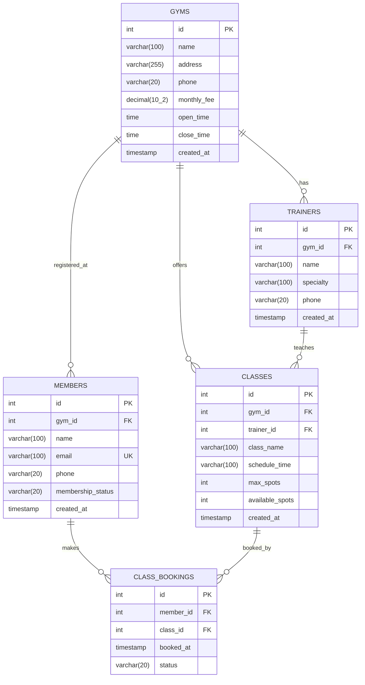

# ข้อกำหนดความต้องการของระบบ (Requirement Specification)
## ระบบข้อมูลฟิตเนสและจัดการการออกกำลังกาย (Fitness & Gym Management System)

- **รหัสนิสิต**: 67160178
- **โจทย์ที่ได้รับมอบหมาย**: Pno = (8 mod 9) + 1 = 9 (`gyms`)
- **วิชา**: Backend Web Service Development
- **โครงงาน**: ระยะที่ 1 (Database & Requirement Design)

---

## 1. ข้อมูลทั่วไปของระบบและวัตถุประสงค์ (System Overview & Objectives)

### 1.1 ที่มาและปัญหาที่ระบบแก้ไข
ธุรกิจฟิตเนสและศูนย์ออกกำลังกายในปัจจุบันมีผู้ใช้บริการเป็นจำนวนมาก การบริหารจัดการข้อมูลสาขาฟิตเนส ข้อมูลสมาชิก รายการคลาสออกกำลังกาย เทรนเนอร์ผู้ฝึกสอน และการสำรองที่นั่งในแต่ละคลาส หากใช้การบันทึกด้วยเอกสารหรือระบบที่ไม่มีความสัมพันธ์เชิงฐานข้อมูลที่ดี จะทำให้เกิดปัญหาข้อมูลซ้ำซ้อน การจองคลาสเกินจำนวนที่รองรับได้ (Overbooking) และความไม่โปร่งใสของอัตราค่าบริการ

ระบบข้อมูลฟิตเนส (Fitness & Gym Management System) ถูกออกแบบขึ้นเพื่อเป็น Backend API Service ศูนย์กลางสำหรับ:
1. บริหารจัดการข้อมูลสาขาฟิตเนส ที่ตั้ง และอัตราค่าบริการรายเดือน (`monthly_fee`)
2. จัดการข้อมูลสมาชิกและสถานะการเป็นสมาชิก
3. จัดการตารางคลาสออกกำลังกายและเทรนเนอร์ประจำสาขา
4. รองรับการจองคลาสออกกำลังกายที่มีการควบคุมจำนวนผู้เข้าร่วมสูงสุดอย่างถูกต้อง

### 1.2 กลุ่มผู้ใช้เป้าหมาย (Target Users)
1. **ผู้ดูแลระบบ / เจ้าหน้าที่ฟิตเนส (Admin / Staff)**: จัดการข้อมูลสาขาฟิตเนส ตารางคลาส และข้อมูลเทรนเนอร์
2. **สมาชิกฟิตเนส (Members)**: ค้นหาข้อมูลสาขาฟิตเนส ตรวจสอบตารางคลาสออกกำลังกาย และทำรายการจองหรือยกเลิกคลาส

---

## 2. ทรัพยากรหลักของระบบและความสัมพันธ์ (Core Resources & Relationships)

ระบบประกอบด้วย 5 ทรัพยากร (Resource) หลักที่มีความสัมพันธ์เชิงสัมพันธ์ (Relational Database Design):

1. **`gyms` (ข้อมูลสาขาฟิตเนส)**: ทรัพยากรหลักตามโจทย์ Pno=9 บันทึกชื่อฟิตเนส ที่ตั้ง เบอร์โทรศัพท์ เวลาเปิด-ปิด และอัตราค่าบริการรายเดือน (`monthly_fee`)
2. **`trainers` (ข้อมูลเทรนเนอร์)**: เทรนเนอร์ผู้ฝึกสอนที่สังกัดในแต่ละฟิตเนส มีความชำนาญเฉพาะด้าน
3. **`classes` (ข้อมูลคลาสออกกำลังกาย)**: คลาสที่เปิดสอนในฟิตเนสแต่ละสาขา ระบุเวลา จำนวนที่นั่งสูงสุด (`max_spots`) และที่นั่งว่างปัจจุบัน (`available_spots`)
4. **`members` (ข้อมูลสมาชิก)**: ข้อมูลผู้ใช้งานที่ลงทะเบียนสมาชิกกับฟิตเนสสาขาหลัก
5. **`class_bookings` (ข้อมูลการจองคลาส)**: ตารางเชื่อมความสัมพันธ์แบบ Many-to-Many ระหว่างสมาชิก (`members`) และคลาสออกกำลังกาย (`classes`)

### ความสัมพันธ์ระหว่าง Entity (Cardinality & Constraints)
* **Gyms (1) — (N) Trainers**: ฟิตเนสหนึ่งสาขามีเทรนเนอร์ได้หลายคน (`ON DELETE CASCADE`)
* **Gyms (1) — (N) Classes**: ฟิตเนสหนึ่งสาขามีคลาสออกกำลังกายได้หลายคลาส (`ON DELETE CASCADE`)
* **Trainers (1) — (N) Classes**: เทรนเนอร์หนึ่งคนสามารถรับผิดชอบสอนได้หลายคลาส (`ON DELETE CASCADE`)
* **Gyms (1) — (N) Members**: สมาชิกหนึ่งคนสังกัดสาขาหลักได้หนึ่งแห่ง (`ON DELETE RESTRICT` เพื่อป้องกันการลบสาขาที่มีสมาชิกคงค้าง)
* **Members (N) — (N) Classes ผ่าน `class_bookings`**:
  * สมาชิกหนึ่งคนสามารถจองได้หลายคลาส
  * คลาสหนึ่งคลาสมีสมาชิกจองได้หลายคน
  * มี constraint `UNIQUE KEY unique_member_class (member_id, class_id)` เพื่อป้องกันไม่ให้สมาชิกจองคลาสเดียวกันซ้ำซ้อน

---

## 3. รายการ Use Case หลัก (Use Case Specifications)

ระบบกำหนด Use Case สำคัญอย่างน้อย 6 รายการ (ครอบคลุมเกณฑ์ขั้นต่ำ 5 รายการ):

### UC-01: ค้นหาและดูรายชื่อฟิตเนส (Search & View Gyms)
* **Actor**: สมาชิก / ผู้ใช้งานทั่วไป
* **Pre-condition**: ระบบฐานข้อมูลเปิดทำงานปกติ
* **Main Flow**:
  1. ผู้ใช้ส่งคำขอเรียกดูรายชื่อฟิตเนส (`GET /api/v1/gyms`)
  2. ผู้ใช้สามารถส่ง Query Parameter เพื่อกรอง เช่น ช่วงราคาค่าบริการรายเดือน (`monthly_fee`)
  3. ระบบดึงข้อมูลจากตาราง `gyms` และตอบกลับในรูปแบบ JSON Array
* **Post-condition**: ผู้ใช้ได้รับรายการข้อมูลฟิตเนส

### UC-02: ดูรายละเอียดฟิตเนสและคลาสที่เปิดสอน (View Gym Details & Associated Classes)
* **Actor**: สมาชิก / ผู้ใช้งานทั่วไป
* **Pre-condition**: มีรหัสฟิตเนส (`id`) ที่มีอยู่ในระบบ
* **Main Flow**:
  1. ผู้ใช้ส่งคำขอ `GET /api/v1/gyms/:id/classes`
  2. ระบบทำการ `JOIN` ตาราง `classes` และ `trainers` เพื่อดึงข้อมูลคลาสพร้อมชื่อผู้สอน
  3. ระบบส่งข้อมูลกลับสถานะ 200 OK
* **Alternative Flow**: หากไม่พบ ID ฟิตเนส ระบบตอบกลับ 404 NOT_FOUND

### UC-03: สมัครสมาชิกฟิตเนสใหม่ (Register Member)
* **Actor**: ผู้ใช้งานใหม่ / เจ้าหน้าที่
* **Pre-condition**: มีสาขาฟิตเนส (`gym_id`) อยู่จริง
* **Main Flow**:
  1. ผู้ใช้ส่งข้อมูลชื่อ อีเมล เบอร์โทรศัพท์ และรหัสสาขา (`POST /api/v1/members`)
  2. ระบบตรวจสอบความถูกต้องของข้อมูล (Email format, Non-empty fields)
  3. ระบบทำการบันทึกลงตาราง `members`
  4. ระบบตอบกลับสถานะ 201 Created พร้อมข้อมูลสมาชิกใหม่
* **Alternative Flow**: หากอีเมลซ้ำกับที่มีในระบบ (`ER_DUP_ENTRY`) ระบบส่งสถานะ 409 DUPLICATE_EMAIL

### UC-04: ค้นหาและตรวจสอบตารางคลาสออกกำลังกาย (Browse Classes)
* **Actor**: สมาชิก
* **Pre-condition**: สมาชิกต้องการค้นหาคลาสออกกำลังกาย
* **Main Flow**:
  1. สมาชิกเรียกดูรายการคลาสทั้งหมด (`GET /api/v1/classes`)
  2. ระบบแสดงรายการคลาส วันเวลา จำนวนที่นั่งสูงสุด (`max_spots`) และที่นั่งว่างคงเหลือ (`available_spots`)
* **Post-condition**: สมาชิกทราบสถานะความพร้อมของแต่ละคลาส

### UC-05: จองคลาสออกกำลังกาย (Book a Class)
* **Actor**: สมาชิก
* **Pre-condition**: สมาชิกและคลาสมีตัวตนในระบบ และ `available_spots > 0`
* **Main Flow**:
  1. สมาชิกส่งคำขอจองคลาส (`POST /api/v1/classes/:id/bookings`) โดยระบุ `member_id`
  2. ระบบใช้ Database Transaction พร้อมคำสั่ง Lock แถว (`SELECT ... FOR UPDATE`)
  3. ระบบตรวจสอบว่าคลาสยังมีที่นั่งว่างและสมาชิกยังไม่เคยจองคลาสนี้
  4. ระบบเพิ่มรายการลงในตาราง `class_bookings`
  5. ระบบหักยอดที่นั่งว่าง `UPDATE classes SET available_spots = available_spots - 1`
  6. ทำการ Commit Transaction และตอบกลับ 201 Created
* **Alternative Flow**:
  * หากที่นั่งเต็ม: Rollback และส่งรหัส 409 SEAT_FULL
  * หากสมาชิกเคยจองแล้ว: Rollback และส่งรหัส 409 ALREADY_BOOKED

### UC-06: ยกเลิกการจองคลาสออกกำลังกาย (Cancel Class Booking)
* **Actor**: สมาชิก
* **Pre-condition**: มีการจองคลาสดังกล่าวอยู่จริงในระบบ
* **Main Flow**:
  1. สมาชิกส่งคำขอยกเลิก (`DELETE /api/v1/classes/:classId/bookings/:memberId`)
  2. ระบบเปิด Transaction ตรวจสอบข้อมูลการจอง
  3. ลบระเบียนออกจากตาราง `class_bookings`
  4. คืนจำนวนที่นั่งว่าง `UPDATE classes SET available_spots = available_spots + 1`
  5. ทำการ Commit Transaction และตอบกลับสถานะ 200 OK
* **Alternative Flow**: หากไม่พบการจอง ตอบกลับ 404 BOOKING_NOT_FOUND

---

## 4. แผนภาพความสัมพันธ์ของข้อมูล (Entity-Relationship Diagram - ERD)

---

## 5. การวิเคราะห์ความพร้อมในการต่อยอด (Scalability & Future Phases)
1. **โครงงานระยะที่ 2 (Docs/DX & Resilience)**: สามารถทำ OpenAPI Spec ครอบคลุม CRUD ของ Gyms, Classes, Members และต่อ External API สำหรับตรวจสอบสภาพอากาศภายนอกหรือบริการแจ้งเตือนการจอง
2. **สัปดาห์ที่ 13 (Microservices)**: สามารถแยก Bounded Context ออกเป็น **Gym-Catalog Service** (ข้อมูลยิมและคลาส) และ **Booking Service** (การจองและสมาชิก) โดยเชื่อมต่อผ่าน API Gateway
3. **โครงงานระยะที่ 3 (Final Integration & Frontend)**: สามารถสร้าง Frontend แสดงแคตตาล็อกฟิตเนส คลาสที่เปิดสอน และระบบฟอร์มลงทะเบียน/จองคลาสที่มี UI สถานะ loading/error ชัดเจน
