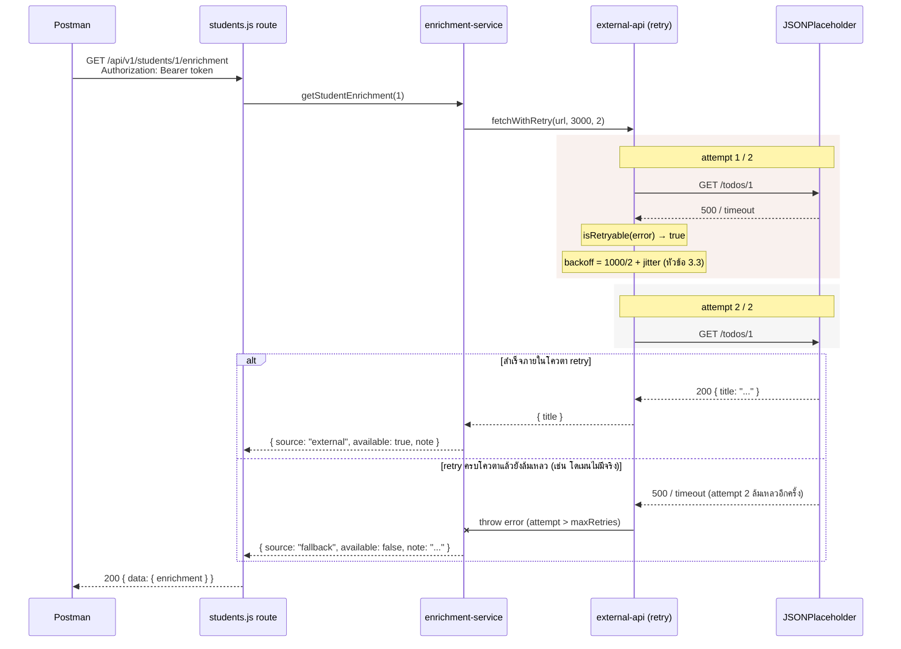

# ปฏิบัติการสัปดาห์ที่ 11: เชื่อมต่อ API ภายนอกอย่างทนทาน (Retry/Timeout/Fallback)

## วัตถุประสงค์ของปฏิบัติการ

เมื่อทำปฏิบัติการนี้เสร็จสิ้น นิสิตจะสามารถ

1. เรียกใช้ Public API ภายนอกจากโปรเจกต์ Node.js/Express ด้วย Axios ได้ถูกต้อง
2. เขียนกลไก Retry พร้อม Exponential Backoff สำหรับความล้มเหลวชั่วคราว
3. กำหนด Timeout ที่เหมาะสมสำหรับการเรียก API ภายนอก
4. เขียนกลไก Fallback ให้ระบบตอบสนองผู้ใช้ได้อย่างเหมาะสมเมื่อ API ภายนอกล้มเหลว
5. จำลองและบันทึกผลการทดสอบ Failure Scenario อย่างเป็นระบบ

ปฏิบัติการนี้ต่อยอดจากเนื้อหาบรรยายในเอกสาร `wk11.md` ขั้นตอนที่ 1-3 ฝึกเทคนิคทั้งหมดบนโปรเจกต์ตัวอย่าง `student-api` ที่สร้างต่อเนื่องมาจากปฏิบัติการสัปดาห์ที่ 1-10 ก่อน เมื่อฝึกจนคล่องแล้ว นิสิตต้อง**ทำซ้ำขั้นตอนเดียวกันกับระบบโครงงานของตนเอง** (ระบบที่กำหนดไว้ในโครงงานระยะที่ 1 ตาม `wk05-project-phase1.md`) เพราะไฟล์ `src/services/external-api.js` และ `failure-scenario-results.md` ที่ต้องส่งเป็นโครงงานระยะ 2 ส่วนที่ 2 (Integration) ต้องเป็นของระบบโครงงานนั้นจริง ไม่ใช่ของ `student-api` ตามที่กำหนดไว้ใน `wk10-project-phase2.md` (วัดผล CLO8/PLO14 ตามที่กำหนดไว้ใน `course_plan.md`)

## เวลาที่ใช้

| ช่วงเวลา    | กิจกรรม                                                       |
| ----------- | ------------------------------------------------------------- |
| 0-15 นาที   | ทบทวนเนื้อหาสัปดาห์ที่ 10 (Review W10 — OpenAPI/Swagger & DX) |
| 15-90 นาที  | เรียก Public API + Implement Retry logic                      |
| 90-120 นาที | ทดสอบ Failure scenario + Fallback                             |

## เครื่องมือที่ต้องใช้

1. โปรเจกต์ `student-api` จากปฏิบัติการสัปดาห์ที่ 1-10 (ต้องมี `openapi.yaml` และ Swagger UI ทำงานได้ตามสัปดาห์ที่ 10)
2. Node.js และ npm
3. ไลบรารี `axios`
4. Postman (สำหรับทดสอบ endpoint ใหม่ที่จะสร้าง)
5. การเชื่อมต่ออินเทอร์เน็ต (สำหรับเรียก Public API จริงในบางขั้นตอน)

---

## ส่วนที่ 1: ทบทวนเนื้อหาสัปดาห์ที่ 10 (0-15 นาที)

### ขั้นตอนที่ 1.1 ตรวจสอบโปรเจกต์เดิม

เปิดโฟลเดอร์ `student-api` และยืนยันว่าเอกสาร Swagger จากสัปดาห์ที่ 10 ยังใช้งานได้ก่อนเริ่มเพิ่มฟีเจอร์ใหม่

1. เปิด terminal แล้วเข้าไปที่โฟลเดอร์โปรเจกต์:
   ```bash
   cd student-api
   ```
2. รันชุดทดสอบ:
   ```bash
   npm test
   ```
   ผลลัพธ์ต้องขึ้น `Tests: N passed, N total` ไม่มีคำว่า `failed` ถ้ามี test ใดล้มเหลวด้วย status `401`/`403` ที่ไม่คาดคิด ให้ตรวจสอบก่อนว่า route ที่ test เรียกต้องแนบ `Authorization: Bearer <token>` หรือไม่ (ดูจาก middleware `authenticateToken`/`authorizeRole` ในไฟล์ route นั้น) แล้วแก้ไฟล์ test ให้ login/สมัครผู้ใช้ก่อนยิง request — อย่าข้ามขั้นตอนนี้ไปโดยที่ยังมี test แดงอยู่
3. เมื่อ test ผ่านครบแล้ว รัน dev server (ปล่อย terminal นี้ทำงานต่อไป ห้ามปิด):
   ```bash
   npm run dev
   ```
   รอจนเห็นข้อความ `Server กำลังทำงานที่พอร์ต 3000`
4. เปิดเว็บเบราว์เซอร์ ไปที่ `http://localhost:3000/api-docs` ยืนยันว่าเอกสาร Swagger แสดงผลถูกต้อง (เห็นรายการ endpoint ต่างๆ ไม่ใช่หน้า error "Cannot GET")

### ขั้นตอนที่ 1.2 วางแผนฟีเจอร์ใหม่ที่จะเพิ่ม

สัปดาห์นี้จะเพิ่ม endpoint ใหม่ `GET /api/v1/students/:id/enrichment` ซึ่งดึงข้อมูลเสริมจาก Public API ภายนอก ([JSONPlaceholder](https://jsonplaceholder.typicode.com)) มาประกอบกับข้อมูลนิสิตที่มีอยู่แล้วในระบบ เพื่อจำลองสถานการณ์การเรียกบริการภายนอกที่อาจล้มเหลวได้

### จุดตรวจสอบที่ 1

- ชุดทดสอบ Jest/Supertest จากสัปดาห์ก่อนหน้ายังรันผ่านทั้งหมด
- `/api-docs` เปิดใช้งานได้ปกติ

---

## ส่วนที่ 2: เรียก Public API และเขียน Retry Logic (15-90 นาที)

### ขั้นตอนที่ 2.1 ติดตั้ง Axios

```bash
npm install axios
```

### ขั้นตอนที่ 2.2 สร้างไฟล์ `services/external-api.js`

ในโฟลเดอร์โปรเจกต์ `student-api` ให้ตรวจสอบว่ามีโฟลเดอร์ชื่อ `services` อยู่แล้วหรือไม่ (ถ้ายังไม่มี ให้สร้างโฟลเดอร์ใหม่ชื่อ `services` ที่ระดับเดียวกับ `routes/`, `middlewares/`) จากนั้นสร้างไฟล์ใหม่ชื่อ `external-api.js` ไว้ข้างใน (path เต็มคือ `services/external-api.js`) ใส่โค้ดนี้ทั้งหมด:

```javascript
// services/external-api.js
const axios = require("axios");

function isRetryable(error) {
  if (!error.response) return true;
  const status = error.response.status;
  return status === 429 || (status >= 500 && status < 600);
}

function delay(ms) {
  return new Promise((resolve) => setTimeout(resolve, ms));
}

async function fetchWithRetry(url, timeoutMs = 3000, maxRetries = 2) {
  let attempt = 0;

  while (true) {
    try {
      const response = await axios.get(url, { timeout: timeoutMs });
      return response.data;
    } catch (error) {
      attempt += 1;
      const canRetry = attempt <= maxRetries && isRetryable(error);

      if (!canRetry) {
        throw error;
      }

      const baseBackoffMs = 2 ** (attempt - 1) * 1000;
      // Equal Jitter ตามหัวข้อ 3.3 ของ wk11.md เพื่อไม่ให้ client หลายตัว retry พร้อมกันเป๊ะ
      const backoffMs = baseBackoffMs / 2 + Math.random() * (baseBackoffMs / 2);
      console.warn(
        `[external-api] request to ${url} failed (attempt ${attempt}/${maxRetries}): ${error.message}. Retrying in ${Math.round(backoffMs)}ms`,
      );
      await delay(backoffMs);
    }
  }
}

module.exports = { fetchWithRetry, isRetryable };
```

### ขั้นตอนที่ 2.3 สร้าง Service ที่รวม Fallback

ในโฟลเดอร์ `services/` เดียวกับขั้นตอนที่แล้ว ให้สร้างไฟล์ใหม่อีกไฟล์ชื่อ `enrichment-service.js` (path เต็มคือ `services/enrichment-service.js`) ใส่โค้ดนี้ทั้งหมด:

```javascript
// services/enrichment-service.js
const { fetchWithRetry } = require("./external-api");

async function getStudentEnrichment(studentId) {
  const url = `https://jsonplaceholder.typicode.com/todos/${studentId}`;

  try {
    const data = await fetchWithRetry(url, 3000, 2);
    return {
      source: "external",
      available: true,
      note: data.title,
    };
  } catch (error) {
    console.error(
      `[enrichment-service] external API unavailable after retries: ${error.message}`,
    );
    return {
      source: "fallback",
      available: false,
      note: "ไม่สามารถดึงข้อมูลเสริมจากบริการภายนอกได้ในขณะนี้ กรุณาลองใหม่ภายหลัง",
    };
  }
}

module.exports = { getStudentEnrichment };
```

หมายเหตุ: ตัวอย่างนี้ใช้ endpoint `/todos/:id` ของ JSONPlaceholder เพื่อจำลองข้อมูลเสริมเท่านั้น ในระบบโครงงานจริงของนิสิต endpoint ภายนอกควรเป็นบริการที่เกี่ยวข้องกับโดเมนของระบบ เช่น Weather API, SMS gateway หรือ Public API อื่นที่เหมาะสมกับหัวข้อโครงงาน

### ขั้นตอนที่ 2.4 เพิ่ม Route ใหม่

1. เปิดไฟล์ `routes/students.js`
2. ไฟล์นี้ import middleware ชื่อ `authenticateToken` ไว้อยู่แล้วที่ด้านบนไฟล์ (บรรทัดประมาณ `const { authenticateToken, authorizeRole } = require("../middlewares/auth");`) — **ใช้ชื่อ `authenticateToken` นี้** (ไม่ใช่ `authenticate`) ให้ตรงกับของจริงในโปรเจกต์
3. เพิ่มบรรทัด import service ที่เพิ่งสร้าง ไว้ต่อจากบรรทัด import อื่นๆ ที่ด้านบนไฟล์:
   ```javascript
   const { getStudentEnrichment } = require("../services/enrichment-service");
   ```
4. เพิ่ม route handler ใหม่นี้เข้าไปในไฟล์ (แทรกไว้ตรงไหนก็ได้ที่อยู่ระหว่าง `router.get("/:id/courses", ...)` กับ `function validateStudentBody(body) {` — คือก่อนจะถึงส่วน POST/PUT/PATCH/DELETE):

   ```javascript
   // สัปดาห์ที่ 11: ข้อมูลเสริมจาก Public API ภายนอก พร้อม Retry/Timeout/Fallback
   router.get("/:id/enrichment", authenticateToken, async (req, res, next) => {
     try {
       const enrichment = await getStudentEnrichment(req.params.id);

       return res.status(200).json({
         data: {
           studentId: req.params.id,
           enrichment,
         },
       });
     } catch (err) {
       next(err);
     }
   });
   ```

   สังเกตว่า path ใน route คือ `/:id/enrichment` (ไม่มี `/students` นำหน้า) เพราะไฟล์นี้ถูก mount ไว้ที่ `/api/v1/students` อยู่แล้วใน `app.js` (prefix จะถูกเติมให้อัตโนมัติ)

5. บันทึกไฟล์

สังเกตว่า route นี้คืน `200` เสมอไม่ว่า external API จะสำเร็จหรือไม่ เพราะ `enrichment-service.js` จัดการ fallback ไว้แล้วในชั้น service ตามหลักการในหัวข้อ 5.3 ของ `wk11.md` ส่วน `try/catch` + `next(err)` ที่ยังครอบ route ไว้ตามมาตรฐานเดิมตั้งแต่สัปดาห์ที่ 4 มีไว้ดักข้อผิดพลาดอื่นที่ไม่เกี่ยวกับ external API เช่น error จากการเข้าถึงฐานข้อมูลนิสิต

แผนภาพต่อไปนี้สรุปเส้นทางของคำขอเดียวตั้งแต่ Postman จนถึง JSONPlaceholder ครอบคลุมทั้งกรณีสำเร็จภายในโควตา retry และกรณี retry ครบโควตาแล้วยังล้มเหลว (ซึ่งจะได้ทดลองจำลองจริงในส่วนที่ 3)



ทั้งสองทาง (สำเร็จ หรือ fallback หลัง retry ครบโควตา) จบที่ `200` เหมือนกัน เพราะ `enrichment-service.js` ดักข้อผิดพลาดของ external API ไว้ที่ชั้น service เองตามที่อธิบายไว้ข้างต้น ไม่ปล่อยให้ error หลุดไปถึง route

### ขั้นตอนที่ 2.5 ทดสอบด้วย Postman

1. เปิดโปรแกรม Postman
2. ขอ token ก่อน (ข้ามข้อนี้ได้ถ้ามี token จากขั้นตอนก่อนหน้าอยู่แล้ว)
   - กด **"+"** สร้าง request ใหม่
   - เปลี่ยน method (dropdown ซ้ายของช่อง URL) เป็น **POST**
   - ช่อง URL ใส่ `http://localhost:3000/api/v1/auth/login`
   - กดแท็บ **Body** → เลือก **raw** → เปลี่ยน dropdown ข้างๆ จาก Text เป็น **JSON**
   - พิมพ์ลงกล่องข้อความ (ใช้ email/password ของบัญชีที่เคยสมัครไว้แล้ว)
     ```json
     { "email": "your_email@example.com", "password": "your_password" }
     ```
   - กด **Send**
   - ใน response ด้านล่าง หา field `"token"` แล้ว copy ค่าข้างในเครื่องหมายคำพูด (ขึ้นต้นด้วย `eyJhbGci...`) เก็บไว้

   ถ้ายังไม่เคยสมัครบัญชี ให้สร้าง request อีกอันก่อน เปลี่ยน URL เป็น `http://localhost:3000/api/v1/auth/register` ตั้งค่า Body แบบเดียวกัน กด Send 1 ครั้งเพื่อสมัคร แล้วค่อยกลับมาทำขั้นตอน login ด้านบน

3. เรียก endpoint ใหม่
   - กด **"+"** สร้าง request ใหม่อีกอัน
   - method เป็น **GET** (ค่า default)
   - ช่อง URL ใส่ `http://localhost:3000/api/v1/students/1/enrichment`
   - กดแท็บ **Headers** → แถวว่างแถวแรก: Key = `Authorization`, Value = `Bearer ` ตามด้วย token ที่ copy มา (เว้นวรรค 1 ครั้งหลัง `Bearer`)
   - กด **Send**

4. ตรวจผลลัพธ์ — มุมล่างซ้ายของ response ต้องขึ้น status **200** และ body (แท็บ Pretty) ต้องมีรูปแบบ

```json
{
  "data": {
    "studentId": "1",
    "enrichment": {
      "source": "external",
      "available": true,
      "note": "delectus aut autem"
    }
  }
}
```

ค่า `note` ("delectus aut autem") คือค่าเฉพาะของ todo id=1 บน JSONPlaceholder เท่านั้น ถ้าเปลี่ยน URL เป็น `.../students/2/enrichment` หรือ id อื่น ค่า `note` จะเปลี่ยนไปตาม todo นั้นๆ ของ JSONPlaceholder — ไม่ต้องตรงกับตัวอย่างนี้เป๊ะ สิ่งที่ต้องตรวจคือโครงสร้าง response และ `source: "external"`

### จุดตรวจสอบที่ 2

- เรียก endpoint ใหม่สำเร็จและได้ข้อมูลจาก external API จริง (`source: "external"`)
- โค้ดใน `external-api.js` แยกประเภท error ที่ควร retry ออกจากที่ไม่ควร retry ตามหัวข้อ 3.1 ของ `wk11.md`
- Retry มี delay แบบ exponential backoff พร้อม jitter ที่สังเกตได้จาก log ใน terminal เมื่อทดลองเปลี่ยน URL เป็นโดเมนปลอมชั่วคราว (ดูวิธีจำลองใน ส่วนที่ 3) — ค่า delay แต่ละครั้งจะไม่ตรงกับ 1000ms/2000ms พอดี เพราะมีส่วนสุ่มบวกเข้าไปตามหัวข้อ 3.3 ของ `wk11.md`

---

## ส่วนที่ 3: ทดสอบ Failure Scenario และ Fallback (90-120 นาที)

### ขั้นตอนที่ 3.1 จำลองสถานการณ์ที่ 1 — เรียก URL ที่ไม่มีอยู่จริง

1. เปิดไฟล์ `services/enrichment-service.js`
2. หาบรรทัดนี้ (อยู่ในฟังก์ชัน `getStudentEnrichment`):
   ```javascript
   const url = `https://jsonplaceholder.typicode.com/todos/${studentId}`;
   ```
   แก้ไขชั่วคราวเป็น:
   ```javascript
   const url = `https://this-domain-does-not-exist-12345.example`;
   ```
3. บันทึกไฟล์ (Ctrl+S) — ถ้า terminal ที่รัน `npm run dev` ยังเปิดอยู่ ไม่ต้องสั่งอะไรเพิ่ม เพราะ `nodemon` จะ restart server ให้อัตโนมัติเมื่อไฟล์ถูกบันทึก (จะเห็นข้อความ `[nodemon] restarting due to changes...` ขึ้นในหน้าต่าง terminal นั้น) ถ้า server ไม่ได้รันอยู่ ให้สั่ง `npm run dev` เอง
4. สลับไปที่ Postman เรียก `GET http://localhost:3000/api/v1/students/1/enrichment` ซ้ำอีกครั้ง (ใช้ request เดิมจากขั้นตอนที่ 2.5 ได้เลย กด **Send** ใหม่)
5. สลับกลับไปดูหน้าต่าง terminal ที่รัน server — จะเห็นบรรทัด log ขึ้นต้นด้วย `[external-api] request to ... failed (attempt 1/2)` และ `(attempt 2/2)` พร้อมเวลา retry ที่สุ่มได้ (ตรวจสอบว่ามีขึ้น 2 ครั้ง)
6. กลับไปดู response ใน Postman — ต้องได้ status `200` และ body เป็น

   ```json
   {
     "data": {
       "studentId": "1",
       "enrichment": {
         "source": "fallback",
         "available": false,
         "note": "ไม่สามารถดึงข้อมูลเสริมจากบริการภายนอกได้ในขณะนี้ กรุณาลองใหม่ภายหลัง"
       }
     }
   }
   ```

7. **สำคัญ**: แก้ไฟล์ `services/enrichment-service.js` กลับเป็นค่าเดิม (`https://jsonplaceholder.typicode.com/todos/${studentId}`) แล้วบันทึกไฟล์ ก่อนไปขั้นตอนถัดไป

### ขั้นตอนที่ 3.2 จำลองสถานการณ์ที่ 2 — Timeout

1. เปิดไฟล์ `services/enrichment-service.js`
2. หาบรรทัดนี้:
   ```javascript
   const data = await fetchWithRetry(url, 3000, 2);
   ```
   แก้ไขชั่วคราวเป็น (เปลี่ยนค่า `3000` เป็น `1` เพื่อบังคับให้ timeout ทุกครั้ง):
   ```javascript
   const data = await fetchWithRetry(url, 1, 2);
   ```
3. บันทึกไฟล์ — `nodemon` จะ restart server ให้อัตโนมัติเหมือนขั้นตอนที่แล้ว
4. สลับไปที่ Postman เรียก `GET http://localhost:3000/api/v1/students/1/enrichment` ซ้ำอีกครั้ง (กด **Send** ใหม่บน request เดิม)
5. ดู log ใน terminal ที่รัน server — ข้อความ error ของแต่ละครั้งที่ retry ควรมีคำว่า `timeout of 1ms exceeded` (มาจาก `error.message` ที่ print อยู่ใน log บรรทัด `[external-api] request to ... failed (attempt N/2): ...`)
6. ดู response ใน Postman — ต้องได้ status `200` และ `source: "fallback"` เหมือนขั้นตอนที่ 3.1 (รูปแบบ body เดียวกันทุกอย่าง)

7. **สำคัญ**: แก้ไฟล์กลับเป็นค่าเดิม `const data = await fetchWithRetry(url, 3000, 2);` แล้วบันทึกไฟล์ ก่อนไปขั้นตอนถัดไป

### ขั้นตอนที่ 3.3 จำลองสถานการณ์ที่ 3 — External API คืน Error Status

เนื่องจากบริการทดสอบสาธารณะที่คืนค่า status code ตามต้องการ (เช่น httpstat.us) อาจไม่เสถียรพอสำหรับการฝึกในชั้นเรียน ให้สร้าง mock server ขนาดเล็กบนเครื่องของตนเองแทน

1. เปิดหน้าต่าง terminal **ใหม่อีกอัน** แยกต่างหาก (ห้ามปิดหรือใช้ซ้ำกับ terminal ที่รัน `npm run dev` ของ `student-api` อยู่ — ต้องมี 2 terminal เปิดพร้อมกัน)
2. ใน terminal ใหม่นี้ ให้แน่ใจว่าอยู่ที่ root ของโปรเจกต์ `student-api` แล้วสร้างไฟล์ชื่อ `mock-fail-server.js` (ไฟล์นี้เป็นสคริปต์ชั่วคราวสำหรับทดสอบเท่านั้น ไม่ใช่ส่วนหนึ่งของแอป ไม่ต้อง require จากที่ไหน) ใส่เนื้อหานี้:

   ```javascript
   // mock-fail-server.js (สคริปต์ชั่วคราว ไม่ต้องเก็บไว้ในโปรเจกต์จริง)
   const http = require("http");

   http
     .createServer((req, res) => {
       res.writeHead(500, { "Content-Type": "application/json" });
       res.end(JSON.stringify({ error: "simulated server error" }));
     })
     .listen(4000, () => console.log("Mock failing server on port 4000"));
   ```

3. ใน terminal เดิม (terminal ที่ 2 ที่เพิ่งเปิด) รันคำสั่ง:
   ```bash
   node mock-fail-server.js
   ```
   ต้องเห็นข้อความ `Mock failing server on port 4000` ขึ้น แปลว่า mock server พร้อมแล้ว (ปล่อย terminal นี้รันทิ้งไว้ ห้ามกด Ctrl+C จนกว่าจะทำขั้นตอนนี้เสร็จ)
4. กลับไปเปิดไฟล์ `services/enrichment-service.js` หาบรรทัด:
   ```javascript
   const url = `https://jsonplaceholder.typicode.com/todos/${studentId}`;
   ```
   แก้ไขชั่วคราวเป็น:
   ```javascript
   const url = `http://localhost:4000`;
   ```
5. บันทึกไฟล์ — `nodemon` (ใน terminal ที่ 1 ที่รัน `student-api`) จะ restart server ให้อัตโนมัติ
6. สลับไปที่ Postman เรียก `GET http://localhost:3000/api/v1/students/1/enrichment` ซ้ำอีกครั้ง (กด **Send** ใหม่บน request เดิม)
7. ดู log ใน terminal ที่ 1 (ตัวที่รัน `student-api`) — ต้องเห็นบรรทัด `[external-api] request to http://localhost:4000 failed (attempt 1/2): Request failed with status code 500` และ `(attempt 2/2)` ตามมา (แปลว่า `isRetryable` คืน `true` สำหรับ status 500 ตามที่ออกแบบไว้)
8. ดู response ใน Postman — ต้องได้ status `200` และ `source: "fallback"` เหมือนขั้นตอนก่อนหน้า

9. **สำคัญ — ทำให้ครบทั้ง 2 ข้อก่อนไปต่อ**:
   - แก้ไฟล์ `services/enrichment-service.js` กลับเป็น `https://jsonplaceholder.typicode.com/todos/${studentId}` แล้วบันทึกไฟล์
   - สลับไปที่ terminal ที่ 2 (ตัวที่รัน mock server) กด `Ctrl+C` เพื่อปิด แล้วปิดหน้าต่าง terminal นั้นได้เลย ไม่ต้องลบไฟล์ `mock-fail-server.js` ทิ้งก็ได้ (เป็นไฟล์ที่ไม่ส่งเป็นงาน)

### ขั้นตอนที่ 3.4 บันทึกผลการทดสอบ

ในโฟลเดอร์โปรเจกต์ `student-api` (โฟลเดอร์เดียวกับที่มีไฟล์ `app.js`, `package.json` — ไม่ใช่ในโฟลเดอร์ `services/` หรือโฟลเดอร์ย่อยอื่น) ให้สร้างไฟล์ใหม่ชื่อ `failure-scenario-results.md` ด้วย editor ที่ใช้อยู่ (เช่น VS Code: คลิกขวาที่ชื่อโปรเจกต์ใน File Explorer → New File → พิมพ์ชื่อไฟล์) แล้วบันทึกผลตามรูปแบบตัวอย่างด้านล่าง (**นี่เป็นตัวอย่างรูปแบบเท่านั้น ห้ามคัดลอกไปใช้ตรง ๆ**) โดยกรอกข้อมูลจากสิ่งที่สังเกตได้จริงในขั้นตอนที่ 3.1-3.3 ที่ทำมา (เช่น เวลา retry ที่เห็นจาก log, ข้อความ error จริง)

ตัวอย่างไฟล์ `failure-scenario-results.md`:

> # บันทึกผลการทดสอบ Failure Scenario
>
> | สถานการณ์                          | วิธีจำลอง                                                | ผลลัพธ์ที่คาดหวัง                              | ผลลัพธ์จริง                                                                     | ผ่าน/ไม่ผ่าน |
> | ---------------------------------- | -------------------------------------------------------- | ---------------------------------------------- | ------------------------------------------------------------------------------- | ------------ |
> | Network error (โดเมนไม่มีอยู่จริง) | เปลี่ยน url เป็นโดเมนปลอม                                | Retry 2 ครั้ง แล้ว fallback พร้อมข้อความชัดเจน | Retry 2 ครั้ง (log แสดงประมาณ 0.5-1s, 1-2s ตาม jitter) แล้วคืน source: fallback | ผ่าน         |
> | Timeout                            | ตั้ง timeoutMs = 1                                       | เกิด ECONNABORTED แล้ว fallback                | เกิด ECONNABORTED ตามที่คาด แล้ว fallback ถูกต้อง                               | ผ่าน         |
> | External API คืน 500               | เปลี่ยน url เป็น mock server ที่คืน 500 (localhost:4000) | Retry เนื่องจากเป็น 5xx แล้ว fallback          | Retry 2 ครั้งตามที่คาด แล้ว fallback ถูกต้อง                                    | ผ่าน         |

ปรับเนื้อหาตารางให้ตรงกับผลลัพธ์จริงที่สังเกตได้ในเครื่องของนิสิตเอง ห้ามคัดลอกผลลัพธ์ตัวอย่างโดยไม่ได้ทดสอบจริง

### จุดตรวจสอบที่ 3

- ทดสอบครบทั้ง 3 สถานการณ์ (network error, timeout, external 5xx) และบันทึกผลจริงในไฟล์ `failure-scenario-results.md`
- ทุกสถานการณ์ระบบตอบกลับผู้ใช้ด้วย response ที่มีความหมาย ไม่มีกรณีที่ request ค้างหรือระบบ crash
- Log การ retry แสดง exponential backoff ที่ถูกต้องตามที่ออกแบบไว้

---

## ส่วนต่อยอด: แบบฝึกหัดเพิ่มเติมด้วยตนเอง

แบบฝึกหัดที่ 1-5 ด้านล่างนี้**ไม่ใช่ส่วนหนึ่งของสิ่งที่ต้องส่งในโครงงานระยะ 2 ส่วนที่ 2** ตามเกณฑ์การให้คะแนนใน `wk10-project-phase2.md` (Retry/Timeout/Fallback/บันทึกผลทดสอบ 4 รายการเท่านั้นที่มีคะแนน) ไม่มีคะแนนผูกกับแบบฝึกหัดเหล่านี้ และไม่ต้องส่งไฟล์ใดจากส่วนนี้ เป็นแบบฝึกหัดสำหรับฝึกฝีมือเพิ่มเติมด้วยตนเองเท่านั้น

### แบบฝึกหัดที่ 1: เพิ่ม Fallback แบบใช้ค่าจาก Cache

ต่อยอดจาก Cache layer ที่สร้างไว้ในสัปดาห์ที่ 7 ให้ `enrichment-service.js` บันทึกผลลัพธ์ล่าสุดที่เรียกสำเร็จไว้ใน cache และเมื่อ external API ล้มเหลว ให้ใช้ค่าจาก cache เดิมแทนข้อความ fallback ทั่วไป พร้อมระบุใน response ว่าเป็นข้อมูลที่อาจไม่ล่าสุด (เช่น เพิ่ม field `stale: true`)

### แบบฝึกหัดที่ 2: ปรับ Retry ให้กำหนดจำนวนครั้งและ Backoff ผ่าน Environment Variable

แก้ไข `fetchWithRetry` ให้อ่านค่า `maxRetries` และ `baseBackoffMs` จาก environment variable (เช่น `EXTERNAL_API_MAX_RETRIES`, `EXTERNAL_API_BASE_BACKOFF_MS`) แทนการกำหนดค่าตายตัวในโค้ด ตามแนวทาง environment variable ที่เรียนในสัปดาห์ที่ 4

### แบบฝึกหัดที่ 3: เขียน Jest Test สำหรับ Retry Logic โดยไม่เรียก Network จริง

ใช้ `jest.mock("axios")` เพื่อจำลองให้ `axios.get` คืนค่า error ตามจำนวนครั้งที่กำหนดก่อนจะสำเร็จ แล้วเขียน test ยืนยันว่า `fetchWithRetry` เรียกซ้ำตามจำนวนที่ถูกต้องและคืนค่าที่ถูกต้องเมื่อสำเร็จในที่สุด แนวทางนี้ต่อยอดจากเทคนิค mocking ที่เรียนในสัปดาห์ที่ 9

### แบบฝึกหัดที่ 4: เพิ่ม Path สำหรับ Enrichment Endpoint ใน OpenAPI

ปรับปรุงไฟล์ `openapi.yaml` จากสัปดาห์ที่ 10 ให้ครอบคลุม endpoint `GET /students/{id}/enrichment` ใหม่ พร้อมระบุ response schema ทั้งกรณี `source: external` และ `source: fallback` ให้ครบถ้วน

### แบบฝึกหัดที่ 5: ออกแบบ Webhook Endpoint พร้อมตรวจสอบ Signature

เขียน route ใหม่ `POST /api/v1/webhooks/notification` ที่จำลองการรับ webhook จากบริการภายนอก โดยต้องทำตามลำดับนี้ก่อนประมวลผล event ทุกครั้ง

1. ตรวจสอบ signature ของ request ด้วย `crypto.createHmac` และ `crypto.timingSafeEqual` ตามโค้ดตัวอย่างในหัวข้อ 6.3 ของ `wk11.md` (ต้องใช้ `express.raw()` สำหรับ route นี้ และตั้งค่า secret ไว้ใน environment variable เช่น `WEBHOOK_SECRET`) หาก signature ไม่ถูกต้องหรือไม่มี header มา ให้คืน `401`
2. ตรวจสอบว่ามี field `eventId` และ `type` ใน payload ที่ผ่านการตรวจ signature แล้วหรือไม่ หากไม่มีให้คืน `400`
3. หากผ่านทั้งสองขั้นตอน ให้บันทึก log และคืน `200` ทันที ตามหลักการตอบกลับที่รวดเร็วในหัวข้อ 6.2 ของ `wk11.md`

สำหรับการทดสอบด้วย Postman ให้เขียนสคริปต์สั้น ๆ (Node.js REPL หรือไฟล์ทดสอบแยก) คำนวณ HMAC ของ payload ตัวอย่างด้วย secret เดียวกัน แล้วนำค่าที่ได้ไปใส่ใน header `x-webhook-signature` ก่อนยิง request จริง เพื่อจำลองการทำงานของผู้ให้บริการภายนอกที่คำนวณ signature ฝั่งเขาเอง

### เช็กลิสต์ตรวจสอบตนเอง (ไม่ใช่เกณฑ์ให้คะแนน)

| รายการ         | ทำสำเร็จเมื่อ                                                                                                                                                  |
| -------------- | -------------------------------------------------------------------------------------------------------------------------------------------------------------- |
| แบบฝึกหัดที่ 1 | Fallback ใช้ค่าจาก cache เดิมได้จริงเมื่อ external API ล้มเหลว และระบุ `stale: true` ในกรณีดังกล่าว                                                            |
| แบบฝึกหัดที่ 2 | ปรับค่าผ่าน environment variable แล้วพฤติกรรมของ retry เปลี่ยนตามค่าที่กำหนดจริง                                                                               |
| แบบฝึกหัดที่ 3 | Test รันผ่านโดยไม่เรียก network จริง และครอบคลุมทั้งกรณีสำเร็จหลัง retry และกรณีล้มเหลวจนครบจำนวนครั้ง                                                         |
| แบบฝึกหัดที่ 4 | `openapi.yaml` มี path ของ enrichment endpoint ครบทั้งสอง response case                                                                                        |
| แบบฝึกหัดที่ 5 | Webhook endpoint ปฏิเสธ request ที่ signature ไม่ถูกต้องด้วย `401` ก่อนตรวจ field อื่น ๆ และตรวจสอบ field ที่จำเป็นถูกต้องสำหรับ request ที่ signature ถูกต้อง |

หมายเหตุสำคัญ: ไฟล์ที่ต้องส่งจริงยังเป็นของระบบโครงงานตนเองตามที่ระบุไว้ข้างต้น ไม่ใช่ของ `student-api` ที่ใช้ฝึกในขั้นตอนที่ 1-3 เนื้อหาสัปดาห์ถัดไป (สัปดาห์ที่ 13) จะขยายผลไปสู่การออกแบบสถาปัตยกรรมแบบ Microservices ซึ่งต่อยอดจากแนวคิดการเชื่อมต่อระหว่างบริการที่เรียนในสัปดาห์นี้
