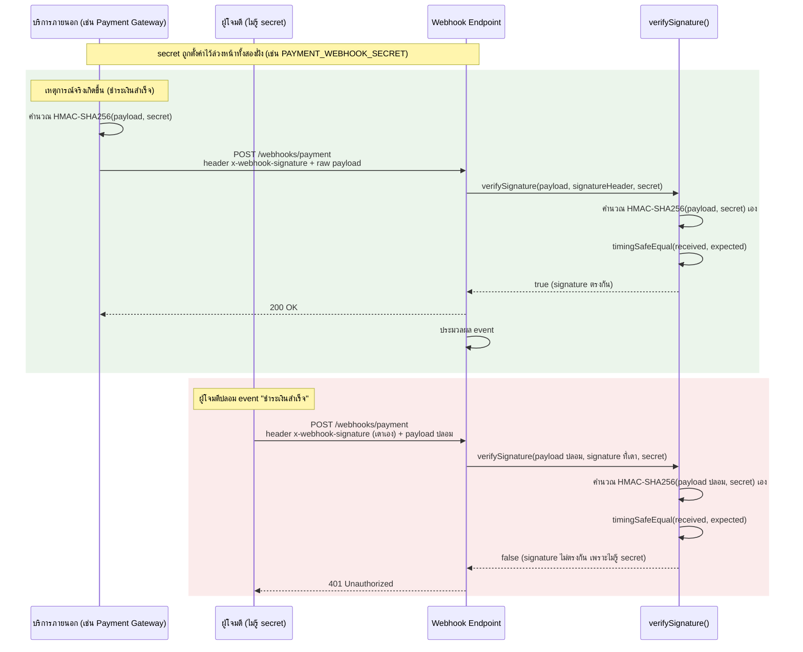

# สัปดาห์ที่ 11: External API Integration & Resilience

## สารบัญ

- [วัตถุประสงค์การเรียนรู้ประจำสัปดาห์](#วัตถุประสงค์การเรียนรู้ประจำสัปดาห์)
- [1. การเรียกใช้บริการภายนอก (External API Consumption)](#1-การเรียกใช้บริการภายนอก-external-api-consumption)
  - [1.1 เหตุใด Backend จึงต้องเรียก API ภายนอก](#11-เหตุใด-backend-จึงต้องเรียก-api-ภายนอก)
  - [1.2 ความเสี่ยงที่เกิดจากการพึ่งพาบริการภายนอก](#12-ความเสี่ยงที่เกิดจากการพึ่งพาบริการภายนอก)
- [2. เรียก API ภายนอกด้วย Axios](#2-เรียก-api-ภายนอกด้วย-axios)
  - [2.1 เหตุใดจึงเลือก Axios แทน `fetch` ดั้งเดิม](#21-เหตุใดจึงเลือก-axios-แทน-fetch-ดั้งเดิม)
  - [2.2 การติดตั้งและเรียกใช้งานพื้นฐาน](#22-การติดตั้งและเรียกใช้งานพื้นฐาน)
  - [2.3 การจัดการ Error เบื้องต้น](#23-การจัดการ-error-เบื้องต้น)
- [3. Retry Logic](#3-retry-logic)
  - [3.1 ประเภทของความล้มเหลวที่ควร Retry](#31-ประเภทของความล้มเหลวที่ควร-retry)
  - [3.2 Fixed Delay กับ Exponential Backoff](#32-fixed-delay-กับ-exponential-backoff)
  - [3.3 ปัญหา Thundering Herd และการแก้ด้วย Jitter](#33-ปัญหา-thundering-herd-และการแก้ด้วย-jitter)
  - [3.4 ตัวอย่างการเขียน Retry พร้อม Exponential Backoff และ Jitter](#34-ตัวอย่างการเขียน-retry-พร้อม-exponential-backoff-และ-jitter)
- [4. Timeout](#4-timeout)
  - [4.1 เหตุใด Timeout จึงจำเป็น](#41-เหตุใด-timeout-จึงจำเป็น)
  - [4.2 การกำหนด Timeout ด้วย Axios](#42-การกำหนด-timeout-ด้วย-axios)
  - [4.3 การเลือกค่า Timeout ที่เหมาะสม](#43-การเลือกค่า-timeout-ที่เหมาะสม)
- [5. Fallback](#5-fallback)
  - [5.1 หลักการของ Fallback](#51-หลักการของ-fallback)
  - [5.2 รูปแบบของ Fallback ที่พบบ่อย](#52-รูปแบบของ-fallback-ที่พบบ่อย)
  - [5.3 ตัวอย่างการนำ Retry, Timeout และ Fallback มาประกอบกัน](#53-ตัวอย่างการนำ-retry-timeout-และ-fallback-มาประกอบกัน)
- [6. Webhook เบื้องต้น](#6-webhook-เบื้องต้น)
  - [6.1 ความแตกต่างระหว่าง API เรียกออก (Outbound) กับ Webhook (Inbound)](#61-ความแตกต่างระหว่าง-api-เรียกออก-outbound-กับ-webhook-inbound)
  - [6.2 โครงสร้างพื้นฐานของ Endpoint รับ Webhook](#62-โครงสร้างพื้นฐานของ-endpoint-รับ-webhook)
  - [6.3 ตัวอย่างการตรวจสอบ Signature ของ Webhook](#63-ตัวอย่างการตรวจสอบ-signature-ของ-webhook)
  - [6.4 รูปแบบ Signature ของผู้ให้บริการจริงแต่ละราย](#64-รูปแบบ-signature-ของผู้ให้บริการจริงแต่ละราย)
- [7. เชื่อมโยงกับ OWASP Top 10](#7-เชื่อมโยงกับ-owasp-top-10)
- [8. โครงงานระยะที่ 2](#8-โครงงานระยะที่-2)
- [สรุปเนื้อหาสำคัญ](#สรุปเนื้อหาสำคัญ)
- [เอกสารอ้างอิง (Reference)](#เอกสารอ้างอิง-reference)
- [คำถามท้ายบท](#คำถามท้ายบท)

## วัตถุประสงค์การเรียนรู้ประจำสัปดาห์

เมื่อเรียนจบเนื้อหาในสัปดาห์นี้ นิสิตจะสามารถ

1. อธิบายรูปแบบการเรียกใช้ (consumption pattern) บริการภายนอกจาก Backend ของตนเอง และความเสี่ยงที่เกิดขึ้นเมื่อบริการภายนอกไม่พร้อมใช้งาน
2. เรียกใช้ REST API ภายนอกด้วย Axios จาก Node.js/Express ได้อย่างถูกต้อง ทั้งกรณีสำเร็จและกรณีผิดพลาด
3. ออกแบบและเขียนกลไก Retry พร้อม Backoff เพื่อรับมือกับความล้มเหลวชั่วคราว (transient failure)
4. กำหนด Timeout ที่เหมาะสมสำหรับการเรียก API ภายนอก และอธิบายผลกระทบเมื่อไม่กำหนด Timeout
5. ออกแบบกลไก Fallback เพื่อให้ระบบตอบสนองผู้ใช้ได้อย่างเหมาะสมแม้บริการภายนอกล้มเหลว
6. อธิบายแนวคิดพื้นฐานของ Webhook ในฐานะรูปแบบการสื่อสารแบบย้อนกลับ (inbound) ที่ต่างจากการเรียก API แบบ outbound

หัวข้อนี้สอดคล้องกับ CLO5 และ CLO6

ดูคู่มืออ้างอิงคำสั่ง Axios ที่ใช้บ่อย (เปิดดูเวลาเขียนโค้ด ไม่ต้องไล่อ่านเนื้อหาเต็ม) ได้ที่ [ref-axios.md](ref-axios.md)

---

## 1. การเรียกใช้บริการภายนอก (External API Consumption)

### 1.1 เหตุใด Backend จึงต้องเรียก API ภายนอก

ระบบ Backend ในโลกจริงแทบไม่เคยทำงานโดยลำพัง โครงงานที่ผ่านมาในรายวิชานี้เน้นการให้บริการ API ของตนเอง (เป็นผู้ถูกเรียก) แต่ในสัปดาห์นี้ระบบของนิสิตจะเปลี่ยนบทบาทเป็น **ผู้เรียก (client)** ของบริการอื่น ตัวอย่างสถานการณ์ที่พบบ่อย

| สถานการณ์                                       | บริการภายนอกที่ถูกเรียก            |
| ----------------------------------------------- | ---------------------------------- |
| ส่งอีเมลยืนยันการสมัครสมาชิก                    | บริการอีเมล เช่น SendGrid, Mailgun |
| ส่ง SMS แจ้งเตือน                               | บริการ SMS gateway                 |
| ตรวจสอบสภาพอากาศก่อนยืนยันการจองพื้นที่กลางแจ้ง | Weather API สาธารณะ                |
| ประมวลผลการชำระเงิน                             | Payment gateway เช่น Omise, Stripe |
| ดึงอัตราแลกเปลี่ยนเงินตรา                       | Currency exchange API สาธารณะ      |

จุดร่วมของทุกสถานการณ์คือระบบของนิสิต **ไม่มีสิทธิ์ควบคุม** ความพร้อมใช้งาน ความเร็ว หรือความถูกต้องของบริการภายนอกเหล่านี้ ต่างจาก MySQL ที่นิสิตติดตั้งและควบคุมเองได้ทั้งหมด

### 1.2 ความเสี่ยงที่เกิดจากการพึ่งพาบริการภายนอก

| ความเสี่ยง                                          | ผลกระทบหากไม่จัดการ                                                                                           |
| --------------------------------------------------- | ------------------------------------------------------------------------------------------------------------- |
| บริการภายนอกล่ม (downtime)                          | Request ของผู้ใช้ค้างหรือได้รับ error 500 โดยไม่ทราบสาเหตุ                                                    |
| เครือข่ายขัดข้องชั่วคราว (transient network error)  | Request ล้มเหลวทั้งที่บริการภายนอกพร้อมใช้งานจริง                                                             |
| บริการภายนอกตอบสนองช้าผิดปกติ                       | Connection และ memory สำหรับ pending request ถูกใช้ค้างไว้ ส่งผลต่อผู้ใช้รายอื่นที่รอคิวอยู่ (event loop ไม่ถูก block โดยตรงระหว่างรอ I/O ดูหัวข้อ 4.1) |
| บริการภายนอกเปลี่ยนแปลง response โดยไม่แจ้งล่วงหน้า | โค้ดที่ parse response ผิดพลาดหรือ crash                                                                      |

หลักการสำคัญของสัปดาห์นี้คือ **"ระบบต้องไม่ล่มตามบริการภายนอก"** (graceful degradation) แนวคิดนี้เรียกรวมกันว่า **Resilience** ซึ่งหมายถึงความสามารถของระบบในการทำงานต่อไปได้อย่างมีเหตุผล แม้ส่วนประกอบภายนอกบางส่วนล้มเหลว

---

## 2. เรียก API ภายนอกด้วย Axios

### 2.1 เหตุใดจึงเลือก Axios แทน `fetch` ดั้งเดิม

Node.js เวอร์ชันปัจจุบันมี `fetch` ในตัว (global fetch) แต่ Axios ยังเป็นที่นิยมในโปรเจกต์ Node.js/Express เนื่องจาก

| คุณสมบัติ                                  | Axios                         | `fetch` (built-in)                       |
| ------------------------------------------ | ----------------------------- | ---------------------------------------- |
| กำหนด timeout ได้โดยตรง                    | มี option `timeout`           | ไม่มี ต้องใช้ `AbortController` เพิ่มเอง |
| แปลง response เป็น JSON อัตโนมัติ          | อัตโนมัติผ่าน `response.data` | ต้องเรียก `.json()` เพิ่มอีกขั้นตอน      |
| โยน error อัตโนมัติเมื่อ status ไม่ใช่ 2xx | ใช่ (throw โดย default)       | ไม่ใช่ ต้องตรวจสอบ `response.ok` เอง     |
| Interceptor สำหรับ request/response        | มี                            | ไม่มีในตัว                               |

บทเรียนนี้จึงใช้ Axios เป็นหลัก

### 2.2 การติดตั้งและเรียกใช้งานพื้นฐาน

```bash
npm install axios
```

```javascript
// services/external-api.js
const axios = require("axios");

async function getPost(postId) {
  const response = await axios.get(
    `https://jsonplaceholder.typicode.com/posts/${postId}`,
    { timeout: 3000 },
  );
  return response.data;
}

module.exports = { getPost };
```

ตัวอย่างนี้ใช้ [JSONPlaceholder](https://jsonplaceholder.typicode.com) ซึ่งเป็น public API สำหรับฝึกทดสอบโดยเฉพาะ ไม่ต้องขอ API key และปลอดภัยสำหรับการทดลองในชั้นเรียน

### 2.3 การจัดการ Error เบื้องต้น

Axios โยน exception โดยอัตโนมัติเมื่อ HTTP status ไม่ใช่ 2xx จึงต้องครอบด้วย `try/catch` เสมอ และแยกประเภทของ error ให้ชัดเจน เนื่องจาก `error.response` จะมีค่าเฉพาะเมื่อ server ตอบกลับมาจริง (เช่น 404, 500) ในขณะที่ error จากเครือข่ายหรือ timeout จะไม่มี `error.response`

```javascript
async function getPostSafe(postId) {
  try {
    const response = await axios.get(
      `https://jsonplaceholder.typicode.com/posts/${postId}`,
      { timeout: 3000 },
    );
    return response.data;
  } catch (error) {
    if (error.response) {
      // Server ตอบกลับมาแล้วแต่เป็น status code ผิดพลาด (4xx, 5xx)
      console.error(`External API responded with ${error.response.status}`);
    } else if (error.code === "ECONNABORTED") {
      // เกิด timeout ตามค่าที่กำหนดไว้
      console.error("External API request timed out");
    } else {
      // ไม่มีการตอบกลับเลย เช่น DNS ผิด, เครือข่ายขาด, connection refused
      console.error(`Network error: ${error.message}`);
    }
    throw error;
  }
}
```

การแยกประเภท error ที่ชัดเจนเช่นนี้เป็นพื้นฐานสำคัญก่อนเขียนกลไก Retry เนื่องจากไม่ใช่ทุก error ที่ควร retry (เช่น `400 Bad Request` ที่เกิดจากข้อมูลผิดพลาดฝั่งเราเอง ไม่ควร retry ซ้ำเพราะผลลัพธ์จะผิดเหมือนเดิม)

---

## 3. Retry Logic

### 3.1 ประเภทของความล้มเหลวที่ควร Retry

| ประเภท error                                                    | ควร Retry หรือไม่         | เหตุผล                                                   |
| --------------------------------------------------------------- | ------------------------- | -------------------------------------------------------- |
| Network error (ECONNRESET, ECONNREFUSED)                        | ควร                       | มักเป็นปัญหาชั่วคราวของเครือข่าย                         |
| Timeout                                                         | ควร                       | บริการอาจช้าเพียงชั่วขณะ                                 |
| `5xx` (Internal Server Error, Bad Gateway, Service Unavailable) | ควร                       | เป็นปัญหาฝั่ง server ภายนอกที่อาจฟื้นตัวได้              |
| `429 Too Many Requests`                                         | ควร (พร้อม delay ยาวขึ้น) | เป็นการจำกัดอัตราชั่วคราว ไม่ใช่ข้อผิดพลาดถาวร           |
| `400 Bad Request`, `401 Unauthorized`, `404 Not Found`          | ไม่ควร                    | เป็นปัญหาที่ retry ซ้ำแล้วผลลัพธ์จะผิดเหมือนเดิมทุกครั้ง |

หลักการนี้เรียกว่าการแยกระหว่าง **transient failure** (ความล้มเหลวชั่วคราว ควร retry) กับ **permanent failure** (ความล้มเหลวถาวร ไม่ควร retry)

### 3.2 Fixed Delay กับ Exponential Backoff

| กลยุทธ์             | ลักษณะการหน่วงเวลา                          | ข้อดี                                                         | ข้อเสีย                                                          |
| ------------------- | ------------------------------------------- | ------------------------------------------------------------- | ---------------------------------------------------------------- |
| Fixed Delay         | หน่วงเวลาคงที่ทุกครั้ง เช่น 1 วินาที        | เขียนง่าย คาดเดาได้                                           | client หลายตัวรอ retry พร้อมกันได้ (ดูหัวข้อ 3.3)                 |
| Exponential Backoff | หน่วงเวลาเพิ่มขึ้นแบบทวีคูณ เช่น 1s, 2s, 4s | ลดภาระบริการภายนอกที่กำลังฟื้นตัว เป็นแนวทางที่นิยมในระบบจริง | ผู้ใช้ต้องรอนานขึ้นในการ retry รอบหลัง ๆ                         |

### 3.3 ปัญหา Thundering Herd และการแก้ด้วย Jitter

Exponential Backoff แบบคำนวณตรง ๆ (`2^(attempt-1)` วินาทีพอดี) มีจุดอ่อนที่มักถูกมองข้าม หากบริการภายนอกล่มแล้วฟื้นตัว **client จำนวนมากที่ fail พร้อมกันจะ retry ที่ time offset เดียวกันพอดีทุกครั้ง** (เช่น ทุก client ที่ fail ตอน t=0 จะ retry พร้อมกันที่ t=1s, t=3s, t=7s) เกิดการยิง request พร้อมกันเป็นคลื่น (**thundering herd**) ซ้ำเติมบริการที่กำลังฟื้นตัวให้ล่มซ้ำได้อีก

วิธีแก้คือเพิ่ม **Jitter** คือสุ่มเวลาหน่วงเพิ่มเติมเข้าไปในค่า backoff เพื่อกระจาย retry ของ client แต่ละตัวไม่ให้ตรงกันพอดี เป็นแนวทางที่ใช้จริงในระบบ production ทั่วไป (AWS Architecture Blog, 2015)

ให้ `baseBackoffMs` คือค่า backoff ที่คำนวณจาก `2^(attempt-1)` วินาทีตามปกติ (ยังไม่สุ่ม)

| กลยุทธ์ Jitter | วิธีคำนวณ | ลักษณะการกระจาย |
| --- | --- | --- |
| Full Jitter | สุ่มค่าระหว่าง `0` ถึง `baseBackoffMs` | กระจายมากที่สุด แต่บาง client อาจได้ delay สั้นเกินไป |
| Equal Jitter | `baseBackoffMs/2 + สุ่มระหว่าง 0 ถึง baseBackoffMs/2` | กระจายพอสมควร และยังคงมี delay ขั้นต่ำที่แน่นอน |

รายวิชานี้ใช้ **Equal Jitter** ในตัวอย่างโค้ด เพราะให้ผลลัพธ์ที่สมดุลระหว่างการกระจาย retry และการันตีว่ามี delay ขั้นต่ำเสมอ

### 3.4 ตัวอย่างการเขียน Retry พร้อม Exponential Backoff และ Jitter

```javascript
// services/external-api.js
const axios = require("axios");

function isRetryable(error) {
  if (!error.response) return true; // network error หรือ timeout
  const status = error.response.status;
  return status === 429 || (status >= 500 && status < 600);
}

function delay(ms) {
  return new Promise((resolve) => setTimeout(resolve, ms));
}

async function fetchWithRetry(url, timeoutMs = 3000, maxRetries = 2) {
  let attempt = 0;

  while (true) {
    try {
      const response = await axios.get(url, { timeout: timeoutMs });
      return response.data;
    } catch (error) {
      attempt += 1;
      const canRetry = attempt <= maxRetries && isRetryable(error);

      if (!canRetry) {
        throw error;
      }

      const baseBackoffMs = 2 ** (attempt - 1) * 1000; // 1s, 2s, 4s, ...
      // Equal Jitter: ครึ่งหนึ่งคงที่ ครึ่งหนึ่งสุ่ม เพื่อไม่ให้ client ทุกตัว retry พร้อมกันเป๊ะ (ดูหัวข้อ 3.3)
      const backoffMs = baseBackoffMs / 2 + Math.random() * (baseBackoffMs / 2);
      console.warn(
        `Request to ${url} failed (attempt ${attempt}/${maxRetries}). Retrying in ${Math.round(backoffMs)}ms`,
      );
      await delay(backoffMs);
    }
  }
}

module.exports = { fetchWithRetry };
```

จุดสำคัญของตัวอย่างนี้

- `isRetryable` แยก error ที่ควร retry ออกจาก error ที่ไม่ควร ตามหลักการในหัวข้อ 3.1
- `maxRetries = 2` หมายถึงพยายามซ้ำ 2 ครั้งหลังจากความพยายามแรก (รวมเป็นเรียกทั้งหมดไม่เกิน 3 ครั้ง)
- ใช้ backoff แบบ `2^(attempt-1)` วินาทีเป็นฐาน ทำให้เวลาหน่วงเพิ่มขึ้นทวีคูณตามจำนวนครั้งที่ล้มเหลว แล้วบวก jitter ตามหัวข้อ 3.3 เพื่อกระจายเวลา retry ของแต่ละ client ไม่ให้ตรงกันพอดี

---

## 4. Timeout

### 4.1 เหตุใด Timeout จึงจำเป็น

หากไม่กำหนด timeout การเรียก API ภายนอกอาจค้างรอผลลัพธ์ไม่มีกำหนด (indefinitely) ซึ่งส่งผลเสียสองด้าน

1. ผู้ใช้ที่ส่ง request เข้ามาต้องรอโดยไม่ทราบว่าจะได้รับผลลัพธ์เมื่อใด (bad user experience)
2. Node.js เป็น single-threaded event loop การมี request ค้างจำนวนมากพร้อมกันจะสะสมและกระทบความสามารถในการรองรับผู้ใช้รายอื่น แม้ event loop จะไม่ถูก block โดยตรงระหว่างรอ I/O ก็ตาม แต่ทรัพยากรเชื่อมต่อ (connection, memory สำหรับ pending request) จะถูกใช้ค้างไว้

### 4.2 การกำหนด Timeout ด้วย Axios

```javascript
const response = await axios.get(url, {
  timeout: 3000, // หน่วยเป็นมิลลิวินาที รอสูงสุด 3 วินาที
});
```

เมื่อเกิน timeout Axios จะโยน error ที่มี `error.code === "ECONNABORTED"` ตามที่แสดงในหัวข้อ 2.3

### 4.3 การเลือกค่า Timeout ที่เหมาะสม

| ปัจจัย                                         | แนวทางพิจารณา                                                                                                           |
| ---------------------------------------------- | ----------------------------------------------------------------------------------------------------------------------- |
| ลักษณะการใช้งาน                                | หากเป็นการเรียกระหว่าง request ของผู้ใช้ (synchronous flow) ควรตั้งค่าสั้น เช่น 2-5 วินาที เพื่อไม่ให้ผู้ใช้รอนานเกินไป |
| SLA ของบริการภายนอก                            | หากผู้ให้บริการภายนอกระบุเวลาตอบสนองปกติไว้ (เช่น 500ms) ควรตั้ง timeout ให้มากกว่าค่านั้นพอสมควรแต่ไม่มากเกินไป        |
| งานที่ทำใน background (ไม่ block ผู้ใช้โดยตรง) | ตั้งค่านานขึ้นได้ เนื่องจากไม่กระทบประสบการณ์ผู้ใช้โดยตรงในขณะนั้น                                                      |

**ข้อควรระวัง**: timeout ของ Axios ควบคุมเฉพาะการเรียก HTTP เท่านั้น หากมีการ retry ต่อจาก timeout (ตามหัวข้อ 3) เวลารวมที่ผู้ใช้อาจต้องรอคือ `timeout x (จำนวนครั้งที่เรียก) + ผลรวมของ backoff delay` จึงต้องคำนวณเวลารวมสูงสุดและออกแบบให้อยู่ในระดับที่ผู้ใช้ยอมรับได้

---

## 5. Fallback

### 5.1 หลักการของ Fallback

Fallback คือกลไกที่ระบบใช้ตอบสนองผู้ใช้อย่างมีเหตุผล เมื่อบริการภายนอกล้มเหลวแม้ retry ครบตามจำนวนที่กำหนดแล้ว หลักการสำคัญคือ **ระบบต้องไม่ปล่อยให้ request ค้างหรือคืนค่า error ที่ไม่มีความหมายต่อผู้ใช้**

### 5.2 รูปแบบของ Fallback ที่พบบ่อย

| รูปแบบ                                     | ตัวอย่าง                                                                                                                                                               |
| ------------------------------------------ | ---------------------------------------------------------------------------------------------------------------------------------------------------------------------- |
| ใช้ค่า Default                             | หากเรียก Weather API ไม่สำเร็จ แสดงข้อความ "ไม่สามารถตรวจสอบสภาพอากาศได้ในขณะนี้ กรุณายืนยันการจองด้วยดุลยพินิจของท่าน" แทนการ block การจอง                            |
| ใช้ค่าจาก Cache เดิม (stale-while-error)   | หากเรียก currency exchange API ไม่สำเร็จ ใช้อัตราแลกเปลี่ยนล่าสุดที่เคย cache ไว้ พร้อมระบุว่าเป็นข้อมูลที่อาจไม่ล่าสุด   |
| แจ้งข้อความผิดพลาดที่ชัดเจนแก่ผู้ใช้       | คืน HTTP `503 Service Unavailable` พร้อม `{"error": {"code": "EXTERNAL_SERVICE_UNAVAILABLE", "message": "ไม่สามารถส่ง SMS แจ้งเตือนได้ในขณะนี้ กรุณาลองใหม่ภายหลัง"}}` |
| เลื่อนงานไปทำภายหลัง (deferred processing) | บันทึกคำขอไว้ในคิวหรือฐานข้อมูล แล้วแจ้งผู้ใช้ว่าจะดำเนินการเมื่อบริการกลับมาใช้งานได้ (แนวคิดขั้นสูง อยู่นอกขอบเขตการฝึกภาคปฏิบัติของสัปดาห์นี้)                      |

### 5.3 ตัวอย่างการนำ Retry, Timeout และ Fallback มาประกอบกัน

```javascript
// services/notification-service.js
const { fetchWithRetry } = require("./external-api");

async function checkWeatherOrFallback(location) {
  try {
    const data = await fetchWithRetry(
      `https://api.example-weather.com/v1/current?location=${location}`,
      3000,
      2,
    );
    return { source: "external", data };
  } catch (error) {
    console.error(`Weather API unavailable after retries: ${error.message}`);
    return {
      source: "fallback",
      data: null,
      message:
        "ไม่สามารถตรวจสอบสภาพอากาศได้ในขณะนี้ กรุณายืนยันการจองด้วยดุลยพินิจของท่าน",
    };
  }
}

module.exports = { checkWeatherOrFallback };
```

```javascript
// routes/booking.js (ตัวอย่างการใช้งานใน route)
router.post("/bookings", async (req, res) => {
  const weatherResult = await checkWeatherOrFallback(req.body.location);

  return res.status(201).json({
    data: {
      bookingId: 123,
      location: req.body.location,
    },
    weatherAdvisory: weatherResult,
  });
});
```

ตัวอย่างนี้แสดงให้เห็นว่า route หลักไม่เคย throw error ออกไปยังผู้ใช้เพียงเพราะ weather API ล้มเหลว การจองยังคงสำเร็จ (`201`) โดยแนบข้อมูลคำแนะนำเรื่องสภาพอากาศเป็นส่วนเสริม ซึ่งเป็นแนวทาง graceful degradation

ฝั่ง client ตรวจสอบว่าจะแสดงข้อความอะไรให้ผู้ใช้ได้จากฟิลด์ `weatherAdvisory.source` ในตัวอย่างนี้: หาก `source === "external"` แสดงข้อมูลสภาพอากาศจาก `weatherAdvisory.data` ตามปกติ แต่หาก `source === "fallback"` ให้แสดงข้อความจาก `weatherAdvisory.message` แทน (เช่น เป็นข้อความเตือนสีเหลืองแทนการแสดงตัวเลขสภาพอากาศ) วิธีนี้ทำให้ client ไม่ต้องเดาว่าค่าที่ได้รับมาจากบริการจริงหรือจาก fallback

---

## 6. Webhook เบื้องต้น

### 6.1 ความแตกต่างระหว่าง API เรียกออก (Outbound) กับ Webhook (Inbound)

หัวข้อ 1-5 ทั้งหมดกล่าวถึงกรณีที่ระบบของนิสิต **เป็นผู้เรียก** บริการภายนอก (outbound) แต่ในบางสถานการณ์ บริการภายนอกต้อง **แจ้งเหตุการณ์กลับมายังระบบ** โดยที่ระบบไม่ทราบล่วงหน้าว่าเหตุการณ์นั้นจะเกิดขึ้นเมื่อใด รูปแบบนี้เรียกว่า Webhook

| ลักษณะ               | การเรียก API ปกติ (Outbound)     | Webhook (Inbound)                                       |
| -------------------- | -------------------------------- | ------------------------------------------------------- |
| ผู้เริ่มการเชื่อมต่อ | ระบบเป็นผู้เรียก                 | บริการภายนอกเป็นผู้เรียกเข้ามาที่ระบบ                   |
| จังหวะเวลา           | ระบบกำหนดเองว่าจะเรียกเมื่อใด    | ขึ้นอยู่กับเหตุการณ์ฝั่งบริการภายนอก ไม่ทราบล่วงหน้า    |
| ตัวอย่าง             | ดึงข้อมูลสภาพอากาศเมื่อผู้ใช้จอง | Payment gateway แจ้งกลับมาว่าการชำระเงินสำเร็จแล้ว      |

### 6.2 โครงสร้างพื้นฐานของ Endpoint รับ Webhook

Endpoint ที่รับ Webhook คือ route ปกติของ Express ที่เปิดรับ `POST` จากบริการภายนอก โดยมีข้อควรพิจารณาเพิ่มเติมจาก route ทั่วไป

```javascript
// routes/webhooks.js
const express = require("express");
const router = express.Router();

router.post("/webhooks/payment", express.json(), (req, res) => {
  const event = req.body;

  // ควรตอบกลับ 200 โดยเร็วที่สุดเพื่อยืนยันว่าได้รับข้อมูลแล้ว
  // ประมวลผลที่ใช้เวลานานควรทำแบบ asynchronous แยกออกไปต่างหาก
  console.log(`Received payment event: ${event.type}`);

  res.status(200).json({ received: true });
});

module.exports = router;
```

ข้อควรพิจารณาสำคัญของ Webhook endpoint

1. **ตอบกลับให้เร็ว**: ผู้ให้บริการภายนอกส่วนใหญ่กำหนด timeout สั้นสำหรับการรอ response จาก webhook endpoint หากประมวลผลนานเกินไปควรตอบ `200` ก่อนแล้วประมวลผลต่อแบบเบื้องหลัง
2. **ตรวจสอบแหล่งที่มา (verification)**: บริการภายนอกที่ดีมักแนบลายเซ็น (signature) มาใน header เพื่อให้ผู้รับตรวจสอบว่าคำขอมาจากบริการจริง ไม่ใช่ผู้โจมตีปลอมแปลง
3. **Idempotency**: บริการภายนอกบางรายอาจส่ง webhook event ซ้ำ (เช่น เมื่อไม่ได้รับ response ยืนยันทันเวลา) endpoint จึงควรออกแบบให้ประมวลผลเหตุการณ์เดียวกันซ้ำได้โดยไม่เกิดผลข้างเคียงซ้ำซ้อน (เช่น ตรวจสอบ event ID ที่เคยประมวลผลแล้วก่อนดำเนินการซ้ำ)

### 6.3 ตัวอย่างการตรวจสอบ Signature ของ Webhook

ข้อ 2 ของหัวข้อ 6.2 สำคัญกว่าที่หลายคนคิด เพราะ endpoint รับ Webhook คือ route ปกติที่เปิดรับ `POST` จากอินเทอร์เน็ต **ใครก็ส่ง request ปลอมมาที่ endpoint นี้ได้** หากไม่ตรวจสอบแหล่งที่มา ระบบจะไม่มีทางแยกแยะ request จริงจากบริการภายนอกกับ request ปลอมที่ผู้โจมตีสร้างขึ้นเอง (เช่น ปลอม event "ชำระเงินสำเร็จ" เพื่อหลอกให้ระบบส่งของโดยไม่ได้รับเงินจริง)

โค้ดด้านล่างคือ route `/webhooks/payment` เดียวกันจากหัวข้อ 6.2 แต่ปรับปรุงให้เพิ่มการตรวจสอบ signature ตามข้อ 2 ก่อนประมวลผล event — ในงานจริงต้องใช้เวอร์ชันนี้แทนเวอร์ชันในหัวข้อ 6.2 ที่เป็นเพียงตัวอย่างโครงสร้างพื้นฐาน ไม่ใช่ route คนละตัวที่ใช้แยกกัน

**HMAC (Hash-based Message Authentication Code)** คือวิธีคำนวณค่า hash ของข้อมูล (เช่น payload ของ webhook) โดยผสมกับ "secret" ที่มีแต่ผู้ส่งและผู้รับตัวจริงเท่านั้นที่รู้ ผลลัพธ์คือสตริงค่าหนึ่ง (เรียกว่า signature) ที่มีคุณสมบัติสำคัญคือ **ถ้าข้อมูลหรือ secret เปลี่ยนไปแม้แต่ 1 ตัวอักษร ค่า HMAC ที่ได้จะเปลี่ยนไปโดยสิ้นเชิง** และผู้ที่ไม่รู้ secret จะไม่สามารถคำนวณค่า HMAC ที่ถูกต้องได้เลยไม่ว่าจะพยายามเดาข้อมูลอย่างไร หลักการนี้จึงใช้พิสูจน์ได้ว่า payload ที่ได้รับมาจริงจากผู้ส่งที่รู้ secret เดียวกัน ไม่ได้ถูกปลอมแปลงหรือแก้ไขระหว่างทาง

ผู้ให้บริการส่วนใหญ่แก้ปัญหานี้ด้วยการเซ็น payload ด้วย HMAC แล้วแนบผลลัพธ์มาใน header ผู้รับต้องคำนวณ HMAC ของ payload ที่ได้รับด้วย secret เดียวกัน แล้วเทียบว่าตรงกับค่าใน header หรือไม่ ก่อนประมวลผล event อย่างไรก็ตาม รูปแบบ header ของแต่ละผู้ให้บริการไม่เหมือนกัน เช่น GitHub ใช้ `X-Hub-Signature-256` ที่มีค่าขึ้นต้นด้วย `sha256=` ส่วน Stripe ใช้ header `Stripe-Signature` ที่รวม timestamp ไว้ด้วย (ดูตารางเปรียบเทียบเพิ่มเติมในหัวข้อ 6.4) ตัวอย่างด้านล่างใช้ชื่อ `x-webhook-signature` และค่าเป็น hex ล้วนเพื่อให้เข้าใจแนวคิดหลัก ต้องอ่านเอกสารของผู้ให้บริการจริงเสมอก่อนนำไปใช้

แผนภาพด้านล่างแสดงลำดับขั้นตอนทั้งหมด ตั้งแต่ผู้ให้บริการภายนอกเซ็น payload จนถึง endpoint ตรวจสอบและปฏิเสธ/ยอมรับ event รวมทั้งกรณีที่ผู้โจมตีส่ง request ปลอมเข้ามาโดยไม่รู้ secret



จุดสำคัญที่แผนภาพนี้แสดงให้เห็นคือ **ทั้งบริการภายนอกและ endpoint คำนวณ HMAC แยกกันคนละฝั่ง โดยไม่มีการส่ง secret ผ่านเครือข่ายเลย** มีเพียงผลลัพธ์ (signature) เท่านั้นที่เดินทางมาด้วย payload ส่วนผู้โจมตีแม้จะปลอม payload และเดาค่า signature ได้ ก็ไม่มีทางคำนวณ HMAC ที่ตรงกับที่ endpoint คำนวณได้ เพราะไม่รู้ค่า secret

```javascript
// routes/webhooks.js
const crypto = require("crypto");

function verifySignature(payload, signatureHeader, secret) {
  // ต้องตรวจสอบว่ามี header มาก่อนเสมอ ไม่เช่นนั้น Buffer.from(undefined, "hex")
  // ด้านล่างจะ throw TypeError ทันที แทนที่จะตอบ 401 อย่างที่ตั้งใจไว้
  if (!signatureHeader) return false;

  const expectedSignature = crypto
    .createHmac("sha256", secret)
    .update(payload)
    .digest("hex");

  // ใช้ timingSafeEqual แทน === เพื่อป้องกัน timing attack
  // (=== เทียบทีละ byte แล้วหยุดทันทีที่พบความต่าง ทำให้ผู้โจมตีวัดเวลาตอบสนอง
  // แล้วเดา signature ที่ถูกต้องได้ทีละ byte)
  const received = Buffer.from(signatureHeader, "hex");
  const expected = Buffer.from(expectedSignature, "hex");

  // timingSafeEqual โยน RangeError หากความยาว buffer ไม่เท่ากัน
  // ต้องเช็คความยาวก่อนเสมอ มิฉะนั้น header ที่ผิดรูปแบบจะทำให้ได้ 500 แทน 401
  if (received.length !== expected.length) return false;

  return crypto.timingSafeEqual(received, expected);
}

router.post(
  "/webhooks/payment",
  express.raw({ type: "application/json" }), // ต้องใช้ raw body ดิบ ไม่ใช่ req.body ที่ parse แล้ว
  (req, res) => {
    const signatureHeader = req.headers["x-webhook-signature"];
    const isValid = verifySignature(
      req.body,
      signatureHeader,
      process.env.PAYMENT_WEBHOOK_SECRET,
    );

    if (!isValid) {
      return res.status(401).json({
        error: { code: "INVALID_SIGNATURE", message: "Signature ไม่ถูกต้อง" },
      });
    }

    const event = JSON.parse(req.body);
    console.log(`Received verified payment event: ${event.type}`);
    res.status(200).json({ received: true });
  },
);
```

จุดสำคัญของตัวอย่างนี้

- ต้องใช้ `express.raw()` แทน `express.json()` สำหรับ route นี้โดยเฉพาะ เพราะ HMAC ต้องคำนวณจาก payload ดิบตัวต่อตัวไบต์ (raw bytes) หากผ่าน `express.json()` ก่อน payload จะถูก parse เป็น object แล้วไปแล้ว ทำให้คำนวณ HMAC ย้อนกลับไม่ตรงกับที่ผู้ส่งคำนวณไว้
- `crypto.timingSafeEqual` ป้องกัน timing attack ไม่ใช่เพียงความสะดวกในการเขียนโค้ด และต้องเช็คความยาว buffer ก่อนเรียกทุกครั้ง
- หากตรวจสอบไม่ผ่าน ต้องปฏิเสธด้วย `401` ทันทีก่อนประมวลผล event ใด ๆ
- การตรวจ signature อย่างเดียวยังไม่ป้องกัน **replay attack** (ผู้โจมตีจับ request ที่ถูกต้องมาส่งซ้ำ) ผู้ให้บริการบางรายจึงนำ timestamp ไปรวมในข้อมูลที่ถูกเซ็นด้วย (เช่น Stripe) ส่วน GitHub ไม่ได้ทำเช่นนั้น ดังนั้นต้องตรวจเอกสารของผู้ให้บริการแต่ละราย แล้วผู้รับปฏิเสธ request ที่เก่าเกินช่วงเวลาที่กำหนด ร่วมกับการตรวจ event ID ตามข้อ 3 ของหัวข้อ 6.2

### 6.4 รูปแบบ Signature ของผู้ให้บริการจริงแต่ละราย

ตัวอย่างในหัวข้อ 6.3 ใช้ชื่อ header และรูปแบบค่าที่ตั้งขึ้นเพื่อสอนแนวคิดหลักเท่านั้น ผู้ให้บริการจริงแต่ละรายกำหนดชื่อ header และการเข้ารหัสค่าต่างกัน ต้องอ่านเอกสารของผู้ให้บริการนั้นก่อนนำไปใช้งานจริงทุกครั้ง

| ผู้ให้บริการ | Header | การเข้ารหัสค่า | รวม timestamp ในข้อมูลที่เซ็นหรือไม่ |
| --- | --- | --- | --- |
| GitHub | `X-Hub-Signature-256` (ค่าขึ้นต้นด้วย `sha256=`) | hex | ไม่ |
| Stripe | `Stripe-Signature` (รูปแบบ `t=...,v1=...`) | hex | รวม (ป้องกัน replay attack โดยตรง) |
| Slack | `X-Slack-Signature` (ค่าขึ้นต้นด้วย `v0=`) ร่วมกับ `X-Slack-Request-Timestamp` | hex | รวม (เซ็น `v0:timestamp:body`) |
| LINE Messaging API | `x-line-signature` | **base64** | ไม่ |
| Shopify | `X-Shopify-Hmac-SHA256` | **base64** | ไม่ |

จุดที่ต้องสังเกตเป็นพิเศษคือ LINE และ Shopify เข้ารหัสค่าเป็น **base64** ไม่ใช่ hex เหมือนตัวอย่างในหัวข้อ 6.3 หากนำโค้ดในหัวข้อ 6.3 ไปปรับใช้กับผู้ให้บริการเหล่านี้ ต้องเปลี่ยน `Buffer.from(signatureHeader, "hex")` เป็น `Buffer.from(signatureHeader, "base64")` และเปลี่ยน `.digest("hex")` เป็น `.digest("base64")` ตามจุดที่คำนวณ `expectedSignature` ด้วย ไม่เช่นนั้น `received.length !== expected.length` จะไม่เท่ากันเสมอและ verification จะล้มเหลวทุกครั้งแม้ secret ถูกต้อง

ช่องโหว่จากการไม่ตรวจสอบ signature จัดอยู่ในหมวด **OWASP A08: Software and Data Integrity Failures** เนื่องจากระบบยอมรับข้อมูลจากภายนอกว่าเป็นของจริงโดยไม่มีการตรวจสอบความถูกต้อง (integrity) ของแหล่งที่มา

เนื้อหา Webhook ในสัปดาห์นี้เป็นเพียงแนวคิดเบื้องต้นเพื่อให้นิสิตเข้าใจภาพรวม การฝึกภาคปฏิบัติของสัปดาห์นี้เน้นที่การเรียก API ภายนอกแบบ outbound พร้อม Retry/Timeout/Fallback เป็นหลัก

---

## 7. เชื่อมโยงกับ OWASP Top 10

| หมวด OWASP Top 10 (2021) | มาตรการที่เกี่ยวข้องในสัปดาห์นี้ | มาตรการที่เรียนไปแล้วในสัปดาห์ก่อนหน้า |
| --- | --- | --- |
| A08: Software and Data Integrity Failures | ตรวจสอบ signature ของ Webhook ก่อนประมวลผล event (หัวข้อ 6.3) | Helmet.js ป้องกัน header ที่ไม่ปลอดภัย (สัปดาห์ที่ 4) |

ตารางนี้แสดงให้เห็นว่าการรับ Webhook ไม่ใช่เพียงประเด็นเรื่อง Resilience เท่านั้น แต่ยังเป็นจุดที่ต้องพิจารณาความปลอดภัยควบคู่กันไปเสมอ สอดคล้องกับแนวคิด defense in depth ที่กล่าวถึงในสัปดาห์ที่ 12

---

## 8. โครงงานระยะที่ 2

เนื้อหาสัปดาห์นี้เป็นส่วนที่ 2 ของโครงงานระยะที่ 2 (Integration) ต่อจากส่วนที่ 1 (Docs/DX) ในสัปดาห์ที่ 10 โดยยังคงใช้ระบบโครงงานเดียวกันที่ออกแบบไว้ตั้งแต่โครงงานระยะที่ 1

---

## สรุปเนื้อหาสำคัญ

1. เมื่อ Backend เรียกใช้บริการภายนอก ระบบไม่มีสิทธิ์ควบคุมความพร้อมใช้งานของบริการนั้น จึงต้องออกแบบให้ทนทานต่อความล้มเหลว (Resilience) แทนที่จะสมมติว่าบริการภายนอกพร้อมใช้งานเสมอ
2. Axios เป็นไลบรารีที่นิยมใช้เรียก API ภายนอกจาก Node.js เนื่องจากรองรับ timeout, แปลง JSON อัตโนมัติ และโยน error เมื่อ status ไม่ใช่ 2xx
3. Retry Logic ควรแยกระหว่าง transient failure (ควร retry เช่น network error, timeout, 5xx, 429) กับ permanent failure (ไม่ควร retry เช่น 400, 401, 404) และใช้ Exponential Backoff พร้อม Jitter เพื่อลดภาระบริการที่กำลังฟื้นตัวและป้องกันปัญหา thundering herd
4. Timeout ป้องกันไม่ให้ request ค้างรอผลลัพธ์ไม่มีกำหนด ต้องเลือกค่าที่เหมาะสมกับลักษณะการใช้งานและคำนึงถึงเวลารวมเมื่อใช้ร่วมกับ retry
5. Fallback คือการตอบสนองผู้ใช้อย่างมีเหตุผลเมื่อบริการภายนอกล้มเหลวแม้ retry ครบแล้ว เช่น ใช้ค่า default, ใช้ค่าจาก cache เดิม หรือแจ้งข้อความผิดพลาดที่ชัดเจน
6. Webhook เป็นรูปแบบการสื่อสารแบบ inbound ที่บริการภายนอกเรียกกลับมายังระบบ ต่างจากการเรียก API ปกติที่ระบบเป็นผู้เริ่มเชื่อมต่อ ต้องคำนึงถึงการตอบกลับที่รวดเร็ว การตรวจสอบ signature ก่อนประมวลผล (ป้องกัน OWASP A08) และ idempotency

---

## เอกสารอ้างอิง (Reference)

1. Axios. _Axios Documentation_. สืบค้นจาก https://axios.rest
2. MDN Web Docs. _HTTP Response Status Codes_. สืบค้นจาก https://developer.mozilla.org/en-US/docs/Web/HTTP/Status
3. Node.js. _Node.js Documentation_. สืบค้นจาก https://nodejs.org/docs
4. Fielding, R., และคณะ. _RFC 7231: HTTP/1.1 Semantics and Content_. สืบค้นจาก https://www.rfc-editor.org/rfc/rfc7231
5. JSONPlaceholder. _Free Fake REST API for Testing_. สืบค้นจาก https://jsonplaceholder.typicode.com
6. AWS Architecture Blog. _Exponential Backoff and Jitter_. สืบค้นจาก https://aws.amazon.com/blogs/architecture/exponential-backoff-and-jitter
7. OWASP. _OWASP Top 10_. สืบค้นจาก https://owasp.org/www-project-top-ten
8. Node.js. _Crypto Documentation_. สืบค้นจาก https://nodejs.org/api/crypto.html
9. Postman. _Postman Learning Center_. สืบค้นจาก https://learning.postman.com
10. GitHub. _Validating Webhook Deliveries_. สืบค้นจาก https://docs.github.com/en/webhooks/using-webhooks/validating-webhook-deliveries
11. Stripe. _Receive Stripe Events in Your Webhook Endpoint_. สืบค้นจาก https://docs.stripe.com/webhooks
12. Slack. _Verifying Requests from Slack_. สืบค้นจาก https://docs.slack.dev/authentication/verifying-requests-from-slack
13. LINE Developers. _Verify Webhook Signature_. สืบค้นจาก https://developers.line.biz/en/docs/messaging-api/verify-webhook-signature
14. Shopify. _Verify a Webhook_. สืบค้นจาก https://shopify.dev/docs/apps/build/webhooks/subscribe/https

---

## คำถามท้ายบท

1. เพราะเหตุใดระบบที่เรียกใช้บริการภายนอกจึงต้องออกแบบให้ทนทานต่อความล้มเหลว (Resilience) มากกว่าระบบที่เชื่อมต่อเฉพาะฐานข้อมูลที่ตนเองควบคุม
2. จงอธิบายความแตกต่างระหว่าง `error.response` ที่มีค่า กับกรณีที่ไม่มีค่า เมื่อเกิด error จากการเรียก Axios
3. เพราะเหตุใด HTTP status `400 Bad Request` จึงไม่ควรถูก retry ในขณะที่ `503 Service Unavailable` ควรถูก retry
4. จงเปรียบเทียบข้อดีข้อเสียระหว่าง Fixed Delay และ Exponential Backoff ในการออกแบบ Retry Logic
5. เพราะเหตุใด Exponential Backoff แบบไม่มี Jitter จึงเสี่ยงต่อปัญหา Thundering Herd และ Jitter ช่วยแก้ปัญหานี้อย่างไร
6. หากไม่กำหนด Timeout ให้กับการเรียก API ภายนอก จะเกิดผลกระทบใดต่อระบบ Backend ที่สร้างด้วย Node.js/Express
7. จงยกตัวอย่างกลยุทธ์ Fallback อย่างน้อย 2 รูปแบบ พร้อมอธิบายสถานการณ์ที่เหมาะสมกับแต่ละรูปแบบ
8. Webhook แตกต่างจากการเรียก API ภายนอกแบบปกติ (outbound) อย่างไร และเหตุใด Webhook endpoint จึงควรตอบกลับด้วยความรวดเร็ว
9. เพราะเหตุใด Webhook endpoint ที่ไม่ตรวจสอบ signature จึงเป็นช่องโหว่ตาม OWASP A08 และเพราะเหตุใดจึงต้องใช้ `crypto.timingSafeEqual` แทน `===` ในการเทียบ signature
10. HMAC คืออะไร และเพราะเหตุใดผู้โจมตีที่ไม่รู้ค่า secret จึงไม่สามารถปลอม signature ที่ถูกต้องได้ แม้จะรู้ชื่อ algorithm ที่ใช้ (เช่น SHA-256)
11. หากนำโค้ดตรวจสอบ signature ในหัวข้อ 6.3 (ที่ใช้ hex) ไปปรับใช้กับ Webhook ของ Shopify หรือ LINE โดยไม่แก้ไขอะไรเลย จะเกิดผลอย่างไร และต้องแก้โค้ดส่วนใด
12. จงเขียนฟังก์ชัน Node.js ที่เรียก API ภายนอกด้วย Axios พร้อม timeout 2 วินาที และ retry สูงสุด 2 ครั้งเมื่อเกิด network error หรือ status `5xx` โดยใช้ Exponential Backoff พร้อม Jitter
