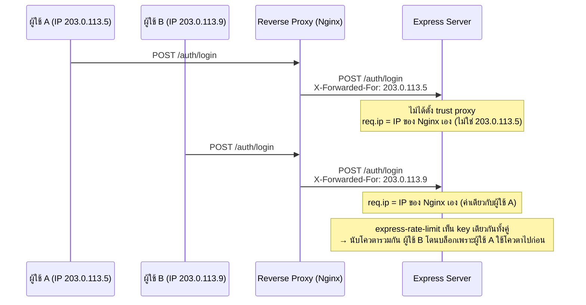
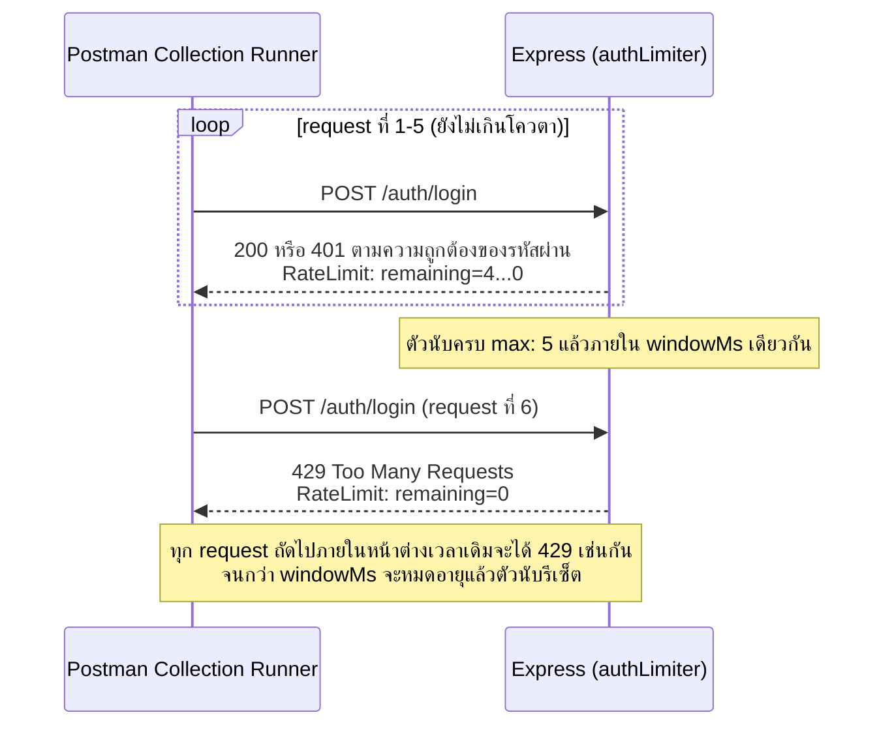

# สัปดาห์ที่ 12: Advanced Input Validation & Rate Limiting

## สารบัญ

- [วัตถุประสงค์การเรียนรู้ประจำสัปดาห์](#วัตถุประสงค์การเรียนรู้ประจำสัปดาห์)
- [1. ทบทวนช่องโหว่ที่ validation อ่อนแอเปิดทางให้](#1-ทบทวนช่องโหว่ที่-validation-อ่อนแอเปิดทางให้)
- [2. Zod: จาก Schema พื้นฐานสู่ Cross-field และ Conditional Validation](#2-zod-จาก-schema-พื้นฐานสู่-cross-field-และ-conditional-validation)
  - [2.1 Zod คืออะไร และโครงสร้าง Schema พื้นฐาน](#21-zod-คืออะไร-และโครงสร้าง-schema-พื้นฐาน)
  - [2.2 Cross-field Validation ด้วย `.refine()`](#22-cross-field-validation-ด้วย-refine)
  - [2.3 Conditional Validation ด้วย `.superRefine()`](#23-conditional-validation-ด้วย-superrefine)
  - [2.4 จำกัดขนาดของ Payload และ Array](#24-จำกัดขนาดของ-payload-และ-array)
  - [2.5 Middleware ห่อ Zod ให้ใช้ซ้ำได้](#25-middleware-ห่อ-zod-ให้ใช้ซ้ำได้)
- [3. Rate Limiting](#3-rate-limiting)
  - [3.1 Rate Limiting กับ Throttling ต่างกันอย่างไร](#31-rate-limiting-กับ-throttling-ต่างกันอย่างไร)
  - [3.2 ติดตั้งและใช้งาน `express-rate-limit`](#32-ติดตั้งและใช้งาน-express-rate-limit)
  - [3.3 Key เริ่มต้นของ express-rate-limit และผลกระทบเมื่ออยู่หลัง Proxy](#33-key-เริ่มต้นของ-express-rate-limit-และผลกระทบเมื่ออยู่หลัง-proxy)
  - [3.4 Rate Limiting แบบแยกตามผู้ใช้ (Key Generator)](#34-rate-limiting-แบบแยกตามผู้ใช้-key-generator)
- [4. ทดสอบด้วย Postman Collection Runner และ OWASP ZAP](#4-ทดสอบด้วย-postman-collection-runner-และ-owasp-zap)
  - [4.1 จำลอง Brute-force ด้วย Postman Collection Runner](#41-จำลอง-brute-force-ด้วย-postman-collection-runner)
  - [4.2 ภาพรวม OWASP ZAP](#42-ภาพรวม-owasp-zap)
- [5. เชื่อมโยงกับ OWASP Top 10](#5-เชื่อมโยงกับ-owasp-top-10)
- [สรุปเนื้อหาสำคัญ](#สรุปเนื้อหาสำคัญ)
- [เอกสารอ้างอิง (Reference)](#เอกสารอ้างอิง-reference)
- [คำถามท้ายบท](#คำถามท้ายบท)

## วัตถุประสงค์การเรียนรู้ประจำสัปดาห์

เมื่อเรียนจบเนื้อหาในสัปดาห์นี้ นิสิตจะสามารถ

1. เขียน validation schema ด้วย Zod ที่ครอบคลุมกฎเชิงธุรกิจที่ซับซ้อนกว่าการตรวจสอบชนิดข้อมูลพื้นฐาน เช่น validation ข้าม field และ conditional validation
2. อธิบายความแตกต่างระหว่าง Rate Limiting และ Throttling พร้อมเลือกกลยุทธ์ที่เหมาะสมกับสถานการณ์
3. ใช้งาน `express-rate-limit` เพื่อจำกัดจำนวน request ต่อ endpoint และต่อผู้ใช้
4. วิเคราะห์ผลการโจมตีจำลอง (brute-force, injection พื้นฐาน) ด้วย Postman แล้วปรับปรุง validation/rate limiter ให้รัดกุมขึ้น และรู้จักหลักการทำงานของเครื่องมือสแกนช่องโหว่อัตโนมัติอย่าง OWASP ZAP
5. เชื่อมโยงเนื้อหา validation และ rate limiting เข้ากับหลักการ OWASP Top 10 ที่เรียนไปแล้วในสัปดาห์ที่ 4

สัปดาห์นี้เป็นครั้งแรกที่วิชานี้สอน Zod อย่างเป็นระบบ (สัปดาห์ที่ 4 เพียงกล่าวถึงปัญหาที่ยังไม่มี Zod มาแก้และเลื่อนมาสอนในสัปดาห์นี้) หัวข้อที่ 2.1 จะปูพื้นฐานการเขียน schema ก่อน แล้วจึงขยายไปสู่กฎที่ซับซ้อนกว่าในหัวข้อถัดไป ดูคู่มืออ้างอิงคำสั่ง Zod ที่ใช้บ่อย (เปิดดูเวลาเขียนโค้ด ไม่ต้องไล่อ่านเนื้อหาเต็ม) ได้ที่ [ref-zod.md](ref-zod.md) และคู่มืออ้างอิง `express-rate-limit` ได้ที่ [ref-express-rate-limit.md](ref-express-rate-limit.md) สำหรับนิสิตที่สนใจทดลอง Throttling เพิ่มเติม (ไม่อยู่ในใบงานหรือจุดตรวจสอบ) ดูคู่มืออ้างอิง `express-slow-down` ได้ที่ [ref-express-slow-down.md](ref-express-slow-down.md)

หัวข้อนี้สอดคล้องกับ CLO1, CLO4 และ CLO8

---

## 1. ทบทวนช่องโหว่ที่ validation อ่อนแอเปิดทางให้

สัปดาห์ที่ 4 นิสิตติดตั้ง Helmet, CORS และหลักการ OWASP Top 10 ภาพรวมไปแล้ว สัปดาห์นี้ลงลึกเฉพาะสองหัวข้อที่เป็นด่านหน้าสุดของทุก endpoint คือการตรวจสอบข้อมูลขาเข้า (input validation) และการจำกัดอัตราการเรียก (rate limiting)

ระบบที่ไม่ตรวจสอบ input อย่างเข้มงวดมักเปิดช่องให้เกิดปัญหาเหล่านี้

| ปัญหา | ตัวอย่างสถานการณ์ | เกี่ยวข้องกับ OWASP Top 10 |
| --- | --- | --- |
| Mass assignment | ผู้ใช้ส่ง `{ "role": "admin" }` แนบมาในฟอร์มสมัครสมาชิก แล้ว field นี้ถูกบันทึกโดยไม่ตรวจสอบ | A01: Broken Access Control |
| Type confusion | endpoint คาดว่า `age` เป็นตัวเลข แต่รับ string `"25 OR 1=1"` แล้วส่งต่อไปยัง query โดยไม่แปลงชนิด | A05: Injection |
| Oversized payload | ผู้ใช้ส่ง array ขนาดหลายหมื่น record ในคำขอเดียว ทำให้ server ใช้หน่วยความจำพุ่งสูง | A06: Insecure Design |
| Credential stuffing / brute-force | บอทยิง `POST /auth/login` ซ้ำหลายพันครั้งต่อวินาทีเพื่อเดารหัสผ่าน | A07: Authentication Failures |

Zod ที่จะแนะนำในหัวข้อถัดไปช่วยแก้ปัญหา 3 อย่างแรก ส่วน rate limiting ช่วยแก้ปัญหาสุดท้ายซึ่ง validation เพียงอย่างเดียวแก้ไม่ได้ เพราะ request แต่ละครั้งอาจมีรูปแบบข้อมูลที่ถูกต้องสมบูรณ์ทุกประการ ปัญหาอยู่ที่ "จำนวนครั้ง" ไม่ใช่ "รูปร่างของข้อมูล"

---

## 2. Zod: จาก Schema พื้นฐานสู่ Cross-field และ Conditional Validation

### 2.1 Zod คืออะไร และโครงสร้าง Schema พื้นฐาน

**Zod** คือไลบรารีสำหรับตรวจสอบและแปลงชนิดข้อมูล (schema validation) ของ JavaScript/TypeScript โดยกำหนดรูปร่างข้อมูลที่ต้องการไว้เป็น schema object แล้วให้ Zod ตรวจสอบข้อมูลที่รับเข้ามาตาม schema นั้นโดยอัตโนมัติ แทนการเขียน `if` ตรวจสอบแต่ละ field ด้วยมือ

```javascript
const { z } = require("zod");

const createStudentSchema = z.object({
  name: z.string().min(1).max(100),
  email: z.email(),
  age: z.number().int().min(15).max(80),
});
```

`z.object({...})` กำหนดว่าข้อมูลที่รับเข้ามาต้องเป็น object ที่มี field ตามที่ระบุ แต่ละ field เลือกชนิดข้อมูล (`z.string()`, `z.number()`, หรือ `z.email()` สำหรับรูปแบบอีเมลโดยเฉพาะ) แล้วต่อเงื่อนไขเพิ่มเติมได้ด้วย method เช่น `.min()`, `.max()` รูปแบบนี้ตรวจสอบแต่ละ field แยกจากกัน เพียงพอสำหรับกรณีทั่วไป แต่ไม่ครอบคลุมกฎที่ต้องเปรียบเทียบระหว่าง field เช่น "วันที่สิ้นสุดต้องมาหลังวันที่เริ่มต้น"

### 2.2 Cross-field Validation ด้วย `.refine()`

**Cross-field validation** คือการตรวจสอบที่ต้องเปรียบเทียบค่าระหว่าง field สองตัวหรือมากกว่าในข้อมูลชุดเดียวกัน ต่างจาก schema พื้นฐานในหัวข้อ 2.1 ที่ตรวจแต่ละ field แยกจากกันโดยลำพัง ตัวอย่างเช่น "วันที่สิ้นสุดต้องมาหลังวันที่เริ่มต้น" แม้ `startDate` และ `endDate` จะเป็น datetime ที่ถูกต้องทั้งคู่แยกกัน แต่ถ้าลำดับผิด (เช่น `endDate` มาก่อน `startDate`) ก็ยังถือว่าข้อมูลไม่ถูกต้อง ซึ่ง schema พื้นฐานตรวจจับกรณีนี้ไม่ได้ ต้องเพิ่มกฎที่เทียบระหว่าง field เข้าไปอีกชั้นด้วย `.refine()`

```javascript
const enrollmentPeriodSchema = z
  .object({
    startDate: z.iso.datetime(), // ตรวจแค่รูปแบบ ISO 8601 ของแต่ละ field แยกกันก่อน
    endDate: z.iso.datetime(),
  })
  // .refine() ทำงานหลังจากแต่ละ field ผ่านการตรวจเบื้องต้นแล้วเท่านั้น
  // ฟังก์ชันนี้รับ data ทั้ง object เข้ามา จึงเปรียบเทียบข้าม field ได้
  .refine((data) => new Date(data.endDate) > new Date(data.startDate), {
    error: "endDate ต้องมาหลัง startDate เสมอ", // ข้อความ error ที่จะแสดง
    path: ["endDate"], // ผูก error นี้เข้ากับ field endDate โดยเฉพาะ
  });
```

`refine` รับฟังก์ชันที่คืนค่า `true`/`false` เมื่อคืน `false` Zod จะโยน error พร้อมข้อความและ `path` ที่ระบุ ทำให้ทราบว่า field ใดผิดโดยไม่ต้องเขียน logic เปรียบเทียบแยกใน controller

### 2.3 Conditional Validation ด้วย `.superRefine()`

**Conditional validation** คือการตรวจสอบที่กฎว่า field ใด "จำเป็นต้องมี" เปลี่ยนไปตามค่าของ field อื่นในข้อมูลชุดเดียวกัน ต่างจาก cross-field validation ในหัวข้อ 2.2 ที่เปรียบเทียบค่าระหว่าง field ที่มีอยู่แล้วทั้งคู่ ตัวอย่างในโลกจริงคือการลงทะเบียนที่ต้องแนบเอกสารเพิ่มเติมเฉพาะกรณีนิสิตต่างชาติ (นิสิตไทยไม่ต้องแนบ `passportNumber` แต่ต้องแนบ `nationalId` แทน) กฎแบบนี้ไม่ใช่การเปรียบเทียบตรง ๆ แต่เป็นเงื่อนไข "ถ้า...แล้วต้องมี..." ที่ซับซ้อนกว่า `.refine()` จะรองรับ จึงต้องใช้ `.superRefine()` แทน

```javascript
const registrationSchema = z
  .object({
    studentType: z.enum(["local", "international"]),
    // ทั้งสอง field นี้ยังไม่บังคับที่ระดับ schema พื้นฐาน
    // เพราะ "บังคับหรือไม่" ขึ้นกับค่า studentType ซึ่งต้องตรวจในชั้นถัดไป
    passportNumber: z.string().optional(),
    nationalId: z.string().optional(),
  })
  // .superRefine() รับ (data, ctx) — ctx ใช้เพิ่ม error ได้มากกว่า 1 จุดในการตรวจครั้งเดียว
  .superRefine((data, ctx) => {
    // เงื่อนไขที่ 1: นิสิตต่างชาติต้องมี passportNumber
    if (data.studentType === "international" && !data.passportNumber) {
      ctx.addIssue({
        code: "custom", // ชนิด error ที่กำหนดเอง (ไม่ใช่ error มาตรฐานของ Zod)
        message: "ต้องระบุ passportNumber สำหรับนิสิตต่างชาติ",
        path: ["passportNumber"], // ผูก error นี้เข้ากับ field passportNumber
      });
    }
    // เงื่อนไขที่ 2: นิสิตไทยต้องมี nationalId — ตรวจแยกจากเงื่อนไขแรกโดยอิสระ
    if (data.studentType === "local" && !data.nationalId) {
      ctx.addIssue({
        code: "custom",
        message: "ต้องระบุ nationalId สำหรับนิสิตไทย",
        path: ["nationalId"],
      });
    }
  });
```

`superRefine` ให้ความยืดหยุ่นมากกว่า `refine` เพราะสามารถเพิ่ม issue ได้หลายจุดในการตรวจสอบครั้งเดียว และเข้าถึง `ctx.addIssue` เพื่อระบุ `path` ของแต่ละ field ที่ผิดแยกกันได้ ต่างจาก `refine` ที่คืนได้เพียง error เดียวต่อการเรียกหนึ่งครั้ง

### 2.4 จำกัดขนาดของ Payload และ Array

Oversized payload คือการที่ client ส่งข้อมูลจำนวนมากผิดปกติมาในคำขอเดียว (เช่น array ขนาดหลายหมื่น record) ทำให้ server ใช้หน่วยความจำสูงเกินจำเป็นตอนประมวลผล วิธีป้องกันคือกำหนดขนาดสูงสุดของ array ไว้ที่ระดับ schema โดยตรง ดังตัวอย่างต่อไปนี้ที่จำกัดให้สร้างนิสิตพร้อมกันได้ครั้งละไม่เกิน 50 คน

```javascript
const bulkCreateSchema = z.object({
  students: z.array(createStudentSchema).min(1).max(50),
});
```

การกำหนด `.max(50)` ที่ระดับ schema ป้องกันปัญหา oversized payload ได้ตั้งแต่ชั้น validation ก่อนที่ข้อมูลจะไปถึงชั้นฐานข้อมูลเสียอีก ควรใช้ร่วมกับการจำกัดขนาด body ที่ระดับ Express ด้วย ดังที่ตั้งค่า `limit` ไว้แล้วตั้งแต่สัปดาห์ที่ 4 (`express.json({ limit: "10kb" })`) หาก endpoint ใดต้องรองรับ bulk array ที่มีขนาดใหญ่กว่าเดิม ให้ปรับค่า `limit` ของ `express.json()` ตัวนั้นขึ้นตามความเหมาะสม เช่น

```javascript
app.use(express.json({ limit: "100kb" }));
```

### 2.5 Middleware ห่อ Zod ให้ใช้ซ้ำได้

การเรียก `schema.safeParse(req.body)` แล้วเช็ค `if (!result.success)` ซ้ำทุก route เป็นโค้ดที่ซ้ำกันมาก (repetitive) จึงควรห่อ logic นี้ไว้ในฟังก์ชัน middleware ตัวเดียวที่รับ schema เป็นพารามิเตอร์ แล้วนำไปใช้ซ้ำกับทุก route ที่ต้องการ validate ได้ทันที

```javascript
// middlewares/validate.js
function validate(schema) {
  return (req, res, next) => {
    const result = schema.safeParse(req.body);
    if (!result.success) {
      return res.status(400).json({
        error: {
          code: "VALIDATION_ERROR",
          message: "ข้อมูลที่ส่งมาไม่ถูกต้อง",
          details: result.error.issues.map((issue) => ({
            field: issue.path.join("."),
            message: issue.message,
          })),
        },
      });
    }
    req.body = result.data;
    next();
  };
}

module.exports = { validate };
```

```javascript
router.post("/students", validate(createStudentSchema), createStudent);
```

`safeParse` ไม่โยน exception เหมือน `parse` แต่คืน object `{ success, data }` หรือ `{ success: false, error }` ทำให้เขียน middleware จัดการ error ได้ตรงไปตรงมาโดยไม่ต้องใช้ `try/catch`

---

## 3. Rate Limiting

### 3.1 Rate Limiting กับ Throttling ต่างกันอย่างไร

| ประเด็น | Rate Limiting | Throttling |
| --- | --- | --- |
| พฤติกรรมเมื่อเกินโควตา | ปฏิเสธ request ทันทีด้วย `429 Too Many Requests` | หน่วงเวลาตอบสนอง (delay) แทนการปฏิเสธ |
| เหมาะกับ | ป้องกัน brute-force, DoS, ป้องกันการใช้งานเกินแผนราคา | ลดภาระ server แบบค่อยเป็นค่อยไปโดยไม่ตัดผู้ใช้ทิ้งทันที |
| ผลกระทบต่อผู้ใช้ | รับรู้ทันทีว่าถูกจำกัด | ผู้ใช้อาจไม่รู้ตัวว่าถูกหน่วง เพราะยังได้รับผลลัพธ์ในที่สุด |
| ไลบรารีตัวอย่างใน Express | `express-rate-limit` | `express-slow-down` |

ตัวอย่างที่เห็นความต่างชัดที่สุดคือ `POST /auth/login` ถูกบอทยิงรัว ๆ 100 ครั้งในหนึ่งนาที

- **ถ้าใช้ Rate Limiting**: request ที่ 6 เป็นต้นไปจะได้ `429 Too Many Requests` ทันที ไม่ไปถึง route handler เลย บอทรู้ตัวทันทีว่าถูกบล็อก
- **ถ้าใช้ Throttling**: ทุก request ยังได้รับการประมวลผลและตอบกลับ `200`/`401` ตามปกติ เพียงแต่ request หลัง ๆ จะถูกหน่วงเวลาตอบนานขึ้นเรื่อย ๆ (เช่น request ที่ 50 ตอบช้ากว่า request ที่ 10) บอทอาจไม่รู้ตัวว่าถูกจำกัดอยู่ เพราะยังได้ผลลัพธ์กลับมาเสมอ

รายวิชานี้เน้น Rate Limiting เพราะตรงกับความต้องการป้องกัน brute-force และ DoS ของโปรเจกต์นิสิตมากกว่า — ต้องการให้ผู้โจมตีถูก "ตัด" ทันที ไม่ใช่แค่ "ช้าลง"

### 3.2 ติดตั้งและใช้งาน `express-rate-limit`

`express-rate-limit` คือไลบรารี middleware สำหรับจำกัดจำนวน request ของ Express โดยนับจำนวนคำขอที่เข้ามาภายในหน้าต่างเวลาที่กำหนด (`windowMs`) แล้วปฏิเสธคำขอที่เกินโควตา (`max`) ด้วย status `429` ขั้นตอนเริ่มต้นคือติดตั้งไลบรารีแล้วสร้าง middleware แยกตามความเสี่ยงของแต่ละกลุ่ม endpoint

```bash
npm install express-rate-limit
```

```javascript
// middlewares/rateLimiter.js
const rateLimit = require("express-rate-limit");

const authLimiter = rateLimit({
  windowMs: 15 * 60 * 1000, // 15 นาที
  max: 5, // จำกัด 5 ครั้งต่อ IP ต่อหน้าต่างเวลา
  standardHeaders: "draft-7", // ส่ง header RateLimit ตามมาตรฐาน IETF draft-7
  legacyHeaders: false, // ปิด header X-RateLimit-* แบบเก่า
  message: {
    error: {
      code: "TOO_MANY_REQUESTS",
      message: "พยายามเข้าสู่ระบบเกินจำนวนที่กำหนด กรุณาลองใหม่ภายหลัง",
    },
  },
});

const generalLimiter = rateLimit({
  windowMs: 60 * 1000, // 1 นาที
  max: 100,
  standardHeaders: "draft-7",
  legacyHeaders: false,
});

module.exports = { authLimiter, generalLimiter };
```

```javascript
// index.js
const { authLimiter, generalLimiter } = require("./middlewares/rateLimiter");

app.use(generalLimiter); // ครอบคลุมทุก route เป็นค่าเริ่มต้น
app.use("/auth/login", authLimiter); // route ที่เสี่ยงต่อ brute-force ใช้ค่าที่เข้มกว่า
```

จุดสำคัญของการตั้งค่านี้คือ endpoint ที่มีความเสี่ยงต่างกันควรมีโควตาต่างกัน `POST /auth/login` เสี่ยงต่อ brute-force มากกว่า `GET /students` ทั่วไปมาก จึงกำหนด `windowMs`/`max` แยกเฉพาะ

### 3.3 Key เริ่มต้นของ express-rate-limit และผลกระทบเมื่ออยู่หลัง Proxy

ค่าเริ่มต้นของ `express-rate-limit` นับโควตาแยกตาม IP address ของผู้เรียก (ผ่าน `req.ip`) **reverse proxy** คือเซิร์ฟเวอร์ตัวกลางที่รับ request จาก client ก่อนส่งต่อไปยัง server จริงของเรา เช่น Nginx หรือ load balancer (สถาปัตยกรรมนี้จะกล่าวถึงรายละเอียดในสัปดาห์ที่ 14)

ปัญหาเกิดขึ้นเมื่อ deploy ระบบไว้หลัง reverse proxy ลักษณะนี้ ค่า `req.ip` ที่ server เห็นจะกลายเป็น IP ของ proxy เอง ไม่ใช่ IP ของผู้ใช้จริง ทำให้ผู้ใช้ทุกคนถูกนับรวมเป็นคนเดียวกัน วิธีแก้คือต้องตั้งค่า `app.set("trust proxy", 1)` ที่ระดับ Express ควบคู่กับการตรวจสอบว่า proxy ส่ง header `X-Forwarded-For` มาอย่างถูกต้อง

แผนภาพต่อไปนี้แสดงให้เห็นว่าทำไมผู้ใช้สองคนที่ใช้ IP ต่างกันจริง จึงถูกนับรวมเป็นคนเดียวกันเมื่อ server ไม่รู้จัก header `X-Forwarded-For`



เมื่อตั้งค่า `app.set("trust proxy", 1)` แล้ว Express จะอ่านค่า IP จริงจาก header `X-Forwarded-For` ที่ proxy แนบมาให้แทน ทำให้ `req.ip` ของผู้ใช้ A และ B แยกจากกันอย่างถูกต้อง

```javascript
app.set("trust proxy", 1);
```

ข้อจำกัดอีกข้อที่ต้องรู้ไว้คือค่าเริ่มต้นของ `express-rate-limit` เก็บตัวนับ (counter) ไว้ใน memory ของ process เดียวเท่านั้น (in-memory store) หากระบบ deploy แบบหลาย instance พร้อมกัน (horizontal scaling คือการเพิ่มจำนวน server/process ที่รันแอปเดียวกันเพื่อรองรับโหลดมากขึ้น) แต่ละ process จะมีตัวนับของตัวเองแยกกัน ทำให้โควตารวมที่ผู้ใช้คนหนึ่งได้รับจริงกลายเป็น `max` คูณด้วยจำนวน process โดยไม่ตั้งใจ

สถานการณ์หนึ่งที่พบปัญหานี้คือการใช้ **PM2 cluster mode** PM2 คือ process manager สำหรับรัน Node.js app ใน production (restart อัตโนมัติเมื่อ crash, จัดการ log) ส่วน cluster mode คือฟีเจอร์ของ PM2 ที่รันแอปตัวเดียวกันพร้อมกันหลาย process บนเครื่องเดียว เช่น `pm2 start index.js -i 4` รัน 4 process เพื่อใช้ CPU หลาย core ให้คุ้มค่า แล้วกระจาย request ไปยัง process เหล่านั้นแบบสุ่ม ผลคือ request ของผู้ใช้คนเดียวอาจตกไปที่ process คนละตัวในแต่ละครั้ง ทำให้ตัวนับ rate limit ที่แยกกันในแต่ละ process ไม่เห็นภาพรวมที่ถูกต้อง (เช่น `max: 5` ต่อ process กลายเป็นผ่านได้จริงถึง 20 ครั้งเมื่อรัน 4 process)

ระดับโปรเจกต์ในรายวิชานี้ที่รันด้วย `node index.js`/`nodemon` เพียง process เดียว (ไม่ได้ใช้ PM2 cluster mode) ยังไม่พบปัญหานี้ แต่ในระบบ production ที่ขยายเป็นหลาย instance หรือหลาย process ต้องเปลี่ยนไปใช้ store ภายนอกที่ใช้ร่วมกันได้ เช่น **Redis** (ฐานข้อมูลแบบ in-memory ที่ทำงานเป็นตัวกลางแยกจาก process ของแอป ทำให้หลาย process เข้าถึงข้อมูลชุดเดียวกันร่วมกันได้) ผ่านแพ็กเกจ `rate-limit-redis` เพื่อให้ทุก instance นับโควตาร่วมกัน

### 3.4 Rate Limiting แบบแยกตามผู้ใช้ (Key Generator)

สำหรับ endpoint ที่มีการยืนยันตัวตนแล้ว การจำกัดตาม `userId` แม่นยำกว่าการจำกัดตาม IP เพราะผู้ใช้หลายคนอาจอยู่หลัง NAT เดียวกัน (เช่นในหอพักหรือสำนักงาน) และใช้ IP เดียวกัน

```javascript
const { rateLimit, ipKeyGenerator } = require("express-rate-limit");

const userLimiter = rateLimit({
  windowMs: 60 * 1000,
  max: 30,
  keyGenerator: (req) => req.user?.id?.toString() || ipKeyGenerator(req.ip),
  standardHeaders: "draft-7",
  legacyHeaders: false,
});

app.use("/api/v1/students", authenticateToken, userLimiter);
```

Middleware `authenticateToken` จากสัปดาห์ที่ 6 ต้องทำงานก่อน `userLimiter` เสมอ เพราะ `keyGenerator` ต้องอ่านค่า `req.user.id` ที่ถูกตั้งไว้แล้ว ส่วน fallback ที่ใช้ IP ต้องเรียกผ่าน `ipKeyGenerator(req.ip)` ที่ไลบรารีมีให้ ไม่ใช่ใช้ `req.ip` ตรง ๆ เพราะ `ipKeyGenerator` จัดการ normalize ที่อยู่ IPv6 ให้ถูกต้อง (รายละเอียดอยู่ในหัวข้อข้อผิดพลาดที่พบบ่อยของ [ref-express-rate-limit.md](ref-express-rate-limit.md)) ข้อควรระวังอีกจุดคือ fallback นี้ยังมีข้อจำกัดเดิมของหัวข้อ 3.3 คือผู้ใช้ที่ยังไม่ login และอยู่หลัง NAT เดียวกันจะยังถูกนับรวมเป็นคนเดียวกันอยู่ดี การจำกัดตาม `userId` จึงแม่นยำกว่าเฉพาะกับ request ที่ยืนยันตัวตนแล้วเท่านั้น

---

## 4. ทดสอบด้วย Postman Collection Runner และ OWASP ZAP

### 4.1 จำลอง Brute-force ด้วย Postman Collection Runner

Postman มีฟีเจอร์ **Collection Runner** ซึ่งต่อยอดจาก Collection ที่นิสิตเขียน test script ไว้แล้วตั้งแต่สัปดาห์ที่ 10 (ตอนนั้นใช้ Newman รัน Collection ผ่าน command line) คราวนี้เปิด Collection เดิมผ่านหน้าต่าง Runner ในตัวโปรแกรม Postman แทน

วิธีจำลองการโจมตี `POST /auth/login` มีขั้นตอนดังนี้ ตั้งค่า Iterations เป็นตัวเลขสูง เช่น 20 และตั้งค่า Delay เป็น 0 เพื่อให้ยิง request ซ้ำจำนวนมากในเวลาสั้น แล้วกด Run จากนั้นตรวจสอบผลลัพธ์ว่าหลังจากครั้งที่ 5 (ตามค่า `max` ที่ตั้งไว้ใน `authLimiter`) ระบบต้องตอบกลับด้วย status code `429` พร้อม header `RateLimit` ที่ระบุค่า `remaining=0` ซึ่งต้องตรวจสอบจากแท็บ Headers ของ response ใน Postman ไม่ใช่ใน body

แผนภาพต่อไปนี้แสดงจุดตัดที่ `authLimiter` เริ่มปฏิเสธ request เมื่อ `max: 5` ถูกใช้ครบภายในหน้าต่างเวลาเดียวกัน



สังเกตว่า status code ของ request ที่ 1-5 ไม่จำเป็นต้องเป็น `200` เสมอไป (ขึ้นอยู่กับว่ารหัสผ่านที่ใช้ทดสอบถูกหรือผิด) แต่ `authLimiter` นับทุก request ที่เข้ามาไม่ว่าผลลัพธ์จะเป็นอย่างไร เพราะนับที่ "จำนวนครั้งที่เรียก" ไม่ใช่ "ผลลัพธ์ที่ได้"

### 4.2 ภาพรวม OWASP ZAP

**OWASP ZAP (Zed Attack Proxy)** คือเครื่องมือทดสอบความปลอดภัยของเว็บแอปพลิเคชันแบบอัตโนมัติ ทำงานเป็น proxy คั่นกลางระหว่าง client กับ server เพื่อตรวจจับช่องโหว่ เช่น SQL Injection, Cross-Site Scripting (XSS), และ header ความปลอดภัยที่ขาดหายไป

การใช้งานเบื้องต้นสำหรับห้องปฏิบัติการ

1. เปิด ZAP แล้วตั้งค่า **Automated Scan** ชี้ไปที่ `http://localhost:3000`
2. ZAP จะ crawl endpoint ที่เข้าถึงได้ทั้งหมดโดยอัตโนมัติ (Spider) แล้วยิง payload ทดสอบต่าง ๆ (Active Scan)
3. ผลลัพธ์แสดงเป็นระดับความเสี่ยง (High/Medium/Low/Informational) พร้อมคำอธิบายและ endpoint ที่พบปัญหา

ระดับความเสี่ยงที่ ZAP มักตรวจพบในโปรเจกต์ระดับนิสิตคือ Missing Anti-CSRF Tokens, Missing Security Headers และบางครั้งพบ SQL Injection หากยังมี query ที่ต่อ string ตรง ๆ โดยไม่ผ่าน parameterized query ตามที่เรียนในสัปดาห์ที่ 5

**ขอบเขตของรายวิชา**: การฝึกภาคปฏิบัติเน้นที่ Automated Scan ระดับพื้นฐานเพื่อให้เห็นภาพรวมของการทดสอบความปลอดภัยอัตโนมัติ ส่วนการตั้งค่า Active Scan แบบละเอียด (custom scan policy, authentication script) เป็นหัวข้อขั้นสูงที่อยู่นอกขอบเขตของรายวิชานี้

---

## 5. เชื่อมโยงกับ OWASP Top 10

| หมวด OWASP Top 10:2025 | มาตรการที่เรียนในสัปดาห์นี้ | มาตรการที่เรียนไปแล้วในสัปดาห์ก่อนหน้า |
| --- | --- | --- |
| A02: Security Misconfiguration | ตรวจสอบ header ด้วย ZAP | Helmet.js (สัปดาห์ที่ 4) |
| A05: Injection | Zod validation ป้องกัน type confusion ก่อนถึงชั้น query | Parameterized query (สัปดาห์ที่ 5) |
| A06: Insecure Design | จำกัดขนาด array/payload ที่ระดับ schema | Middleware pattern (สัปดาห์ที่ 4) |
| A07: Authentication Failures | Rate limiting บน `/auth/login` | JWT + RBAC (สัปดาห์ที่ 6) |

ตารางนี้แสดงให้เห็นว่า OWASP Top 10 ไม่ใช่หัวข้อที่จบในสัปดาห์เดียว แต่เป็นกรอบความคิดที่แต่ละสัปดาห์เพิ่มมาตรการป้องกันเข้าไปทีละชั้น (defense in depth)

---

## สรุปเนื้อหาสำคัญ

1. Validation ที่ดีต้องครอบคลุมทั้งชนิดข้อมูลพื้นฐาน กฎข้าม field (`refine`) และกฎแบบมีเงื่อนไข (`superRefine`) ไม่ใช่แค่ตรวจสอบ type ของแต่ละ field แยกกัน
2. Rate Limiting ปฏิเสธ request ทันทีเมื่อเกินโควตา ต่างจาก Throttling ที่หน่วงเวลาแทนการปฏิเสธ รายวิชานี้เน้น Rate Limiting เพราะตรงกับการป้องกัน brute-force มากกว่า
3. `express-rate-limit` ควรตั้งค่าต่าง endpoint ต่างโควตา และต้องตั้ง `trust proxy` ให้ถูกต้องเมื่ออยู่หลัง reverse proxy
4. Rate limiting ที่จำกัดตาม `userId` แม่นยำกว่าตาม IP สำหรับ endpoint ที่มีการยืนยันตัวตนแล้ว
5. OWASP ZAP ช่วยตรวจจับช่องโหว่อัตโนมัติในระดับพื้นฐาน แต่ไม่ทดแทนการออกแบบความปลอดภัยตั้งแต่ต้น
6. Validation และ Rate Limiting คือมาตรการต่อยอดจาก OWASP Top 10 ที่เรียนในสัปดาห์ที่ 4 ไม่ใช่หัวข้อใหม่ที่แยกขาดจากกัน

---

## เอกสารอ้างอิง (Reference)

1. Zod. _Zod Documentation_. สืบค้นจาก https://zod.dev
2. express-rate-limit. _express-rate-limit GitHub Repository_. สืบค้นจาก https://github.com/express-rate-limit/express-rate-limit
3. OWASP. _OWASP Top 10:2025_. สืบค้นจาก https://top10.owasp.org/2025/
4. OWASP ZAP. _OWASP ZAP Official Site_. สืบค้นจาก https://www.zaproxy.org
5. Express. _Express Documentation_. สืบค้นจาก https://expressjs.com
6. Postman. _Postman Learning Center_. สืบค้นจาก https://learning.postman.com
7. MDN Web Docs. _HTTP Response Status Codes_. สืบค้นจาก https://developer.mozilla.org/en-US/docs/Web/HTTP/Status

---

## คำถามท้ายบท

1. จงอธิบายความแตกต่างระหว่าง `.refine()` และ `.superRefine()` ใน Zod พร้อมยกตัวอย่างสถานการณ์ที่ต้องใช้แต่ละแบบ
2. เพราะเหตุใด Rate Limiting เพียงอย่างเดียวจึงไม่สามารถทดแทน Input Validation ได้ และในทางกลับกัน
3. จงเปรียบเทียบ Rate Limiting และ Throttling พร้อมยกตัวอย่างสถานการณ์ที่ควรเลือกใช้แต่ละแบบ
4. หากไม่ตั้งค่า `trust proxy` เมื่อระบบอยู่หลัง reverse proxy จะเกิดปัญหาใดกับ `express-rate-limit`
5. จงออกแบบ Zod schema ที่ตรวจสอบว่า `discountEndDate` ต้องมาหลัง `discountStartDate` เสมอ โดยใช้ `.refine()`
6. เพราะเหตุใดการจำกัด rate ตาม `userId` จึงแม่นยำกว่าการจำกัดตาม IP ในบาง endpoint ยกตัวอย่างสถานการณ์ที่การจำกัดตาม IP ล้มเหลว
7. OWASP ZAP ตรวจพบช่องโหว่ประเภทใดได้บ้าง และมีข้อจำกัดใดที่ทีมพัฒนายังต้องตรวจสอบด้วยตนเองเพิ่มเติม
8. จงยกตัวอย่างมาตรการป้องกันจากสัปดาห์ที่ 4-12 อย่างน้อย 4 มาตรการ ที่ร่วมกันป้องกันหมวด A07 (Authentication Failures) ของ OWASP Top 10
