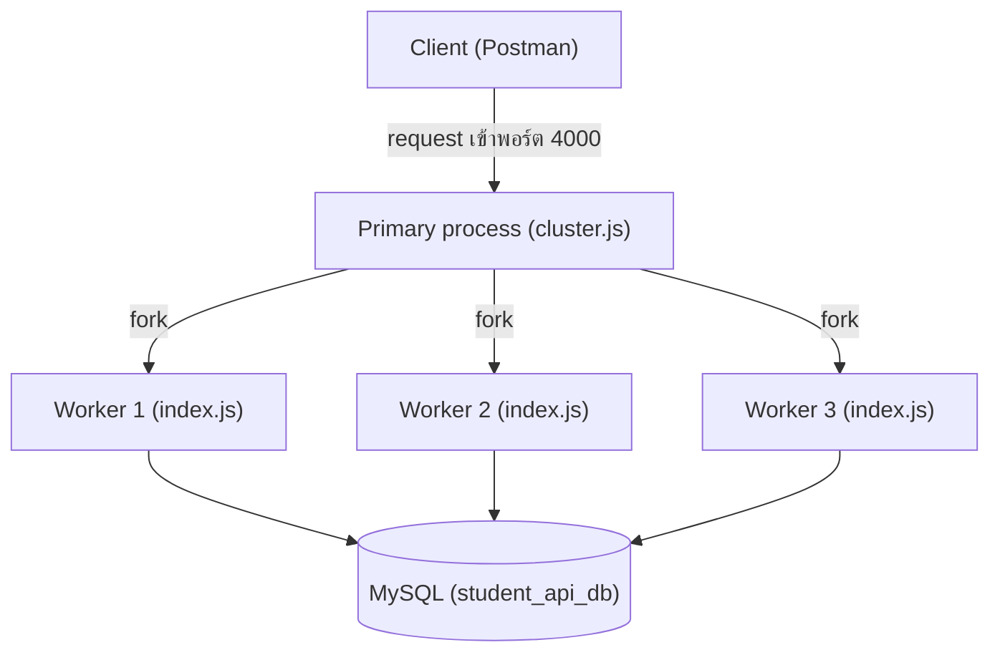
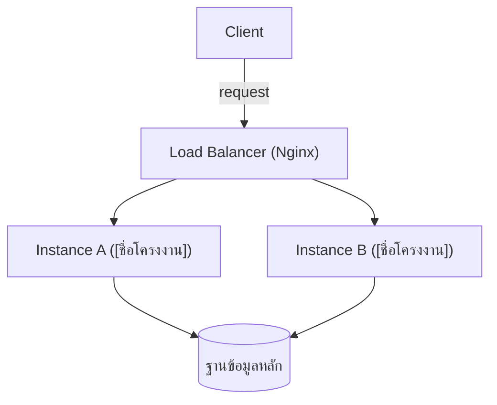

# ปฏิบัติการสัปดาห์ที่ 14: เขียน Migration Script และออกแบบสถาปัตยกรรมรองรับ Scale

## วัตถุประสงค์ของปฏิบัติการ

เมื่อทำปฏิบัติการนี้เสร็จสิ้น นิสิตจะสามารถ

1. ติดตั้งและตั้งค่า Knex.js สำหรับโปรเจกต์ `student-api`
2. เขียน migration script ที่แก้ไข schema จริงของโปรเจกต์ได้หลายกรณี (เพิ่ม column, สร้างตาราง, เพิ่ม index, เปลี่ยนชื่อ column ด้วย Expand-Contract, เปลี่ยนชนิดข้อมูล, เพิ่ม NOT NULL พร้อม backfill) พร้อมทดสอบทั้งทิศทาง up และ down
3. ทดลองรัน `student-api` แบบหลาย process ด้วย Node.js Cluster Module เพื่อเห็นรูปร่างจริงของ Horizontal Scaling ในระดับเล็กที่สุด
4. วิเคราะห์จุดที่เป็นคอขวด (bottleneck) ของระบบโครงงานของตนเอง
5. ออกแบบสถาปัตยกรรมที่รองรับ Horizontal Scaling พร้อมระบุตำแหน่งของ Load Balancer

ปฏิบัติการนี้ต่อยอดจากเนื้อหาบรรยายในเอกสาร `wk14.md` ไฟล์ที่ต้อง**ส่งจริง**เป็นใบงานสัปดาห์ที่ 14 คือ `scalability-design.md` ของ**ระบบโครงงานของตนเอง** ตามที่กำหนดไว้ในขั้นตอนที่ 3.3 โดย `course_plan.md` ระบุว่าสัปดาห์นี้วัดผลด้วย CLO3 (PLO4) และ CLO4 (PLO5) ไม่ใช่ CLO1 เนื่องจาก CLO1 (ใบงาน) วัดผลครบ 10 ครั้งแล้วที่สัปดาห์ที่ 13 ผลลัพธ์การเขียน Migration และการออกแบบสถาปัตยกรรมรองรับ Scale ของสัปดาห์นี้จะเตรียมความพร้อมโดยตรงสำหรับสอบวัดผลออกแบบ CLO3/PLO4 ในสัปดาห์ที่ 16 (Final)

## เวลาที่ใช้

| ช่วงเวลา    | กิจกรรม                                    |
| ----------- | -------------------------------------------- |
| 0-15 นาที   | ทบทวนเนื้อหาสัปดาห์ที่ 13 (Review W13 — Microservices Architecture) |
| 15-75 นาที  | ทดลองเขียน Migration script หลายกรณี         |
| 75-90 นาที  | ทดลองรัน student-api แบบหลาย process ด้วย Cluster Module |
| 90-120 นาที | วิเคราะห์จุดคอขวดและเขียนไฟล์ scalability-design.md ของโปรเจกต์ |

## เครื่องมือที่ต้องใช้

1. โปรเจกต์ `student-api` จากปฏิบัติการสัปดาห์ที่ 1-13
2. Node.js และ npm
3. ไลบรารี `knex`, `mysql2`
4. MySQL (ตาม container/instance ที่ใช้มาตั้งแต่สัปดาห์ที่ 5)
5. Node.js Cluster Module (`cluster` เป็นโมดูลมาตรฐานของ Node.js ไม่ต้องติดตั้งเพิ่ม)
6. เครื่องมือวาดแผนภาพ (กระดาษ, draw.io หรือ Markdown แบบข้อความ)

---

## ส่วนที่ 1: ทบทวนเนื้อหาสัปดาห์ที่ 13 (0-15 นาที)

### ขั้นตอนที่ 1.1 ตรวจสอบโปรเจกต์เดิม

```bash
cd student-api
npm test
npm run dev
```

ยืนยันว่าการแบ่งบริการและ API Gateway จากสัปดาห์ที่ 13 ยังทำงานได้ปกติ

### ขั้นตอนที่ 1.2 สำรองฐานข้อมูลก่อนเริ่มทดลอง Migration

เนื่องจากสัปดาห์นี้จะแก้ไข schema จริง ให้สำรองข้อมูลก่อนเสมอ

```bash
docker exec mysql_db mysqldump -u root -p student_api_db > backup_wk14.sql
```

### จุดตรวจสอบที่ 1

- ชุดทดสอบเดิมรันผ่านทั้งหมดก่อนเริ่มแก้ไข schema
- มีไฟล์ backup ของฐานข้อมูลก่อนเริ่มทดลอง migration

---

## ส่วนที่ 2: เขียน Migration Script (15-75 นาที)

### ขั้นตอนที่ 2.1 ติดตั้ง Knex.js

```bash
npm install knex mysql2
npx knex init
```

### ขั้นตอนที่ 2.2 ตั้งค่า knexfile.js

```javascript
// knexfile.js
require("dotenv").config();

module.exports = {
  development: {
    client: "mysql2",
    connection: {
      host: process.env.DB_HOST || "127.0.0.1",
      user: process.env.DB_USER || "root",
      password: process.env.DB_PASSWORD || "",
      database: process.env.DB_NAME || "student_api_db",
      charset: "utf8mb4",
    },
    migrations: {
      directory: "./migrations",
    },
  },
};
```

### ขั้นตอนที่ 2.3 สร้าง Migration แรก: เพิ่ม Column

```bash
npx knex migrate:make add_phone_number_to_students
```

```javascript
// migrations/<timestamp>_add_phone_number_to_students.js
exports.up = function (knex) {
  return knex.schema.alterTable("students", (table) => {
    table.string("phone_number", 20).nullable().defaultTo(null);
  });
};

exports.down = function (knex) {
  return knex.schema.alterTable("students", (table) => {
    table.dropColumn("phone_number");
  });
};
```

### ขั้นตอนที่ 2.4 รัน Migration และตรวจสอบผล

```bash
npx knex migrate:latest
```

```
Batch 1 run: 1 migrations
```

ตรวจสอบด้วย MySQL client ว่า column ใหม่ปรากฏจริงและแถวเดิมทุกแถวมีค่า `phone_number` เป็น `NULL`

```sql
DESCRIBE students;
SELECT id, name, phone_number FROM students LIMIT 5;
```

### ขั้นตอนที่ 2.5 ทดสอบการย้อนกลับ (Rollback)

```bash
npx knex migrate:rollback
```

```
Batch 1 rolled back: 1 migrations
```

ตรวจสอบว่า column `phone_number` หายไปจากตารางจริง แล้วรัน `npx knex migrate:latest` อีกครั้งเพื่อให้ schema กลับมาอยู่ในสถานะที่มี column นี้ก่อนไปยังขั้นตอนถัดไป

### ขั้นตอนที่ 2.6 สร้าง Migration ที่สอง: สร้างตารางใหม่

```bash
npx knex migrate:make create_login_history_table
```

```javascript
// migrations/<timestamp>_create_login_history_table.js
exports.up = function (knex) {
  return knex.schema.createTable("login_history", (table) => {
    table.increments("id").primary();
    table.integer("student_id").unsigned().notNullable();
    table.foreign("student_id").references("id").inTable("students");
    table.timestamp("logged_in_at").defaultTo(knex.fn.now());
    table.string("ip_address", 45).nullable();
  });
};

exports.down = function (knex) {
  return knex.schema.dropTableIfExists("login_history");
};
```

```bash
npx knex migrate:latest
```

ยืนยันว่าตาราง `login_history` ถูกสร้างพร้อม foreign key ที่อ้างอิงตาราง `students` ถูกต้อง

### ขั้นตอนที่ 2.7 สร้าง Migration ที่สาม: เพิ่ม Index เพื่อเพิ่มความเร็วในการ Query

Index คือโครงสร้างข้อมูลเสริมที่ MySQL ใช้ค้นหาแถวได้เร็วขึ้นโดยไม่ต้องไล่อ่านทุกแถว (full table scan) ใช้กับ column ที่ query ค้นหาบ่อย เช่น column ที่ใช้ใน `WHERE`

```bash
npx knex migrate:make add_index_to_login_history
```

```javascript
// migrations/<timestamp>_add_index_to_login_history.js
exports.up = function (knex) {
  return knex.schema.alterTable("login_history", (table) => {
    table.index("student_id", "idx_login_history_student_id");
  });
};

exports.down = function (knex) {
  return knex.schema.alterTable("login_history", (table) => {
    table.dropIndex("student_id", "idx_login_history_student_id");
  });
};
```

```bash
npx knex migrate:latest
```

ตรวจสอบด้วยคำสั่ง `SHOW INDEX FROM login_history;` ว่ามี index ชื่อ `idx_login_history_student_id` ปรากฏอยู่

### ขั้นตอนที่ 2.8 สร้าง Migration ที่สี่: เปลี่ยนชื่อ Column อย่างปลอดภัยด้วย Expand-Contract Pattern

การเปลี่ยนชื่อ column ตรง ๆ ด้วย `renameColumn` เพียงครั้งเดียวมีความเสี่ยง เพราะหากมีโค้ดส่วนอื่นของระบบที่ยังอ้างอิงชื่อเดิมอยู่ (เช่น endpoint อื่นที่ deploy คนละรอบ) endpoint นั้นจะพังทันทีหลัง migration รัน จึงต้องใช้ **Expand-Contract Pattern** ตามที่อธิบายไว้ในหัวข้อ 2.5 ของ `wk14.md` โดยสมมติว่าต้องการเปลี่ยนชื่อ column `ip_address` เป็น `client_ip`

**ขั้น Expand**: เพิ่ม column ใหม่โดยยังไม่ลบของเดิม

```bash
npx knex migrate:make add_client_ip_to_login_history
```

```javascript
// migrations/<timestamp>_add_client_ip_to_login_history.js
exports.up = function (knex) {
  return knex.schema.alterTable("login_history", (table) => {
    table.string("client_ip", 45).nullable();
  });
};

exports.down = function (knex) {
  return knex.schema.alterTable("login_history", (table) => {
    table.dropColumn("client_ip");
  });
};
```

**ขั้น Migrate**: ปรับโค้ด route handler ให้เขียนลงทั้งสอง column พร้อมกัน (`ip_address` และ `client_ip`) แล้ว deploy ให้โค้ด application อ่านจาก `client_ip` เป็นหลัก เมื่อยืนยันว่าทุก endpoint อ่านจาก column ใหม่แล้วเท่านั้น จึงไปขั้นต่อไป

**ขั้น Contract**: ลบ column เดิมทิ้ง

```bash
npx knex migrate:make remove_ip_address_from_login_history
```

```javascript
// migrations/<timestamp>_remove_ip_address_from_login_history.js
exports.up = function (knex) {
  return knex.schema.alterTable("login_history", (table) => {
    table.dropColumn("ip_address");
  });
};

exports.down = function (knex) {
  return knex.schema.alterTable("login_history", (table) => {
    table.string("ip_address", 45).nullable();
  });
};
```

ในปฏิบัติการนี้ให้รันเฉพาะขั้น Expand (migration `add_client_ip_to_login_history`) เพื่อฝึกเขียนและทดสอบ ไม่ต้องรันขั้น Contract จริง เนื่องจากขั้นตอนนี้มีไว้เพื่อสอนแนวคิดการเปลี่ยนชื่อ column แบบไม่มี downtime ไม่ใช่ขั้นตอนที่ต้องทำให้ครบในโปรเจกต์จริงทุกครั้ง

### ขั้นตอนที่ 2.9 สร้าง Migration ที่ห้า: เปลี่ยนชนิดข้อมูลของ Column ที่มีข้อมูลอยู่แล้ว

การเปลี่ยนชนิดข้อมูล (เช่น จาก `integer` เป็น `smallint`) มีความเสี่ยงที่ข้อมูลเดิมจะสูญหายหรือผิดเพี้ยนหากค่าเดิมเกินขอบเขตของชนิดใหม่ ต้องตรวจสอบข้อมูลเดิมก่อนเขียน migration เสมอ ตัวอย่างนี้เปลี่ยนชนิดของ column `logged_in_at` ในตาราง `login_history` ให้รองรับโซนเวลา โดยใช้ `alterTable` ร่วมกับ `.alter()`

```bash
npx knex migrate:make change_logged_in_at_type_in_login_history
```

```javascript
// migrations/<timestamp>_change_logged_in_at_type_in_login_history.js
exports.up = function (knex) {
  return knex.schema.alterTable("login_history", (table) => {
    table.timestamp("logged_in_at", { useTz: true }).defaultTo(knex.fn.now()).alter();
  });
};

exports.down = function (knex) {
  return knex.schema.alterTable("login_history", (table) => {
    table.timestamp("logged_in_at").defaultTo(knex.fn.now()).alter();
  });
};
```

การเรียก `.alter()` ต่อท้ายบอก Knex ว่าให้แก้ไข column ที่มีอยู่แล้วแทนการสร้างใหม่ ก่อนรัน migration นี้จริงต้องสำรองข้อมูลและตรวจสอบก่อนว่าไม่มีค่าเดิมที่ชนิดใหม่รองรับไม่ได้

### ขั้นตอนที่ 2.10 สร้าง Migration ที่หก: เพิ่ม Column แบบ NOT NULL พร้อม Backfill ข้อมูลเดิม

หัวข้อ 2.3 ของ `wk14.md` อธิบายว่าเพิ่ม column แบบ `NOT NULL` ตรง ๆ กับตารางที่มีข้อมูลอยู่แล้วจะทำให้ migration ล้มเหลว หากต้องการให้ column ใหม่เป็น `NOT NULL` จริง ๆ (ไม่ใช่แค่ nullable) ต้องแบ่งเป็น 3 migration ติดกัน

**ขั้นที่ 1**: เพิ่ม column แบบ nullable ก่อน

```javascript
exports.up = function (knex) {
  return knex.schema.alterTable("students", (table) => {
    table.string("student_status", 20).nullable();
  });
};

exports.down = function (knex) {
  return knex.schema.alterTable("students", (table) => {
    table.dropColumn("student_status");
  });
};
```

**ขั้นที่ 2**: backfill ค่า default ให้ทุกแถวเดิมที่ยังเป็น `NULL` อยู่ (เขียนคำสั่ง SQL ตรงในฟังก์ชัน `up` ได้ด้วย `knex.raw()`)

```javascript
exports.up = function (knex) {
  return knex("students").whereNull("student_status").update({ student_status: "active" });
};

exports.down = function (knex) {
  // ไม่ย้อนกลับค่าข้อมูล เพราะไม่ทราบค่าเดิมก่อน backfill
  return Promise.resolve();
};
```

**ขั้นที่ 3**: เปลี่ยน column เป็น `NOT NULL` เมื่อมั่นใจว่าทุกแถวมีค่าแล้ว

```javascript
exports.up = function (knex) {
  return knex.schema.alterTable("students", (table) => {
    table.string("student_status", 20).notNullable().alter();
  });
};

exports.down = function (knex) {
  return knex.schema.alterTable("students", (table) => {
    table.string("student_status", 20).nullable().alter();
  });
};
```

การแบ่งเป็น 3 migration แยกกันทำให้ตรวจสอบและ rollback แต่ละขั้นได้อย่างปลอดภัย ต่างจากการพยายามเพิ่ม `NOT NULL` ในขั้นเดียวซึ่งจะล้มเหลวทันทีตามที่อธิบายไว้ในหัวข้อ 2.3

### ขั้นตอนที่ 2.11 ข้อควรระวังในการเขียนและรัน Migration

ตารางต่อไปนี้สรุปข้อผิดพลาดที่พบบ่อยเมื่อเขียน migration และวิธีป้องกัน

| ข้อควรระวัง | ผลกระทบหากพลาด | วิธีป้องกัน |
| --- | --- | --- |
| ลืมกำหนด `nullable()` หรือ `defaultTo()` เมื่อเพิ่ม column ใน NOT NULL ให้ตารางที่มีข้อมูลอยู่แล้ว | Migration ล้มเหลวทันที (ตามหัวข้อ 2.3 ของ `wk14.md`) | เพิ่มแบบ nullable ก่อน, backfill ข้อมูล, แล้วค่อยเปลี่ยนเป็น NOT NULL ตามขั้นตอนที่ 2.10 |
| เขียนฟังก์ชัน `down` ที่ไม่ใช่ตรงข้ามของ `up` จริง ๆ (เช่น ลืมคืนค่า default เดิม) | Rollback แล้ว schema ไม่กลับสู่สถานะเดิมทุกประการ ทำให้ migration ถัดไปอาจพังเพราะ schema ไม่ตรงกับที่คาดไว้ | ทดสอบ `migrate:latest` ตามด้วย `migrate:rollback` ทุกครั้งหลังเขียน migration ใหม่ แล้วเทียบ schema ก่อน-หลังด้วย `DESCRIBE` |
| ใช้ `renameColumn` เปลี่ยนชื่อ column ตรง ๆ ในระบบที่ deploy แบบ rolling | Endpoint ที่ยังอ้างอิงชื่อเดิมพังทันทีระหว่างช่วงที่ instance เก่าและใหม่ทำงานพร้อมกัน (ตามหัวข้อ 2.5 ของ `wk14.md`) นอกจากนี้ Knex ยังต้องอ่านชนิดข้อมูลและ collation เดิมของ column มาเขียนซ้ำในคำสั่ง `ALTER TABLE ... CHANGE` ของ MySQL ซึ่งหากตรวจพบผิดอาจเปลี่ยนชนิดข้อมูลไปโดยไม่ตั้งใจ | ใช้ Expand-Contract Pattern ตามขั้นตอนที่ 2.8 แทนการ rename ตรง ๆ |
| รัน migration ที่แก้ไขตารางขนาดใหญ่ (หลายแสน/ล้านแถว) ตรงบน production โดยไม่ประเมินเวลาก่อน | คำสั่ง `ALTER TABLE` บางชนิดใน MySQL ล็อกตารางระหว่างทำงาน ทำให้ endpoint ที่ query ตารางนั้นหยุดตอบสนองชั่วคราว | ทดสอบเวลาที่ migration ใช้บนข้อมูลจำลองขนาดใกล้เคียง production ก่อน และพิจารณารันช่วง traffic ต่ำ |
| ลืมสำรองฐานข้อมูลก่อนรัน migration บนข้อมูลจริง | หาก migration ทำงานผิดพลาดกลางทางและ `down` เขียนไม่ถูกต้อง ข้อมูลอาจสูญหายโดยไม่มีทางย้อนกลับ | สำรองฐานข้อมูลก่อนรัน migrate:latest เสมอ ตามขั้นตอนที่ 1.2 ของปฏิบัติการนี้ |
| แก้ไขไฟล์ migration ที่รันไปแล้วบน instance อื่นหรือเพื่อนในทีมแล้ว (แทนการสร้างไฟล์ migration ใหม่) | ตาราง `knex_migrations` บันทึกว่าไฟล์นี้รันไปแล้ว เครื่องอื่นจะไม่รันไฟล์ที่แก้ไขซ้ำ ทำให้ schema ของแต่ละเครื่องไม่ตรงกันโดยไม่มีการแจ้งเตือน | ถือว่าไฟล์ migration ที่ commit และแชร์ให้ทีมแล้วเปลี่ยนแก้ไม่ได้อีก หากต้องแก้ไขให้สร้างไฟล์ migration ใหม่เพื่อแก้ไขต่อ |

### จุดตรวจสอบที่ 2

- Migration ทั้งหกไฟล์ (เพิ่ม column, สร้างตารางใหม่, เพิ่ม index, Expand-Contract, เปลี่ยนชนิดข้อมูล, NOT NULL พร้อม backfill) รันสำเร็จด้วย `npx knex migrate:latest`
- ทดสอบ `npx knex migrate:rollback` แล้ว schema ย้อนกลับได้ถูกต้องอย่างน้อย 1 ครั้ง
- ตาราง `login_history` มี foreign key เชื่อมกับตาราง `students` ถูกต้อง
- ตาราง `login_history` มี index `idx_login_history_student_id` ปรากฏจริงจากคำสั่ง `SHOW INDEX`
- เข้าใจเหตุผลที่การเปลี่ยนชื่อ column ต้องใช้ Expand-Contract Pattern แทนการ `renameColumn` ตรง ๆ
- อธิบายได้ว่าเพราะเหตุใดการเพิ่ม column แบบ NOT NULL ให้ตารางที่มีข้อมูลอยู่แล้วต้องแบ่งเป็น 3 ขั้นตอน
- บอกข้อควรระวังในตารางขั้นตอนที่ 2.11 ได้อย่างน้อย 3 ข้อ พร้อมวิธีป้องกัน

---

## ส่วนที่ 3: ทดลอง Cluster และออกแบบสถาปัตยกรรมรองรับ Scale (75-120 นาทีในคาบ + Peer Review เป็นการบ้าน)

### ขั้นตอนที่ 3.1 ทดลองรัน student-api แบบหลาย Process ด้วย Node.js Cluster Module

ก่อนออกแบบสถาปัตยกรรมบนเอกสาร ให้ทดลองเห็นรูปร่างจริงของ Horizontal Scaling ในระดับเล็กที่สุดก่อน คือการรันแอปพลิเคชันเดียวกันหลาย process บนเครื่องเดียว ด้วยโมดูลมาตรฐานของ Node.js ที่ชื่อ `cluster` (ไม่ต้องติดตั้งเพิ่ม)

สร้างไฟล์ `cluster.js` ที่ระดับรากของโปรเจกต์ `student-api` (ไฟล์นี้ใช้ทดลองเท่านั้น ไม่ต้องแก้ไข `index.js` เดิม)

```javascript
// cluster.js
const cluster = require("cluster");
const os = require("os");

const numWorkers = 3; // จำลองว่ามี 3 instance (ใช้ os.availableParallelism() แทนได้หากต้องการ fork ตามจำนวน CPU จริง)

if (cluster.isPrimary) {
  console.log(`Primary process ${process.pid} กำลังทำงาน`);

  for (let i = 0; i < numWorkers; i++) {
    cluster.fork();
  }

  cluster.on("exit", (worker, code, signal) => {
    console.log(`Worker ${worker.process.pid} หยุดทำงาน (code: ${code})`);
  });
} else {
  // Worker process แต่ละตัวโหลดแอป Express เดิมของโปรเจกต์
  require("./index.js");
}
```

```bash
node cluster.js
```

```
Primary process 12345 กำลังทำงาน
Worker 12346 started, listening on port 4000
Worker 12347 started, listening on port 4000
Worker 12348 started, listening on port 4000
```

ทุก worker process เรียก `require("./index.js")` ซึ่งคือไฟล์ Express แอปเดิมของโปรเจกต์ (ยังฟังที่พอร์ตเดียวกัน) กลไกของ `cluster` module ทำให้ทุก worker process "แชร์" การรับฟัง port เดียวกันได้ และระบบปฏิบัติการจะกระจาย request ที่เข้ามาไปยัง worker แต่ละตัวแบบ round-robin โดยอัตโนมัติ (ในระบบปฏิบัติการส่วนใหญ่ ยกเว้น Windows)



แผนภาพนี้แสดงให้เห็นว่า Primary process (ที่รัน `cluster.js`) ไม่ได้ประมวลผล request เอง แต่ทำหน้าที่ fork worker process และรับ request ที่เข้าพอร์ต 4000 มาแจกจ่ายให้ worker ทั้งสามแบบ round-robin โดยอัตโนมัติ ทุก worker รันโค้ด `index.js` ชุดเดียวกันและเชื่อมต่อฐานข้อมูล MySQL ตัวเดียวกัน ซึ่งเป็นรูปร่างเดียวกับแผนภาพ Load Balancer ในหัวข้อ 4.1 ของ `wk14.md` เพียงแต่ที่นี่ Primary process ทำหน้าที่แทน Load Balancer และ worker ทั้งหมดอยู่ในเครื่องเดียวกัน (ต่างจาก Load Balancer ที่กระจายไปหลายเครื่องจริง)

**ทดสอบว่าทำงานได้จริง**: ยิง request ซ้ำหลายครั้งด้วย Postman ไปที่ endpoint ใดก็ได้ของโปรเจกต์ (เช่น `GET /students`) แล้วสังเกตจาก log ของแต่ละ worker ว่า `process.pid` ที่ปรากฏในแต่ละครั้งต่างกันหรือไม่ หากต่างกันแสดงว่า request ถูกกระจายไปยังหลาย process จริง

**ข้อควรรู้ก่อนใช้งานจริง**: `cluster` module ใช้ได้เฉพาะการขยายในระดับเครื่องเดียว (scale จำนวน process บน CPU หลาย core ของเครื่องเดียว) ไม่ใช่การกระจายไปหลายเครื่องจริงแบบที่ต้องใช้ Load Balancer ในหัวข้อที่ 4 ของ `wk14.md` นอกจากนี้ worker แต่ละ process มี memory แยกจากกันโดยสิ้นเชิง (เช่นเดียวกับที่อธิบายไว้ในหัวข้อ 3.2 ของ `wk14.md` เรื่อง in-memory cache ที่ไม่ตรงกันระหว่าง instance) หากโปรเจกต์ใดยังมี cache แบบ in-memory จะเห็นปัญหานี้ทันทีเมื่อรันผ่าน cluster

### ขั้นตอนที่ 3.2 วิเคราะห์จุดคอขวดของระบบโครงงาน

พิจารณาระบบโครงงานของตนเองแล้วตอบคำถามต่อไปนี้เป็นลายลักษณ์อักษร

1. Endpoint ใดถูกเรียกบ่อยที่สุด และ endpoint นั้นมีการ query ฐานข้อมูลกี่ครั้งต่อ 1 request
2. หากมีผู้ใช้เพิ่มขึ้น 10 เท่าในทันที ส่วนใดของระบบจะรับภาระหนักที่สุดก่อน (application server หรือฐานข้อมูล)
3. ระบบปัจจุบันเก็บ state ใด ๆ ไว้ใน memory ของ server หรือไม่ (เช่น cache ในสัปดาห์ที่ 7 ที่เก็บแบบ in-memory) — หากมี ให้ลองรันผ่าน `cluster.js` ตามขั้นตอนที่ 3.1 แล้วสังเกตว่า cache เห็นข้อมูลตรงกันทุก worker หรือไม่
4. หากเพิ่มจำนวน instance ของระบบตาม Horizontal Scaling จำนวน connection ที่ฐานข้อมูลต้องรองรับพร้อมกันจะเพิ่มขึ้นเท่าใด (คำนวณจากค่า `connectionLimit` ของ Connection Pool คูณจำนวน instance ที่ตั้งใจจะมี ตามหัวข้อ 3.4 ของ `wk14.md`)

### ขั้นตอนที่ 3.3 สร้างไฟล์ scalability-design.md

สร้างไฟล์ `scalability-design.md` ที่ระดับรากของโปรเจกต์โครงงาน **ไฟล์นี้คือใบงานที่ต้องส่งของสัปดาห์ที่ 14** ประกอบด้วย

```markdown
# ออกแบบสถาปัตยกรรมรองรับ Scale ของระบบ [ชื่อโครงงาน]

## จุดคอขวดที่พบ

| Endpoint/ส่วนของระบบ | ปัญหาที่อาจเกิดเมื่อ Traffic สูงขึ้น |
| --- | --- |
| ... | ... |

## แผนภาพสถาปัตยกรรมที่รองรับ Horizontal Scaling

[วาดหรืออธิบายตำแหน่ง Load Balancer, จำนวน instance, ฐานข้อมูล]
```

ตัวอย่างรูปแบบแผนภาพที่ใช้ (ปรับจำนวน instance และชื่อให้ตรงกับระบบโครงงานของตนเอง) อ้างอิงรูปแบบเดียวกับหัวข้อ 4.1 ของ `wk14.md`



```markdown
## รายการที่ต้องแก้ไขก่อนรองรับ Horizontal Scaling ได้จริง

| รายการ | สถานะปัจจุบัน | สิ่งที่ต้องแก้ไข |
| --- | --- | --- |
| Session/Authentication | ... | ... |
| In-memory Cache (ถ้ามี) | ... | ... |
| ไฟล์ที่อัปโหลด (ถ้ามี) | ... | ... |
| Database Connection Limit | ... | ... |

## Migration Plan สำหรับ Schema ที่ต้องเปลี่ยนแปลงในอนาคต

| การเปลี่ยนแปลงที่คาดว่าจะเกิด | ใช้ Expand-Contract Pattern หรือไม่ | เหตุผล |
| --- | --- | --- |
| ... | ... | ... |
```

ประเด็นสำคัญที่ต้องตอบให้ครบในหัวข้อ "รายการที่ต้องแก้ไขก่อนรองรับ Horizontal Scaling ได้จริง" มี 2 จุด จุดแรกคือ cache แบบ in-memory จากสัปดาห์ที่ 7 หากยังเก็บอยู่ใน memory ของแต่ละ instance จะทำให้แต่ละ instance เห็นข้อมูล cache ไม่ตรงกัน ต้องพิจารณาย้ายไปใช้ Redis แบบรวมศูนย์ตามที่กล่าวถึงไว้แล้วในสัปดาห์ที่ 7 จุดที่สองคือ Database Connection Limit ให้คำนวณจำนวน connection รวมที่ต้องการ (`connectionLimit` คูณจำนวน instance ที่วางแผนไว้) แล้วเทียบกับค่า `max_connections` ปัจจุบันของ MySQL server ตามที่อธิบายไว้ในหัวข้อ 3.4 ของ `wk14.md`

### ขั้นตอนที่ 3.4 ตรวจทานร่วมกับเพื่อนในชั้นเรียน (Peer Review — ทำนอกคาบเป็นการบ้าน)

เนื่องจากขั้นตอนที่ 3.1-3.3 ใช้เวลาในคาบจนครบ 120 นาทีแล้ว ให้ทำขั้นตอนนี้นอกคาบก่อนส่งงาน จับคู่กับเพื่อนในชั้นเรียนคนละกลุ่ม ส่งไฟล์ `scalability-design.md` ของตนเองให้เพื่อนตรวจ (เช่น ผ่านช่องทางที่อาจารย์กำหนด) แล้วให้ข้อเสนอแนะกันอย่างน้อย 2 ข้อต่อคน โดยเน้นตรวจสอบว่าจุดคอขวดที่ระบุไว้สมเหตุสมผลกับ endpoint ที่มีอยู่จริงในระบบหรือไม่ บันทึกข้อเสนอแนะที่ได้รับกลับเข้าไปในไฟล์ `scalability-design.md` ก่อนส่งงานจริงตามกำหนดส่งใบงานสัปดาห์ที่ 14

### จุดตรวจสอบที่ 3

- รัน `node cluster.js` แล้วเห็น worker process อย่างน้อย 2 ตัวเริ่มทำงานจาก log และสังเกตเห็น `process.pid` ที่ต่างกันระหว่าง worker ได้จริง
- ไฟล์ `scalability-design.md` ระบุจุดคอขวดที่สอดคล้องกับ endpoint จริงของระบบโครงงาน
- แผนภาพสถาปัตยกรรมแสดงตำแหน่ง Load Balancer และจำนวน instance อย่างชัดเจน
- ระบุรายการที่ต้องแก้ไขก่อนรองรับ Horizontal Scaling ได้ครบทั้ง 4 หัวข้อ (Session, Cache, ไฟล์อัปโหลด, Database Connection Limit)
- ได้รับข้อเสนอแนะจากเพื่อนอย่างน้อย 2 ข้อ และบันทึกไว้ในไฟล์

หมายเหตุสำคัญ: ขั้นตอนที่ 1-2 และขั้นตอนที่ 3.1 ข้างต้นฝึกเขียน migration และทดลอง cluster บน `student-api` เพื่อให้เห็นตัวอย่างที่ถูกต้องก่อน แต่ไฟล์ที่ต้อง**ส่งจริง**เป็นใบงานสัปดาห์ที่ 14 คือ `scalability-design.md` ของ**ระบบโครงงานของตนเอง** ตามที่กำหนดไว้ในขั้นตอนที่ 3.3 โดย `course_plan.md` ระบุว่าสัปดาห์นี้วัดผลด้วย CLO3 (PLO4) และ CLO4 (PLO5)

---

## ส่วนต่อยอด: แบบฝึกหัดเพิ่มเติมด้วยตนเอง

### แบบฝึกหัดที่ 1: Migration ที่แก้ไขชนิดข้อมูล

เขียน migration ที่เปลี่ยนชนิดข้อมูลของ column `age` จาก `integer` เป็น `smallint` แล้วทดสอบว่าข้อมูลเดิมไม่สูญหายหลังรัน migration

### แบบฝึกหัดที่ 2: เพิ่ม Auto-Restart ให้ Cluster และนับจำนวน Request ต่อ Worker

ต่อยอดจาก `cluster.js` ในขั้นตอนที่ 3.1 เพิ่มความสามารถ 2 อย่าง (1) ดักฟัง event `exit` ของ `cluster` แล้วสั่ง `cluster.fork()` ใหม่ทันทีเมื่อ worker ตัวใดหยุดทำงานโดยไม่ได้ตั้งใจ เพื่อให้ระบบยังรับ request ต่อได้แม้ worker ตัวหนึ่งพัง และ (2) เพิ่มตัวนับจำนวน request ที่แต่ละ worker รับไปในแต่ละ process แล้ว log สรุปทุก 10 วินาที เพื่อยืนยันว่าการกระจายโหลดระหว่าง worker ใกล้เคียงกัน อ้างอิงจาก https://nodejs.org/api/cluster.html

### แบบฝึกหัดที่ 3: จำลอง Load Balancer ด้วย Nginx

ต่อยอดจากตัวอย่างใน `nginx.conf` ของหัวข้อ 4.3 ของ `wk14.md` ให้ตั้งค่าจริงบนเครื่องพัฒนา โดยรัน `student-api` สอง instance คนละพอร์ต แล้วใช้ Nginx กระจายโหลดระหว่างสอง instance นั้น

**ขั้นที่ 1**: รัน `student-api` สอง instance คนละพอร์ตพร้อมกัน (เปิด terminal สองหน้าต่าง)

```bash
PORT=4001 node index.js
PORT=4002 node index.js
```

หากโปรเจกต์ยังไม่อ่านค่า `PORT` จาก environment variable ให้แก้ไขส่วนที่ `app.listen(...)` ในไฟล์ `index.js` ให้อ่านจาก `process.env.PORT || 4000` ก่อน

**ขั้นที่ 2**: ติดตั้ง Nginx

```bash
# Ubuntu/WSL
sudo apt install nginx

# หรือใช้ Docker container แทนการติดตั้งลงเครื่องจริง
docker run -d --name nginx-lb -p 8080:80 -v $(pwd)/nginx.conf:/etc/nginx/conf.d/default.conf nginx
```

**ขั้นที่ 3**: สร้างไฟล์ `nginx.conf` ตามตัวอย่างในหัวข้อ 4.3 ของ `wk14.md` โดยแก้พอร์ตให้ตรงกับสอง instance ที่รันไว้ในขั้นที่ 1

```nginx
# nginx.conf
upstream student_api_backend {
    server 127.0.0.1:4001;
    server 127.0.0.1:4002;
}

server {
    listen 80;

    location / {
        proxy_pass http://student_api_backend;
        proxy_set_header X-Forwarded-For $proxy_add_x_forwarded_for;
    }
}
```

หากใช้ Docker ให้ยิง request ไปที่ `http://localhost:8080` แทน `http://localhost` (ตาม mapping พอร์ต `-p 8080:80` ในขั้นที่ 2) ถ้าติดตั้ง Nginx ลงเครื่องจริงให้นำไฟล์นี้ไปวางแทนที่ `/etc/nginx/sites-enabled/default` แล้วรัน `sudo nginx -t` ตรวจสอบ syntax ก่อน `sudo systemctl reload nginx`

**ขั้นที่ 4**: ทดสอบด้วยการยิง request ซ้ำหลายครั้งด้วย Postman ไปที่ endpoint ใดก็ได้ (เช่น `GET /students`) ผ่าน Nginx แล้วสังเกตจาก log ของแต่ละ instance (terminal ในขั้นที่ 1) ว่า instance ใดรับ request บ้าง ยืนยันว่า Nginx กระจาย request ไปยังทั้งสอง instance ตามอัลกอริทึม Round Robin ที่เป็นค่าเริ่มต้นของ Nginx (ตามหัวข้อ 4.2 ของ `wk14.md`)

### แบบฝึกหัดที่ 4: เขียน Migration Rollback Test อัตโนมัติ

เขียนสคริปต์ทดสอบที่รัน `migrate:latest` ตามด้วย `migrate:rollback` แล้วตรวจสอบว่า schema กลับสู่สถานะเดิมทุกประการ (เปรียบเทียบรายชื่อ column ก่อนและหลัง)

### แบบฝึกหัดที่ 5: วิเคราะห์ Query ที่ช้าที่สุดในระบบ

ใช้คำสั่ง `EXPLAIN` ของ MySQL วิเคราะห์ query ที่ซับซ้อนที่สุดใน endpoint ของโครงงาน แล้วเสนอแนวทางเพิ่ม index หรือปรับ query ให้เร็วขึ้น

### เกณฑ์การประเมินแบบฝึกหัดต่อยอด

| รายการ | ผ่านเกณฑ์เมื่อ |
| --- | --- |
| แบบฝึกหัดที่ 1 | Migration รันสำเร็จและข้อมูลเดิมในตารางไม่สูญหายหรือผิดเพี้ยน |
| แบบฝึกหัดที่ 2 | Worker ที่ถูกสั่งปิดหรือพังระหว่างทำงานถูก fork ขึ้นมาใหม่โดยอัตโนมัติ และมีตัวเลขสรุปจำนวน request ต่อ worker แสดงใน log ทุก 10 วินาที |
| แบบฝึกหัดที่ 3 | Nginx กระจาย request ไปยังทั้งสอง instance ได้จริง ตรวจสอบได้จาก log ของแต่ละ instance |
| แบบฝึกหัดที่ 4 | สคริปต์ยืนยันได้ว่า schema ก่อนและหลัง rollback เหมือนกันทุกประการ |
| แบบฝึกหัดที่ 5 | ระบุ query ที่ช้าที่สุดได้ถูกต้อง พร้อมข้อเสนอแนะที่นำไปปฏิบัติได้จริง |

สัปดาห์ถัดไป (สัปดาห์ที่ 15) จะนำโมดูลทั้งหมดที่พัฒนามาตลอดภาคการศึกษา รวมถึงผลการออกแบบ Migration และ Scalability ของสัปดาห์นี้ มารวมเป็นระบบเดียวในขั้นตอน Final Integration ก่อนนำเสนอโครงงานจริงต่อผู้สอน
