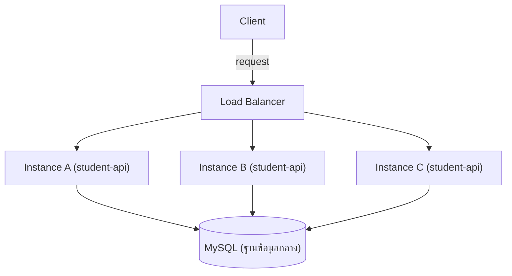

# สัปดาห์ที่ 14: Schema Evolution & Large-Scale Backend Design

## สารบัญ

- [วัตถุประสงค์การเรียนรู้ประจำสัปดาห์](#วัตถุประสงค์การเรียนรู้ประจำสัปดาห์)
- [1. ปัญหาของการแก้ไข Schema แบบไม่มีระบบ](#1-ปัญหาของการแก้ไข-schema-แบบไม่มีระบบ)
- [2. แนวคิดของ Database Migration](#2-แนวคิดของ-database-migration)
  - [2.1 นิยาม](#21-นิยาม)
  - [2.2 ติดตั้งและตั้งค่า Knex.js](#22-ติดตั้งและตั้งค่า-knexjs)
  - [2.3 สร้างและเขียน Migration File](#23-สร้างและเขียน-migration-file)
  - [2.4 รันและย้อนกลับ Migration](#24-รันและย้อนกลับ-migration)
  - [2.5 กลยุทธ์การเปลี่ยนแปลง Schema แบบไม่กระทบระบบที่ใช้งานอยู่ (Backward-Compatible Migration)](#25-กลยุทธ์การเปลี่ยนแปลง-schema-แบบไม่กระทบระบบที่ใช้งานอยู่-backward-compatible-migration)
  - [2.6 แนวปฏิบัติในการรัน Migration บน Production ที่มีข้อมูลจริง](#26-แนวปฏิบัติในการรัน-migration-บน-production-ที่มีข้อมูลจริง)
- [3. Scalability Patterns](#3-scalability-patterns)
  - [3.1 Vertical Scaling (Scale Up)](#31-vertical-scaling-scale-up)
  - [3.2 Horizontal Scaling (Scale Out)](#32-horizontal-scaling-scale-out)
  - [3.3 เมื่อใดควรเลือกแบบใด](#33-เมื่อใดควรเลือกแบบใด)
  - [3.4 ข้อจำกัดด้านฐานข้อมูลเมื่อ Scale แอปพลิเคชันแนวนอน](#34-ข้อจำกัดด้านฐานข้อมูลเมื่อ-scale-แอปพลิเคชันแนวนอน)
- [4. Load Balancing](#4-load-balancing)
  - [4.1 บทบาทของ Load Balancer](#41-บทบาทของ-load-balancer)
  - [4.2 อัลกอริทึมการกระจายโหลดพื้นฐาน](#42-อัลกอริทึมการกระจายโหลดพื้นฐาน)
  - [4.3 ตัวอย่าง Load Balancer เบื้องต้นด้วย Nginx](#43-ตัวอย่าง-load-balancer-เบื้องต้นด้วย-nginx)
- [5. ขอบเขตของโครงงาน](#5-ขอบเขตของโครงงาน)
- [สรุปเนื้อหาสำคัญ](#สรุปเนื้อหาสำคัญ)
- [เอกสารอ้างอิง (Reference)](#เอกสารอ้างอิง-reference)
- [คำถามท้ายบท](#คำถามท้ายบท)

## วัตถุประสงค์การเรียนรู้ประจำสัปดาห์

เมื่อเรียนจบเนื้อหาในสัปดาห์นี้ นิสิตจะสามารถ

1. อธิบายปัญหาที่เกิดขึ้นเมื่อแก้ไข schema ของฐานข้อมูลที่มีข้อมูลจริงอยู่แล้ว และเหตุผลที่ต้องใช้ migration แทนการแก้ไขตารางด้วยมือ
2. เขียน migration script เพื่อเปลี่ยนแปลง schema อย่างปลอดภัย ทั้งทิศทางไปข้างหน้า (up) และย้อนกลับ (down)
3. เปรียบเทียบ Horizontal Scaling กับ Vertical Scaling พร้อมข้อจำกัดของแต่ละแบบ
4. อธิบายบทบาทของ Load Balancer ในสถาปัตยกรรมที่รองรับ Scale และอัลกอริทึมการกระจายโหลดพื้นฐาน
5. ออกแบบสถาปัตยกรรมของระบบโครงงานให้รองรับการขยายตัวในอนาคต โดยพิจารณาจุดที่เป็นคอขวด (bottleneck)

หัวข้อนี้สอดคล้องกับ CLO3 และ CLO4

ดูคู่มืออ้างอิงคำสั่ง mysql2/Knex ที่ใช้บ่อย (เปิดดูเวลาเขียนโค้ด ไม่ต้องไล่อ่านเนื้อหาเต็ม) ได้ที่ [ref-mysql2-knex.md](ref-mysql2-knex.md)

---

## 1. ปัญหาของการแก้ไข Schema แบบไม่มีระบบ

**Schema Evolution** แปลว่า "การเปลี่ยนแปลงโครงสร้างฐานข้อมูลอย่างมีขั้นตอน" หมายถึงการแก้ไข schema (โครงสร้างตารางในฐานข้อมูล) อย่างเป็นระบบและปลอดภัย แทนการแก้ไขตารางตรง ๆ ด้วยมือ หัวข้อที่ 1-2 ของเอกสารนี้ว่าด้วยเรื่องนี้โดยตรง ผ่านเครื่องมือที่เรียกว่า Migration

โปรเจกต์ `student-api` ตั้งแต่สัปดาห์ที่ 5 สร้างตารางด้วยคำสั่ง SQL ที่รันครั้งเดียวตอนเริ่มโครงงาน (`seed.sql` หรือคำสั่ง `CREATE TABLE` ที่รันตรงในคอนโซล MySQL) วิธีนี้ใช้ได้ดีตอนเริ่มต้น แต่เมื่อโครงงานพัฒนาไปหลายสัปดาห์และมีข้อมูลจริงสะสมอยู่ในตารางแล้ว การแก้ไข schema ด้วยวิธีเดิมจะเกิดปัญหา

| สถานการณ์                                             | ปัญหาที่เกิดขึ้น                                            |
| ----------------------------------------------------- | ----------------------------------------------------------- |
| เพิ่ม column `phone_number` ที่กำหนด `NOT NULL`       | Query ล้มเหลวทันทีเพราะแถวเดิมไม่มีค่าใน column นี้         |
| ลบ column ที่ยังมี endpoint อื่นอ้างอิงอยู่           | Endpoint นั้นพังโดยไม่มีการแจ้งเตือนล่วงหน้า                |
| เพื่อนร่วมทีมแก้ไข schema บนเครื่องตนเอง              | ฐานข้อมูลของแต่ละคนไม่ตรงกัน เกิด bug ที่ reproduce ไม่ได้  |
| Deploy schema ใหม่ขึ้น production โดยไม่มีแผนย้อนกลับ | หากพบปัญหาหลัง deploy ไม่มีวิธีย้อนกลับที่ปลอดภัยและรวดเร็ว |

ปัญหาเหล่านี้คือเหตุผลที่ระบบ production ทุกระบบใช้เครื่องมือ **Migration** ในการจัดการการเปลี่ยนแปลง schema แทนการแก้ไขตารางด้วยมือ

---

## 2. แนวคิดของ Database Migration

### 2.1 นิยาม

**Migration** คือไฟล์สคริปต์ที่บันทึกการเปลี่ยนแปลง schema แต่ละครั้งเป็นลำดับขั้น (version) แต่ละไฟล์ระบุสองทิศทาง

- **Up**: คำสั่งที่ใช้ทำการเปลี่ยนแปลงไปข้างหน้า (เช่น เพิ่ม column, สร้างตารางใหม่)
- **Down**: คำสั่งที่ใช้ย้อนกลับการเปลี่ยนแปลงนั้น (เช่น ลบ column ที่เพิ่งเพิ่ม)

เครื่องมือ migration จะบันทึกไว้ในตารางพิเศษ (เช่น `knex_migrations`) ว่าระบบรันไฟล์ migration ใดไปแล้วบ้าง ทำให้ทุกเครื่องที่รัน migration ชุดเดียวกันจบลงด้วย schema ที่เหมือนกันทุกประการ ไม่ว่าจะรันตอนไหนหรือรันกี่ครั้งก็ตาม (idempotent ในความหมายที่ว่า migration เดิมจะไม่ถูกรันซ้ำ)

ในทางเทคนิค Knex ไม่บังคับให้ทุกไฟล์ migration ต้องมีฟังก์ชัน `down` เสมอไป ไฟล์ที่มีแค่ `exports.up` ก็รันผ่าน `migrate:latest` ได้ปกติ แต่ถ้าไฟล์นั้นไม่มี `down` เลย คำสั่ง `migrate:rollback` จะไม่สามารถย้อนกลับ migration ไฟล์นั้นได้ จึงควรเขียน `down` ไว้เสมอ แม้ในกรณีที่ย้อนข้อมูลกลับจริง ๆ ไม่ได้ เช่น migration ที่ backfill ข้อมูลเข้า column ที่เพิ่งเพิ่ม (เติมค่า default ให้แถวเดิมที่ไม่มีค่ามาก่อน) เมื่อ rollback แล้วไม่มีทางรู้ว่าค่าดั้งเดิมก่อน backfill คืออะไร กรณีนี้ให้เขียนฟังก์ชัน `down` เป็นฟังก์ชันที่ไม่ทำอะไร (คืนค่า `Promise.resolve()`) พร้อม comment อธิบายเหตุผลไว้ เพื่อให้ `migrate:rollback` ยังทำงานได้โดยไม่เกิด error ดีกว่าละ `down` ไว้เฉย ๆ

### 2.2 ติดตั้งและตั้งค่า Knex.js

รายวิชานี้ใช้ **Knex.js** เป็นเครื่องมือ migration หลัก แต่ Knex ไม่ใช่ทางเลือกเดียวที่มีอยู่จริง ตารางต่อไปนี้เปรียบเทียบ Knex กับเครื่องมือ migration อื่นที่ใช้กันแพร่หลายในระบบ Node.js/MySQL เพื่อให้เห็นเหตุผลของการเลือกและทราบว่ามีทางเลือกอื่นอยู่

| เครื่องมือ         | ลักษณะ                                                                              | ข้อดีสำหรับโครงงานนี้                                                                                                                          | ข้อจำกัด                                                                                                                                 |
| ------------------ | ----------------------------------------------------------------------------------- | ---------------------------------------------------------------------------------------------------------------------------------------------- | ---------------------------------------------------------------------------------------------------------------------------------------- |
| **Knex.js**        | Query builder ที่มีโมดูล migration ในตัว ไม่ใช่ ORM เต็มรูปแบบ                      | ทำงานร่วมกับ `mysql2` ที่ใช้อยู่แล้วตั้งแต่สัปดาห์ที่ 5 ได้โดยตรง เขียน query เดิมด้วย `mysql2` ต่อไปได้ ใช้ Knex เฉพาะส่วน migration เท่านั้น | ต้องเขียนไฟล์ migration ด้วย JavaScript API ของ Knex เอง                                                                                 |
| **db-migrate**     | เครื่องมือจัดการ migration โดยเฉพาะ (migration-only) ไม่มีส่วน query builder มาด้วย | แยกส่วนชัดเจน เหมาะกับโปรเจกต์ที่ไม่ต้องการเปลี่ยนวิธี query เลยแม้แต่น้อย                                                                     | ชุมชนผู้ใช้และตัวอย่างน้อยกว่า Knex ต้องติดตั้ง driver adapter (เช่น `db-migrate-mysql`) เพิ่มเติม                                       |
| **Sequelize**      | ORM เต็มรูปแบบ มี migration module (`sequelize-cli`) รวมอยู่                        | จัดการ model และ migration ในระบบเดียวกัน เหมาะกับโปรเจกต์ที่เริ่มต้นใหม่และตั้งใจใช้ ORM แต่แรก                                               | ต้องเปลี่ยนวิธีเขียน query ทั้งหมดจาก SQL ตรง ๆ เป็น ORM syntax (`Model.findAll()` แทน `pool.query()`) กระทบโค้ดเดิมของนิสิตทั้งโปรเจกต์ |
| **Prisma Migrate** | ORM รุ่นใหม่ที่สร้าง migration จากไฟล์ schema (`schema.prisma`) โดยอัตโนมัติ        | เขียน schema แล้วให้ Prisma สร้าง migration ให้เอง ลดงานเขียน SQL ตรง ๆ                                                                        | เปลี่ยนวิธีเขียน query ทั้งหมดเช่นเดียวกับ Sequelize และต้องเรียนรู้ Prisma Schema Language เพิ่มเติม                                    |

เหตุผลที่รายวิชานี้เลือก Knex คือโปรเจกต์ `student-api` เขียน query ด้วย `mysql2` ตรง ๆ มาตั้งแต่สัปดาห์ที่ 5 (ไม่ใช้ ORM) การเปลี่ยนไปใช้ Sequelize หรือ Prisma จะบังคับให้นิสิตเขียน query ทั้งหมดใหม่ด้วย ORM syntax ซึ่งเกินขอบเขตของสัปดาห์นี้ที่ต้องการสอนแค่แนวคิด migration ส่วน db-migrate แม้ไม่บังคับเปลี่ยนวิธี query เช่นกัน แต่มีชุมชนผู้ใช้และตัวอย่างการใช้งานน้อยกว่า Knex ซึ่งเป็นที่นิยมกว้างขวางกว่าในระบบ Node.js/MySQL Knex จึงเป็นตัวเลือกที่ตรงกับทั้งสถาปัตยกรรมเดิมของโปรเจกต์และขอบเขตของเนื้อหาสัปดาห์นี้มากที่สุด

```bash
npm install knex mysql2
npx knex init
```

คำสั่งนี้สร้างไฟล์ `knexfile.js` ที่ระดับรากของโปรเจกต์

```javascript
// knexfile.js
module.exports = {
  development: {
    client: "mysql2",
    connection: {
      host: process.env.DB_HOST || "127.0.0.1",
      user: process.env.DB_USER || "root",
      password: process.env.DB_PASSWORD || "",
      database: process.env.DB_NAME || "student_api_db",
      charset: "utf8mb4",
    },
    migrations: {
      directory: "./migrations",
    },
  },
};
```

ค่า `charset: "utf8mb4"` จำเป็นสำหรับโปรเจกต์นี้เนื่องจากตารางเดิมตั้งแต่สัปดาห์ที่ 5 ใช้ `utf8mb4` เพื่อรองรับข้อความภาษาไทยและ emoji อย่างถูกต้อง

### 2.3 สร้างและเขียน Migration File

```bash
npx knex migrate:make add_phone_number_to_students
```

คำสั่งนี้สร้างไฟล์ใหม่ในโฟลเดอร์ `migrations/` ชื่อรูปแบบ `<timestamp>_add_phone_number_to_students.js` โดย `<timestamp>` คือเวลาที่สร้างไฟล์ในรูปแบบ `YYYYMMDDHHmmss` (ปี-เดือน-วัน-ชั่วโมง-นาที-วินาที) ที่ Knex สร้างให้อัตโนมัติ

**แนวปฏิบัติในการตั้งชื่อไฟล์ใน `migrations/`**

- **ห้ามเปลี่ยนหรือลบส่วน `<timestamp>` ที่ Knex สร้างให้** เพราะ Knex ใช้ค่านี้ในการจัดเรียงลำดับว่าต้องรัน migration ไฟล์ใดก่อนหลัง หากลำดับผิดอาจทำให้ migration ที่ต้องพึ่งพากัน (เช่น สร้างตาราง `students` ก่อนสร้างตาราง `login_history` ที่มี foreign key อ้างอิงกลับไป) รันผิดลำดับและล้มเหลว
- **ส่วนชื่อหลัง timestamp ต้องสื่อว่า migration ทำอะไร** ไม่ใช่แค่หมายเลข เพราะเมื่อโปรเจกต์มี migration สะสมหลายสิบไฟล์ ชื่อไฟล์คือสิ่งเดียวที่บอกให้รู้ว่าไฟล์ใดทำอะไรโดยไม่ต้องเปิดไฟล์อ่าน
- **ใช้รูปแบบกริยา + สิ่งที่เปลี่ยน + ตารางที่เกี่ยวข้อง** เป็นภาษาอังกฤษ snake_case สม่ำเสมอกันทั้งโปรเจกต์ เช่น
  - เพิ่ม column: `add_<column>_to_<table>` เช่น `add_phone_number_to_students`
  - ลบ column: `remove_<column>_from_<table>` เช่น `remove_ip_address_from_login_history`
  - สร้างตารางใหม่: `create_<table>_table` เช่น `create_login_history_table`
  - เปลี่ยนชนิดข้อมูล: `change_<column>_type_in_<table>` เช่น `change_logged_in_at_type_in_login_history`
  - เพิ่ม index: `add_index_to_<table>` หรือระบุชื่อ column ด้วยหากตารางมีหลาย index เช่น `add_student_id_index_to_login_history`
- **ชื่อไฟล์ควรสื่อการเปลี่ยนแปลงเดียวต่อไฟล์** ไม่รวมหลายการเปลี่ยนแปลงที่ไม่เกี่ยวข้องกันไว้ใน migration เดียว เพื่อให้ rollback แต่ละการเปลี่ยนแปลงแยกจากกันได้ชัดเจน เช่น ไม่ควรเขียน migration ที่ชื่อ `update_students_and_courses_tables` เพราะหาก rollback จะย้อนทั้งสองตารางพร้อมกันทั้งที่อาจต้องการย้อนแค่ตารางเดียว

```javascript
// migrations/20260101120000_add_phone_number_to_students.js
exports.up = function (knex) {
  return knex.schema.alterTable("students", (table) => {
    table.string("phone_number", 20).nullable().defaultTo(null);
  });
};

exports.down = function (knex) {
  return knex.schema.alterTable("students", (table) => {
    table.dropColumn("phone_number");
  });
};
```

จุดสำคัญคือ column ใหม่ต้องกำหนดเป็น `nullable()` หรือมี `defaultTo()` เสมอเมื่อเพิ่มเข้าตารางที่มีข้อมูลอยู่แล้ว เพราะแถวเดิมทุกแถวไม่มีค่าของ column นี้มาก่อน หากกำหนด `NOT NULL` โดยไม่มีค่า default การรัน migration จะล้มเหลวทันที

### 2.4 รันและย้อนกลับ Migration

```bash
npx knex migrate:latest
```

```
Batch 1 run: 1 migrations
```

หากพบปัญหาหลังรัน สามารถย้อนกลับ batch ล่าสุดได้ทันที

```bash
npx knex migrate:rollback
```

```
Batch 1 rolled back: 1 migrations
```

คำสั่ง `migrate:rollback` เรียกใช้ฟังก์ชัน `down` ของ migration ล่าสุดที่รันไป การมีทั้ง `up` และ `down` ที่ถูกต้องคือหัวใจของ migration ที่ปลอดภัย เพราะทำให้การ deploy มีแผนย้อนกลับเสมอ ต่างจากการรัน `ALTER TABLE` ตรง ๆ ที่ไม่มีบันทึกว่าจะย้อนกลับอย่างไร

### 2.5 กลยุทธ์การเปลี่ยนแปลง Schema แบบไม่กระทบระบบที่ใช้งานอยู่ (Backward-Compatible Migration)

ระบบที่มีผู้ใช้งานจริงต่อเนื่อง (เช่น production API ที่ deploy ตาม workflow ในสัปดาห์ที่ 1) ไม่สามารถหยุดระบบเพื่อแก้ไข schema ได้เสมอไป จึงมีแนวปฏิบัติที่เรียกว่า **Expand-Contract Pattern**

| ขั้นตอน     | การกระทำ                                                                                    | ตัวอย่าง                                                     |
| ----------- | ------------------------------------------------------------------------------------------- | ------------------------------------------------------------ |
| 1. Expand   | เพิ่ม schema ใหม่โดยไม่ลบของเดิม                                                            | เพิ่ม column `email_address` ควบคู่กับ column เดิม `email`   |
| 2. Migrate  | ปรับโค้ด application ให้เขียนลงทั้งสอง column พร้อมกัน แล้วค่อยย้ายการอ่านไปที่ column ใหม่ | Deploy เวอร์ชันที่เขียน `email` และ `email_address` พร้อมกัน |
| 3. Contract | เมื่อมั่นใจว่าไม่มีโค้ดส่วนใดอ้างอิง column เดิมแล้ว จึงลบทิ้ง                              | สร้าง migration ใหม่ลบ column `email`                        |

รูปแบบนี้หลีกเลี่ยงการมี downtime และป้องกันปัญหากรณีที่ instance เก่าและใหม่ทำงานพร้อมกันชั่วคราวระหว่าง deploy (rolling deployment)

ตัวอย่างต่อไปนี้แสดงการเปลี่ยนชื่อ column `email` เป็น `email_address` ในตาราง `students` ตามขั้นตอนทั้งสามของ Expand-Contract Pattern

**ขั้นที่ 1 — Expand**: เพิ่ม column ใหม่โดยยังไม่ลบของเดิม

```javascript
// migrations/20260102090000_add_email_address_to_students.js
exports.up = function (knex) {
  return knex.schema.alterTable("students", (table) => {
    table.string("email_address", 100).nullable().defaultTo(null);
  });
};

exports.down = function (knex) {
  return knex.schema.alterTable("students", (table) => {
    table.dropColumn("email_address");
  });
};
```

**ขั้นที่ 2 — Migrate**: ปรับโค้ด application ให้เขียนลงทั้งสอง column พร้อมกัน (ยังอ่านจาก column เดิม `email` ไปก่อน จนกว่าจะมั่นใจว่าข้อมูลใน `email_address` ครบทุกแถวแล้ว)

```javascript
// controllers/studentController.js (เฉพาะส่วนที่เกี่ยวข้อง)
async function updateStudentEmail(req, res) {
  const { email } = req.body;
  await pool.query(
    "UPDATE students SET email = ?, email_address = ? WHERE id = ?",
    [email, email, req.params.id],
  );
  res.json({ message: "อัปเดตอีเมลสำเร็จ" });
}
```

Deploy โค้ดนี้แล้วรัน migration เพื่อ backfill ข้อมูลเดิมที่มีอยู่แล้วเข้า column ใหม่ให้ครบทุกแถว (ไม่ใช่แค่แถวที่ถูกอัปเดตใหม่หลัง deploy)

```javascript
// migrations/20260103090000_backfill_email_address_in_students.js
exports.up = function (knex) {
  return knex("students").update({
    email_address: knex.ref("email"),
  });
};

exports.down = function () {
  // ponytail: ไม่มีทางย้อนค่า email_address กลับสู่ก่อน backfill ได้ (ไม่ได้บันทึกค่าก่อนหน้าไว้)
  return Promise.resolve();
};
```

**ขั้นที่ 3 — Contract**: เมื่อมั่นใจว่าทุกแถวมีค่าใน `email_address` ครบถ้วนและไม่มีโค้ดส่วนใดอ้างอิง column เดิมแล้ว จึงลบ column `email` ทิ้ง

```javascript
// migrations/20260104090000_remove_email_from_students.js
exports.up = function (knex) {
  return knex.schema.alterTable("students", (table) => {
    table.dropColumn("email");
  });
};

exports.down = function (knex) {
  return knex.schema.alterTable("students", (table) => {
    table.string("email", 100).nullable().defaultTo(null);
  });
};
```

สังเกตว่าแต่ละขั้นตอนแยกเป็น migration คนละไฟล์ตามแนวปฏิบัติในหัวข้อ 2.3 เพื่อให้ rollback แต่ละขั้นตอนแยกจากกันได้ และ migration ที่ backfill ข้อมูล (ขั้นที่ 2) มีฟังก์ชัน `down` ที่ไม่ทำอะไรพร้อม comment อธิบายเหตุผล ตามหลักการที่กล่าวไว้ในหัวข้อ 2.1

### 2.6 แนวปฏิบัติในการรัน Migration บน Production ที่มีข้อมูลจริง

หัวข้อ 2.1-2.5 อธิบายวิธีเขียน migration ที่ปลอดภัยในระดับไฟล์ หัวข้อนี้เพิ่มแนวปฏิบัติระดับขั้นตอนการ deploy สำหรับฐานข้อมูล production ที่มีข้อมูลผู้ใช้จริงสะสมอยู่ ซึ่งความเสี่ยงสูงกว่าฐานข้อมูล dev ที่ใช้ทดสอบระหว่างพัฒนา

1. **สำรองข้อมูลก่อนรันเสมอ** ด้วย `mysqldump` แม้ migration จะทดสอบผ่านบน dev แล้วก็ตาม เพราะข้อมูลจริงบน production อาจมี edge case ที่ dev ไม่มี เช่น ค่า NULL ที่ไม่คาดคิดหรือรูปแบบข้อมูลเก่าที่ไม่ตรงสมมติฐานของ migration

   ```bash
   mysqldump -u root -p student_api_db > backup_before_migration_$(date +%Y%m%d).sql
   ```

2. **ทดสอบ migration บน staging ที่มีข้อมูลจำลองใกล้เคียงของจริงก่อน** ไม่ใช่ทดสอบกับฐานข้อมูลเปล่า เพื่อให้เห็นพฤติกรรมจริงเมื่อมีข้อมูลสะสมอยู่ (เช่น เวลาที่ใช้รัน `ALTER TABLE` บนตารางขนาดใหญ่)

3. **ตรวจว่า migration มีฟังก์ชัน `down` ที่ใช้งานได้จริงก่อน deploy** ตามหลักการในหัวข้อ 2.1 หาก migration เป็นประเภทที่ rollback คืนค่าเดิมไม่ได้ (เช่น migration backfill ในหัวข้อ 2.5) ต้องรู้ตัวล่วงหน้าว่าแผนสำรองคือการ restore จาก backup ข้อ 1 ไม่ใช่ `migrate:rollback`

4. **ใช้ Expand-Contract Pattern สำหรับการเปลี่ยนแปลงที่กระทบ column ซึ่งโค้ดที่ใช้งานอยู่ยังอ้างอิงอยู่** ตามหัวข้อ 2.5 เพื่อเลี่ยง downtime และปัญหา instance เก่ากับใหม่ไม่เข้ากันระหว่าง rolling deployment

5. **รัน migration ก่อนเสมอ แล้วจึง deploy โค้ดใหม่ที่ต้องใช้ schema นั้น** (migrate-then-deploy) ไม่รันพร้อมกัน เพื่อให้ schema พร้อมใช้งานก่อนโค้ดที่อ้างอิง column หรือตารางใหม่ถูกเรียกจริง

6. **รันในช่วงเวลาที่มีผู้ใช้งานน้อยที่สุด** และแจ้งแผนย้อนกลับ (ใช้ `migrate:rollback` หรือ restore จาก backup) ให้ทีมรับทราบก่อนรันจริงเสมอ

**ตัวอย่างสมมติ**: นำแนวปฏิบัติทั้ง 6 ข้อมาใช้กับโปรเจกต์ `student-api` ในสถานการณ์ที่ต้องเพิ่ม column `phone_number` (ตามตัวอย่างในหัวข้อ 2.3) เข้าตาราง `students` บน production ที่มีข้อมูลนิสิตจริงอยู่แล้ว 500 แถว (ตัวอย่างนี้สำหรับทำความเข้าใจขั้นตอนเท่านั้น ไม่ต้องลงมือทำจริงตามขอบเขตของสัปดาห์นี้)

| ขั้นตอน                | สิ่งที่ทำกับ `student-api`                                                                                                                                                                                                                                      |
| ---------------------- | --------------------------------------------------------------------------------------------------------------------------------------------------------------------------------------------------------------------------------------------------------------- |
| 1. สำรองข้อมูล         | รัน `mysqldump -u root -p student_api_db > backup_before_migration_20260119.sql` บนเครื่อง production VM ก่อนรันคำสั่งใด ๆ                                                                                                                                      |
| 2. ทดสอบบน staging     | คัดลอกไฟล์ backup ไปยังฐานข้อมูล staging แล้วรัน `npx knex migrate:latest` ที่นั่นก่อน ตรวจสอบว่า column `phone_number` ถูกเพิ่มเข้าตารางที่มี 500 แถวโดยไม่มี error และแถวเดิมทุกแถวได้ค่า `NULL` ตามที่ migration กำหนด `nullable()` ไว้                      |
| 3. ตรวจ `down`         | เปิดไฟล์ `migrations/20260101120000_add_phone_number_to_students.js` ยืนยันว่า `exports.down` มี `table.dropColumn("phone_number")` ที่ใช้งานได้จริง (ย้อนกลับได้สมบูรณ์ เพราะเป็นการเพิ่ม column ใหม่ ไม่ใช่ backfill)                                         |
| 4. Expand-Contract     | migration นี้เป็นการ "เพิ่ม column ใหม่" ล้วน ๆ ไม่มี column เดิมที่โค้ดอ้างอิงอยู่ถูกลบหรือเปลี่ยนชนิด จึงไม่จำเป็นต้องผ่านขั้น Migrate/Contract เหมือนตัวอย่างเปลี่ยนชื่อ `email` ในหัวข้อ 2.5                                                                |
| 5. Migrate ก่อน deploy | SSH เข้า production VM แล้วรัน `npx knex migrate:latest` ให้ตาราง `students` มี column `phone_number` พร้อมก่อน จากนั้นจึง deploy โค้ด controller เวอร์ชันใหม่ที่อ่าน/เขียน field นี้ (เช่น `pm2 reload student-api` ตาม workflow ใน `backend-api-workflow.md`) |
| 6. เลือกเวลารัน        | รันคำสั่งในข้อ 5 ช่วงดึกที่มีนิสิตใช้งานระบบน้อย และแจ้งในกลุ่มทีมพัฒนาไว้ก่อนว่าหากมีปัญหาจะ `npx knex migrate:rollback` ทันที                                                                                                                                 |

แนวปฏิบัติทั้ง 6 ข้อข้างต้นเป็น **best practice** ที่ยอมรับกันกว้างขวางในอุตสาหกรรม ไม่ใช่มาตรฐานที่มีเอกสารบังคับอย่างเป็นทางการ (เช่น ISO หรือ RFC) แนวคิด Expand-Contract Pattern มีที่มาจากบทความ "Evolutionary Database Design" ของ Martin Fowler (อ้างอิงที่ 9 ด้านล่าง) ส่วนแนวทาง migrate-then-deploy และการสำรองข้อมูลก่อน migration สอดคล้องกับเอกสารของเครื่องมือ migration หลักที่ใช้กันทั่วไป เช่น Knex และ Rails Active Record Migrations

---

## 3. Scalability Patterns

**Large-Scale Backend Design** แปลว่า "การออกแบบระบบ Backend ให้รองรับการขยายขนาดใหญ่" หมายถึงการออกแบบสถาปัตยกรรมของระบบให้รองรับจำนวนผู้ใช้และปริมาณ request ที่เพิ่มขึ้นได้ในอนาคต หัวข้อที่ 3-4 ของเอกสารนี้ว่าด้วยเรื่องนี้ ครอบคลุม Scalability Patterns (หัวข้อนี้) และ Load Balancing (หัวข้อที่ 4)

### 3.1 Vertical Scaling (Scale Up)

**Vertical Scaling** คือการเพิ่มทรัพยากรให้กับเครื่องเดิม เช่น เพิ่ม CPU, RAM หรือเปลี่ยนไปใช้ SSD ที่เร็วขึ้น

| ข้อดี                                           | ข้อเสีย                                                       |
| ----------------------------------------------- | ------------------------------------------------------------- |
| ทำได้ง่าย ไม่ต้องแก้ไขสถาปัตยกรรมของแอปพลิเคชัน | มีเพดานจำกัด ฮาร์ดแวร์ที่แรงที่สุดก็ยังมีขีดจำกัด             |
| ไม่ต้องจัดการปัญหา distributed system           | มักมี downtime ช่วงอัปเกรดเครื่อง                             |
| เหมาะกับฐานข้อมูลที่ยังไม่พร้อมกระจายศูนย์      | ต้นทุนต่อหน่วยประสิทธิภาพสูงขึ้นเรื่อย ๆ เมื่อใกล้เพดานสูงสุด |

### 3.2 Horizontal Scaling (Scale Out)

**Horizontal Scaling** คือการเพิ่มจำนวนเครื่อง (instance) ที่รันแอปพลิเคชันเดียวกัน แล้วกระจายโหลดไปยังหลายเครื่อง

| ข้อดี                                                               | ข้อเสีย                                                                             |
| ------------------------------------------------------------------- | ----------------------------------------------------------------------------------- |
| ขยายได้แทบไม่มีเพดาน เพิ่มเครื่องเรื่อย ๆ ได้ตามความต้องการ         | ต้องมี Load Balancer กระจายโหลด                                                     |
| ทนทานต่อความล้มเหลว (หากเครื่องหนึ่งล่ม เครื่องอื่นยังรับงานต่อได้) | Application ต้องออกแบบให้ไม่เก็บ state ไว้ใน memory ของเครื่องเดียว (stateless)     |
| รองรับ rolling deployment ได้ดี ไม่มี downtime                      | ฐานข้อมูลกลายเป็นจุดร่วมที่ต้องออกแบบให้รองรับการเชื่อมต่อจากหลาย instance พร้อมกัน |

โปรเจกต์ `student-api` ที่ใช้ JWT (สัปดาห์ที่ 6) แทนการเก็บ session ไว้ใน memory ของ server เป็นตัวอย่างของการออกแบบแบบ **stateless** ซึ่งเป็นเงื่อนไขจำเป็นสำหรับ Horizontal Scaling เพราะ request จากผู้ใช้คนเดียวกันสามารถไปตกที่ instance ใดก็ได้โดยไม่ต้องพึ่งพา session ที่ผูกกับเครื่องใดเครื่องหนึ่ง

### 3.3 เมื่อใดควรเลือกแบบใด

ทีมขนาดเล็กมักเริ่มจาก Vertical Scaling ก่อนเสมอ เพราะทำได้เร็วและไม่ต้องแก้ไขสถาปัตยกรรม เมื่อถึงเพดานของ Vertical Scaling หรือเมื่อระบบต้องการความทนทานต่อความล้มเหลวสูง (high availability) จึงค่อยลงทุนออกแบบให้รองรับ Horizontal Scaling หลักการนี้สอดคล้องกับแนวทาง "เริ่มจาก Monolith ก่อนแยกเป็น Microservices" ที่กล่าวถึงในสัปดาห์ที่ 13

### 3.4 ข้อจำกัดด้านฐานข้อมูลเมื่อ Scale แอปพลิเคชันแนวนอน

ตารางข้อเสียของ Horizontal Scaling ในหัวข้อ 3.2 ระบุไว้ว่า "ฐานข้อมูลกลายเป็นจุดร่วมที่ต้องออกแบบให้รองรับการเชื่อมต่อจากหลาย instance พร้อมกัน" หัวข้อนี้อธิบายว่าปัญหานี้เกิดขึ้นอย่างไรและแนวทางพื้นฐานในการแก้ไข

แต่ละ instance ของ `student-api` สร้าง **Connection Pool** ของตัวเอง (ตามที่เรียนในสัปดาห์ที่ 5 ด้วยค่า `connectionLimit: 10`) เมื่อเพิ่มจำนวน instance ตาม Horizontal Scaling จำนวน connection ที่ฐานข้อมูลต้องรองรับพร้อมกันจึงเพิ่มขึ้นตามจำนวน instance คูณด้วย `connectionLimit` ของแต่ละ instance เช่น 3 instance x 10 connections = 30 connections พร้อมกัน หาก MySQL server ตั้งค่า `max_connections` ไว้ต่ำกว่าผลรวมนี้ instance ที่ขอเชื่อมต่อเกินจะได้รับ error `ER_CON_COUNT_ERROR` ทันที

| แนวทาง                                      | หลักการ                                                                                                                                                    | ข้อจำกัด                                                                                                                               |
| ------------------------------------------- | ---------------------------------------------------------------------------------------------------------------------------------------------------------- | -------------------------------------------------------------------------------------------------------------------------------------- |
| เพิ่มค่า `max_connections` ของ MySQL server | ขยายเพดานจำนวน connection ที่ server รองรับได้พร้อมกัน                                                                                                     | ใช้ RAM มากขึ้นต่อ connection แก้ปัญหาได้ชั่วคราวเท่านั้น ยังมีเพดานจำกัดเหมือน Vertical Scaling                                       |
| ลดค่า `connectionLimit` ต่อ instance        | ลดจำนวน connection ที่แต่ละ instance จองไว้ ปล่อยให้แต่ละ instance รอคิวมากขึ้นแทน                                                                         | request อาจหน่วงขึ้นหาก instance ใช้ connection ชนเพดานบ่อย                                                                            |
| Read Replica                                | ทำสำเนาฐานข้อมูลสำหรับอ่านอย่างเดียว แล้วแยก query `SELECT` (อ่าน) ไปที่ replica ส่วน `INSERT`/`UPDATE`/`DELETE` (เขียน) ยังคงไปที่ฐานข้อมูลหลัก (primary) | ข้อมูลใน replica อาจล่าช้ากว่า primary เล็กน้อย (replication lag) จึงเหมาะกับ endpoint ที่ไม่ต้องการข้อมูลล่าสุดแบบ real-time เท่านั้น |

**Read Replica** คือฐานข้อมูลสำเนาที่ MySQL ทำการ replication (คัดลอกข้อมูลจาก primary มาเก็บไว้แบบต่อเนื่องอัตโนมัติ) มาให้ ใช้สำหรับรับ query อ่านข้อมูลโดยเฉพาะ เพื่อแบ่งภาระการอ่านออกจากฐานข้อมูลหลักที่ต้องรองรับการเขียนด้วย แนวทางนี้เหมาะกับระบบที่มีสัดส่วนการอ่านมากกว่าการเขียนมาก (เช่น endpoint `GET /students` ที่ถูกเรียกบ่อยกว่า endpoint `POST`/`PUT`/`DELETE` อย่างเห็นได้ชัด)

**ขอบเขตของรายวิชา**: Read Replica และการตั้งค่า MySQL replication ไม่อยู่ในขอบเขตการปฏิบัติของสัปดาห์นี้ เนื่องจากต้องใช้ MySQL server อย่างน้อย 2 instance และการตั้งค่า replication ที่ซับซ้อนกว่าทรัพยากรที่ห้องปฏิบัติการกำหนดไว้ หัวข้อนี้มีไว้เพื่อให้นิสิตรู้จักแนวทางและข้อจำกัด สามารถนำไปใช้ตอบคำถามเชิงออกแบบในข้อสอบ Final และนำไปใช้จริงได้หากโครงงานในอนาคตต้องขยายขนาด

---

## 4. Load Balancing

### 4.1 บทบาทของ Load Balancer

**Load Balancer** คือองค์ประกอบที่อยู่หน้าเครื่อง instance หลายเครื่อง ทำหน้าที่กระจาย request ที่เข้ามาไปยัง instance ที่เหมาะสม เพื่อไม่ให้เครื่องใดเครื่องหนึ่งรับภาระงานมากเกินไปในขณะที่เครื่องอื่นว่าง



แผนภาพนี้แสดงให้เห็นว่า Client ไม่เคยเรียก instance ใดโดยตรง แต่เรียกผ่าน Load Balancer เสมอ ซึ่งเป็นผู้เลือกว่าจะส่ง request ไปยัง Instance A, B หรือ C (อัลกอริทึมการเลือกจะอธิบายในหัวข้อ 4.2) ทุก instance รันโค้ด `student-api` ชุดเดียวกันและเชื่อมต่อฐานข้อมูล MySQL ตัวเดียวกัน จึงเห็นข้อมูลตรงกันไม่ว่า request จะไปตกที่ instance ใด

### 4.2 อัลกอริทึมการกระจายโหลดพื้นฐาน

| อัลกอริทึม        | หลักการทำงาน                                                | เหมาะกับ                                                          |
| ----------------- | ----------------------------------------------------------- | ----------------------------------------------------------------- |
| Round Robin       | ส่ง request ไปยัง instance ถัดไปตามลำดับวนซ้ำ               | Instance ทุกเครื่องมีสเปกเท่ากันและงานมีขนาดใกล้เคียงกัน          |
| Least Connections | ส่งไปยัง instance ที่มีจำนวนการเชื่อมต่อค้างอยู่น้อยที่สุด  | งานที่แต่ละ request ใช้เวลาประมวลผลต่างกันมาก                     |
| IP Hash           | คำนวณ hash จาก IP ของ client แล้วส่งไปยัง instance เดิมเสมอ | กรณีที่ยังจำเป็นต้องใช้ session แบบผูกกับเครื่อง (sticky session) |

### 4.3 ตัวอย่าง Load Balancer เบื้องต้นด้วย Nginx

```nginx
# nginx.conf (ตัวอย่างสำหรับความเข้าใจแนวคิด)
upstream student_api_backend {
    server 127.0.0.1:4001;
    server 127.0.0.1:4002;
    server 127.0.0.1:4003;
}

server {
    listen 80;

    location / {
        proxy_pass http://student_api_backend;
        proxy_set_header X-Forwarded-For $proxy_add_x_forwarded_for;
    }
}
```

การตั้งค่า `proxy_set_header X-Forwarded-For` มีความสำคัญโดยตรงกับเนื้อหา rate limiting ในสัปดาห์ที่ 12 เพราะหาก Nginx ไม่ส่ง header นี้มาให้ Express ทราบ IP ที่แท้จริงของ client ค่า `req.ip` ที่ `express-rate-limit` ใช้จะกลายเป็น IP ของ Nginx เอง ทำให้ผู้ใช้ทุกคนถูกนับรวมเป็นคนเดียวกันเช่นเดียวกับที่อธิบายไว้ในหัวข้อ 3.3 ของ `wk12.md`

**ขอบเขตของรายวิชา**: การฝึกภาคปฏิบัติของสัปดาห์นี้เน้นที่การเขียน migration script และการออกแบบสถาปัตยกรรมบนกระดาษ/เอกสาร ไม่ได้กำหนดให้ติดตั้ง Nginx จริงหรือรันหลาย instance พร้อมกันในเครื่องของนิสิต เนื่องจากต้องใช้ทรัพยากรเครื่องมากกว่าที่ห้องปฏิบัติการกำหนดไว้ นิสิตที่สนใจทดลองจริงสามารถทำเป็นแบบฝึกหัดต่อยอดในเอกสารปฏิบัติการ

---

## 5. ขอบเขตของโครงงาน

เนื้อหาสัปดาห์นี้เป็นการวางแผนสถาปัตยกรรมเพื่อรองรับ Scale ในอนาคต ไม่ได้กำหนดให้นิสิตต้อง deploy ระบบจริงแบบ multi-instance หรือ load balancer ในโครงงาน เนื่องจาก workflow ของรายวิชายังคง deploy ขึ้น production VM เครื่องเดียวตามที่ระบุใน `backend-api-workflow.md` ผลลัพธ์ของสัปดาห์นี้คือเอกสารออกแบบและ migration script ที่พร้อมนำไปใช้จริงหากระบบต้องขยายตัวในอนาคต

---

## สรุปเนื้อหาสำคัญ

1. การแก้ไข schema ของฐานข้อมูลที่มีข้อมูลจริงต้องใช้ Migration แทนการรันคำสั่ง SQL ตรง ๆ เพื่อให้มีแผนย้อนกลับและทุกเครื่องมี schema ตรงกัน
2. Migration ที่ดีต้องมีทั้งฟังก์ชัน `up` และ `down` และ column ใหม่ที่เพิ่มในตารางที่มีข้อมูลอยู่แล้วต้องกำหนด `nullable` หรือ `default` เสมอ
3. Expand-Contract Pattern ช่วยเปลี่ยนแปลง schema โดยไม่มี downtime เหมาะกับระบบที่ต้อง deploy แบบ rolling
4. Vertical Scaling ทำได้ง่ายแต่มีเพดานจำกัด ส่วน Horizontal Scaling ขยายได้มากกว่าแต่ต้องออกแบบแอปพลิเคชันให้ stateless และมี Load Balancer
5. Load Balancer กระจายโหลดด้วยอัลกอริทึมต่าง ๆ เช่น Round Robin, Least Connections และ IP Hash โดยแต่ละแบบเหมาะกับสถานการณ์ต่างกัน
6. การตั้งค่า header `X-Forwarded-For` ที่ระดับ Load Balancer เชื่อมโยงโดยตรงกับความถูกต้องของ Rate Limiting ที่เรียนในสัปดาห์ที่ 12

---

## เอกสารอ้างอิง (Reference)

1. Knex.js. _Migrations Guide_. สืบค้นจาก https://knexjs.org/guide/migrations.html
2. Nginx. _Nginx Documentation_. สืบค้นจาก https://nginx.org/en/docs
3. Node.js. _Cluster Module Documentation_. สืบค้นจาก https://nodejs.org/api/cluster.html
4. MySQL. _MySQL Documentation_. สืบค้นจาก https://dev.mysql.com/doc
5. Express. _Express Documentation_. สืบค้นจาก https://expressjs.com
6. db-migrate. _Database Migration Framework for Node.js_. สืบค้นจาก https://db-migrate.readthedocs.io/en/latest/
7. Sequelize. _Migrations_. สืบค้นจาก https://sequelize.org/docs/v6/other-topics/migrations/
8. Prisma. _Prisma Migrate_. สืบค้นจาก https://www.prisma.io/docs/orm/prisma-migrate
9. Fowler, M. (2016). _Evolutionary Database Design_. สืบค้นจาก https://martinfowler.com/articles/evodb.html
10. Ruby on Rails. _Active Record Migrations_. สืบค้นจาก https://guides.rubyonrails.org/active_record_migrations.html

---

## คำถามท้ายบท

1. เพราะเหตุใดการเพิ่ม column แบบ `NOT NULL` โดยไม่มีค่า default จึงเป็นอันตรายต่อตารางที่มีข้อมูลอยู่แล้ว
2. จงอธิบายความแตกต่างระหว่างฟังก์ชัน `up` และ `down` ใน migration file และยกตัวอย่างสถานการณ์ที่ต้องใช้ `down`
3. จงอธิบายขั้นตอนของ Expand-Contract Pattern พร้อมยกตัวอย่างการเปลี่ยนชื่อ column โดยไม่มี downtime
4. จงเปรียบเทียบ Vertical Scaling และ Horizontal Scaling อย่างน้อยด้านละ 3 ประเด็น
5. เพราะเหตุใดการออกแบบแอปพลิเคชันแบบ stateless จึงเป็นเงื่อนไขจำเป็นสำหรับ Horizontal Scaling
6. จงเปรียบเทียบอัลกอริทึม Round Robin, Least Connections และ IP Hash พร้อมยกตัวอย่างสถานการณ์ที่เหมาะสมกับแต่ละแบบ
7. หาก Load Balancer ไม่ส่ง header `X-Forwarded-For` จะส่งผลกระทบต่อ Rate Limiting ที่เรียนในสัปดาห์ที่ 12 อย่างไร
8. จงเขียน migration script ที่เพิ่ม column `last_login_at` ชนิด `datetime` ที่รับค่า null ได้ ในตาราง `students` พร้อมฟังก์ชัน `down` ที่ถูกต้อง
