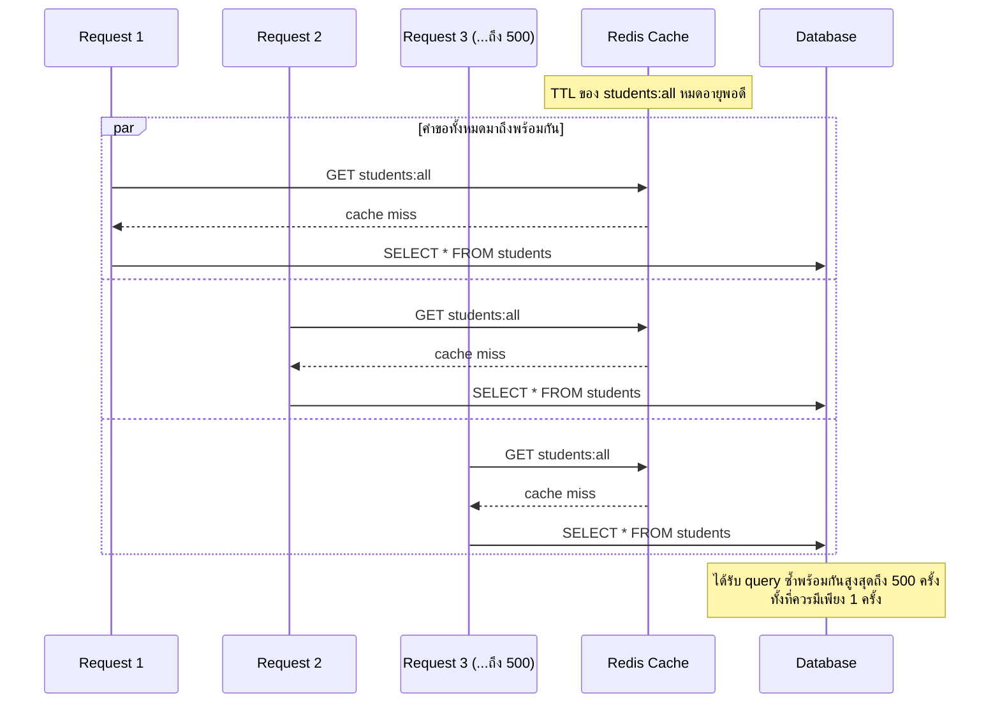

# สัปดาห์ที่ 7: Caching, Performance & Client-Oriented API Design

## สารบัญ

- [วัตถุประสงค์การเรียนรู้ประจำสัปดาห์](#วัตถุประสงค์การเรียนรู้ประจำสัปดาห์)
  - [ทำไมสัปดาห์นี้จึงสำคัญ](#ทำไมสัปดาห์นี้จึงสำคัญ)
- [1. Caching: หลักการและการตัดสินใจ](#1-caching-หลักการและการตัดสินใจ)
  - [1.1 ปัญหาที่ Caching แก้ไข](#11-ปัญหาที่-caching-แก้ไข)
  - [1.2 ข้อมูลลักษณะใดที่ควรทำแคช](#12-ข้อมูลลักษณะใดที่ควรทำแคช)
- [2. In-memory Cache กับ Redis](#2-in-memory-cache-กับ-redis)
  - [2.1 In-memory Cache](#21-in-memory-cache)
  - [2.2 Redis](#22-redis)
  - [2.3 ตารางเปรียบเทียบ](#23-ตารางเปรียบเทียบ)
- [3. TTL (Time To Live) และกลยุทธ์การล้างแคช](#3-ttl-time-to-live-และกลยุทธ์การล้างแคช)
  - [3.1 TTL คืออะไร](#31-ttl-คืออะไร)
  - [3.2 กลยุทธ์ Cache Invalidation](#32-กลยุทธ์-cache-invalidation)
  - [3.3 ตัวอย่างการทำ Explicit Invalidation](#33-ตัวอย่างการทำ-explicit-invalidation)
  - [3.4 Cache Stampede: ปัญหาที่พบบ่อยเมื่อ TTL หมดอายุพร้อมกันจำนวนมาก](#34-cache-stampede-ปัญหาที่พบบ่อยเมื่อ-ttl-หมดอายุพร้อมกันจำนวนมาก)
- [4. Pagination, Filtering และ Sorting](#4-pagination-filtering-และ-sorting)
  - [4.1 ปัญหาของการคืนข้อมูลทั้งหมดในคราวเดียว](#41-ปัญหาของการคืนข้อมูลทั้งหมดในคราวเดียว)
  - [4.2 Pagination](#42-pagination)
  - [4.3 Filtering](#43-filtering)
  - [4.4 Sorting](#44-sorting)
  - [4.5 การรวม Pagination, Filtering และ Sorting เข้าด้วยกัน](#45-การรวม-pagination-filtering-และ-sorting-เข้าด้วยกัน)
- [5. API Versioning](#5-api-versioning)
  - [5.1 เหตุใดจึงต้องทำ Versioning](#51-เหตุใดจึงต้องทำ-versioning)
  - [5.2 กลยุทธ์การทำ Versioning ที่พบบ่อย](#52-กลยุทธ์การทำ-versioning-ที่พบบ่อย)
  - [5.3 ตัวอย่างการรองรับสองเวอร์ชันพร้อมกัน](#53-ตัวอย่างการรองรับสองเวอร์ชันพร้อมกัน)
- [สรุปเนื้อหาสำคัญ](#สรุปเนื้อหาสำคัญ)
- [เอกสารอ้างอิง (Reference)](#เอกสารอ้างอิง-reference)
- [คำถามท้ายบท](#คำถามท้ายบท)

## วัตถุประสงค์การเรียนรู้ประจำสัปดาห์

เมื่อเรียนจบเนื้อหาในสัปดาห์นี้ นิสิตจะสามารถ

1. อธิบายหลักการทำงานของ Caching และตัดสินใจได้ว่าข้อมูลลักษณะใดควรทำแคช
2. เปรียบเทียบข้อดีข้อเสียระหว่าง In-memory Cache และ Redis ได้
3. Implement ระบบแคชพร้อมกำหนดอายุข้อมูล (TTL) ได้
4. ออกแบบและ implement Pagination, Filtering และ Sorting สำหรับ API ได้
5. อธิบายและประยุกต์ใช้กลยุทธ์การทำ Versioning สำหรับ API ได้

หัวข้อนี้สอดคล้องกับ CLO5 และ CLO6

ดูคู่มืออ้างอิงคำสั่ง Redis ที่ใช้บ่อย (เปิดดูเวลาเขียนโค้ด ไม่ต้องไล่อ่านเนื้อหาเต็ม) ได้ที่ [ref-redis.md](ref-redis.md)

### ทำไมสัปดาห์นี้จึงสำคัญ

สัปดาห์ที่ 1-6 ที่ผ่านมาเน้นให้ API **"ทำงานถูกต้อง"** (correctness) — เขียนข้อมูลได้ อ่านข้อมูลได้ มี Authentication/Authorization ที่ปลอดภัย แต่ระบบที่ "ถูกต้อง" อย่างเดียวยังไม่พร้อมใช้งานจริงกับผู้ใช้จำนวนมาก ลองจินตนาการสถานการณ์ต่อไปนี้ซึ่งเป็นสิ่งที่เกิดขึ้นจริงกับระบบที่ไม่ได้เตรียมเนื้อหาสัปดาห์นี้ไว้

- **ไม่มี Caching**: หน้าเว็บแสดงรายชื่อรายวิชาถูกเปิดดูหลายพันครั้งต่อวัน ทั้งที่รายวิชาแทบไม่เปลี่ยนแปลงเลย แต่เซิร์ฟเวอร์ query ฐานข้อมูลซ้ำทุกครั้งโดยไม่จำเป็น จนฐานข้อมูลรับภาระหนักเกินความจำเป็นและอาจล่มในช่วงเวลาที่มีคนใช้งานพร้อมกันมาก (เช่น ช่วงลงทะเบียนเรียน)
- **ไม่มี Pagination**: endpoint คืนข้อมูลนักศึกษาทั้งหมดในคำขอเดียวเสมอ เมื่อข้อมูลเพิ่มจากหลักสิบเป็นหลักหมื่นระเบียน แอปพลิเคชันฝั่ง client (เช่นมือถือที่เน็ตช้า) อาจค้างหรือ crash เพราะต้องโหลดและ render ข้อมูลจำนวนมหาศาลในครั้งเดียว
- **ไม่มี Versioning**: ทีมพัฒนาต้องการปรับโครงสร้างข้อมูลที่ API คืนกลับ (เช่น เปลี่ยนจาก `name` เป็น `firstName`/`lastName`) แต่มี mobile app เวอร์ชันเก่าที่ผู้ใช้หลายพันคนยังไม่อัปเดตอยู่ หากแก้ API โดยตรงโดยไม่ทำ versioning แอปเวอร์ชันเก่าจะหยุดทำงานทันทีสำหรับผู้ใช้ทุกคน

ทั้งสามตัวอย่างชี้ให้เห็นหลักการเดียวกัน คือ **API ที่ "ถูกต้อง" ในวันที่มีผู้ใช้คนเดียว อาจ "ใช้งานไม่ได้" ในวันที่มีผู้ใช้จริงหลักพันหลักหมื่นคน** เนื้อหาสัปดาห์นี้ทั้งหมด (Caching, Pagination/Filtering/Sorting, Versioning) คือชุดเทคนิคมาตรฐานที่ backend developer ทุกคนต้องรู้เพื่อทำให้ API พร้อมสำหรับการใช้งานจริง (production-ready) ไม่ใช่แค่ทำงานถูกต้องในสภาพแวดล้อมทดสอบเท่านั้น

---

## 1. Caching: หลักการและการตัดสินใจ

### 1.1 ปัญหาที่ Caching แก้ไข

ทุกครั้งที่มีคำขอ `GET /api/v1/students` เซิร์ฟเวอร์ต้อง query ฐานข้อมูลใหม่ทุกครั้ง แม้ข้อมูลจะไม่ได้เปลี่ยนแปลงเลยระหว่างคำขอที่ติดกัน การ query ฐานข้อมูลซ้ำ ๆ โดยไม่จำเป็นสิ้นเปลืองทรัพยากรและเพิ่มเวลาตอบสนอง (response time) โดยเฉพาะเมื่อมีผู้ใช้งานจำนวนมากพร้อมกัน

Caching คือการเก็บผลลัพธ์ที่คำนวณหรือดึงมาแล้วไว้ในที่ที่เข้าถึงได้เร็วกว่า (เช่น หน่วยความจำ) เพื่อนำกลับมาใช้ซ้ำโดยไม่ต้องประมวลผลใหม่ทั้งหมด

```
ไม่มี Cache:
Request → Server → Query Database → Response  (ทุกครั้งช้าเท่ากัน)

มี Cache:
Request 1 → Server → Query Database → เก็บผลลัพธ์ใน Cache → Response
Request 2 → Server → พบข้อมูลใน Cache → Response ทันที (เร็วกว่ามาก)
```

### 1.2 ข้อมูลลักษณะใดที่ควรทำแคช

| ควรทำแคช                                        | ไม่ควรทำแคช (หรือต้องระมัดระวังเป็นพิเศษ)                                                    |
| ----------------------------------------------- | -------------------------------------------------------------------------------------------- |
| ข้อมูลที่เปลี่ยนแปลงไม่บ่อย เช่น รายชื่อรายวิชา | ข้อมูลที่เปลี่ยนแปลงตลอดเวลา เช่น ยอดคงเหลือบัญชีธนาคาร                                      |
| ข้อมูลที่ถูกเรียกดูบ่อยครั้ง (read-heavy)       | ข้อมูลที่เขียนบ่อยกว่าอ่าน (write-heavy)                                                     |
| ผลลัพธ์จากการคำนวณที่ใช้เวลานาน                 | ข้อมูลเฉพาะบุคคลที่มีความอ่อนไหว เช่น ข้อมูลส่วนตัวที่ไม่ควรถูกแชร์ข้าม session โดยไม่ตั้งใจ |
| ข้อมูลสาธารณะที่ทุกคนเห็นเหมือนกัน              | ข้อมูลที่ต้องถูกต้องแบบ real-time เสมอ (strong consistency)                                  |

หลักการสำคัญคือต้องยอมรับได้ว่าข้อมูลที่แคชไว้อาจไม่ตรงกับข้อมูลล่าสุดในฐานข้อมูลเสมอไป (eventual consistency) ความหน่วงของข้อมูลที่ยอมรับได้ (staleness) นี้ขึ้นอยู่กับลักษณะของระบบแต่ละประเภท

> **ข้อแนะนำ**: หลักการเลือกข้อมูลที่ควรทำแคชสรุปโดยย่อได้ด้วยคำถาม 2 ข้อ (1) "ข้อมูลนี้ถูก**อ่าน**บ่อยกว่าถูก**เขียน**มากน้อยเพียงใด" (read-to-write ratio ยิ่งสูงยิ่งคุ้มค่าทำแคช) และ (2) "หากผู้ใช้เห็นข้อมูลที่ล้าสมัยไปสักครู่ จะเกิดความเสียหายร้ายแรงหรือไม่" หากคำตอบคือ "ไม่เสียหายมาก" (เช่น รายชื่อรายวิชา) ควรทำแคช แต่หากคำตอบคือ "เสียหายมาก" (เช่น ยอดเงินคงเหลือ สถานะการชำระเงิน) ไม่ควรทำแคชหรือต้องใช้ TTL ที่สั้นมากเป็นพิเศษ

---

## 2. In-memory Cache กับ Redis

> โค้ดตัวอย่างตั้งแต่หัวข้อนี้เป็นต้นไปใช้ `async`/`await` และ Promise นิสิตที่ยังไม่เข้าใจให้อ่าน [wk07-async-await-essential.md](wk07-async-await-essential.md) ประกอบ

### 2.1 In-memory Cache

In-memory Cache คือการเก็บข้อมูลแคชไว้ในหน่วยความจำของโปรเซส Node.js เอง วิธีที่ง่ายที่สุดคือใช้ `Map` ของ JavaScript โดยตรง แต่จะต้องเขียนกลไกหมดอายุ (TTL) เอง ในทางปฏิบัติจึงนิยมใช้ไลบรารีสำเร็จรูปอย่าง `node-cache` ซึ่งจัดการ TTL และการลบ key ที่หมดอายุให้อัตโนมัติ ติดตั้งด้วย

```bash
npm install node-cache
```

```javascript
// cache.js
const NodeCache = require("node-cache");

// stdTTL: อายุ default ของทุก key (วินาที), checkperiod: รอบการกวาด key หมดอายุทิ้ง
const cache = new NodeCache({ stdTTL: 60, checkperiod: 120 });

module.exports = cache;
```

#### Cache key

แคชทำงานแบบ key-value ทุกครั้งที่เก็บข้อมูลต้องกำหนด **cache key** ซึ่งเป็น string ที่ผู้พัฒนากำหนดขึ้นเพื่ออ้างอิงข้อมูลชิ้นนั้น (แนวคิดเดียวกับ key ใน `Map` หรือชื่อตัวแปร) การดึงข้อมูลกลับมาใช้ key เดิม และการลบข้อมูลเมื่อข้อมูลต้นทางเปลี่ยนก็ใช้ key เดิมเช่นกัน

ตัว string จะเป็นอะไรก็ได้ แต่ธรรมเนียมที่นิยมคือใช้ `:` คั่นเป็นลำดับชั้นเพื่อให้อ่านเข้าใจและกัน key ชนกัน เช่น

| cache key           | ข้อมูลที่อ้างถึง         |
| ------------------- | ------------------------ |
| `students:all`      | รายชื่อนิสิตทั้งหมด      |
| `students:page:2`   | รายชื่อนิสิตหน้าที่ 2    |
| `students:major:CS` | รายชื่อนิสิตเฉพาะสาขา CS |
| `student:42`        | ข้อมูลนิสิตคนเดียว id 42 |

ในเอกสารนี้จึงใช้ `students:all` เป็น key ของ "รายชื่อนิสิตทั้งหมด" ตลอดทุกตัวอย่าง

การใช้งานพื้นฐาน `set` / `get` / `del`

```javascript
const cache = require("./cache");

cache.set("students:all", studentsData); // ใช้ TTL default (60 วินาที)
cache.set("courses:list", coursesData, 3600); // กำหนด TTL เฉพาะ key นี้เป็น 1 ชั่วโมง

const cachedData = cache.get("students:all"); // ได้ข้อมูลเดิม หรือ undefined ถ้าไม่มี/หมดอายุ

cache.del("students:all"); // ลบทิ้งเมื่อข้อมูลต้นทางเปลี่ยน
cache.del(["students:all", "students:page:1"]); // ลบหลาย key พร้อมกัน
```

ตัวอย่างการใช้งานใน route handler (รูปแบบ cache-aside: ตรวจสอบแคชก่อน หากไม่พบจึง query ฐานข้อมูลแล้วเก็บผลลัพธ์ลงแคช)

```javascript
const cache = require("./cache");

app.get("/api/v1/students", async (req, res, next) => {
  try {
    const cacheKey = "students:all";
    const cached = cache.get(cacheKey);
    if (cached) {
      return res.status(200).json({ message: "สำเร็จ (จากแคช)", data: cached });
    }

    const [rows] = await pool.query("SELECT * FROM students");
    cache.set(cacheKey, rows); // เก็บลงแคชด้วย TTL default
    res.status(200).json({ message: "สำเร็จ", data: rows });
  } catch (err) {
    next(err);
  }
});

// เมื่อข้อมูลเปลี่ยน ต้องล้างแคชที่เกี่ยวข้อง
app.post("/api/v1/students", async (req, res, next) => {
  try {
    // ... เพิ่มข้อมูลนิสิตลงฐานข้อมูล ...
    cache.del("students:all");
    res.status(201).json({ message: "เพิ่มข้อมูลสำเร็จ", data: newStudent });
  } catch (err) {
    next(err);
  }
});
```

รูปแบบ cache-aside ข้างต้นเหมือนกับที่ใช้กับ Redis ในหัวข้อ 2.2 ต่างกันเพียง `cache.get()`/`cache.set()` ของ `node-cache` เป็น synchronous (ไม่ต้อง `await`) และเก็บ object ได้โดยตรง ไม่ต้องใช้ `JSON.stringify`/`JSON.parse` เหมือน Redis

**ข้อดี:** ติดตั้งง่าย ไม่ต้องพึ่งพาระบบภายนอก เข้าถึงข้อมูลได้เร็วมากเนื่องจากอยู่ในหน่วยความจำเดียวกับแอปพลิเคชัน

**ข้อจำกัด:** ข้อมูลหายทันทีเมื่อรีสตาร์ตเซิร์ฟเวอร์ และหากรันเซิร์ฟเวอร์หลายอินสแตนซ์ (เช่น ใช้ load balancer กระจายคำขอ) แต่ละอินสแตนซ์จะมีแคชแยกจากกัน ทำให้ข้อมูลไม่สอดคล้องกันระหว่างอินสแตนซ์

> **อ่านเพิ่มเติม**: เอกสาร `node-cache` (เมท็อด `set`/`get`/`del`/`flushAll`, event, ตัวเลือก config) — https://github.com/node-cache/node-cache#readme

### 2.2 Redis

Redis คือฐานข้อมูลประเภท key-value store ที่ทำงานในหน่วยความจำ (in-memory data store) แต่**แยกเป็นระบบต่างหาก**จากแอปพลิเคชัน ทำให้หลายอินสแตนซ์ของแอปพลิเคชันสามารถแชร์แคชชุดเดียวกันได้

การใช้ Redis จากโค้ด Node.js แบ่งเป็น 3 ขั้น (1) ติดตั้งไลบรารีและสร้าง client (2) เชื่อมต่อ Redis ให้สำเร็จก่อนเปิดเซิร์ฟเวอร์ (3) เรียก `get`/`set`/`del` ใน route handler

**ขั้นที่ 1: ติดตั้งไลบรารีและสร้าง client**

ต่างจาก `node-cache` ที่เป็นหน่วยความจำในโปรเซสเดียวกัน Redis เป็นเซิร์ฟเวอร์แยกต่างหาก โค้ด Node.js จึงต้องมี "client" ไว้เป็นตัวกลางสื่อสารกับ Redis ผ่านเครือข่าย client ที่ใช้คือ package `redis` (ชื่อ repo คือ node-redis)

> **หมายเหตุเรื่องเวอร์ชัน**: `npm install redis` ปัจจุบันได้ node-redis เวอร์ชัน 4 ขึ้นไป ("v4+") ซึ่งเปลี่ยน API จากเวอร์ชัน 3 อย่างมาก จุดสำคัญคือ (1) ต้องเรียก `await redisClient.connect()` เองก่อนใช้งาน (v3 ต่อให้อัตโนมัติ) (2) ทุกคำสั่งคืนค่าเป็น Promise ใช้ `await` ได้ (v3 ใช้ callback) (3) ตั้ง TTL ด้วย object `{ EX: 60 }` (v3 ใช้ `"EX", 60`) หากพบโค้ดตัวอย่างบนอินเทอร์เน็ตที่ใช้ callback หรือไม่เรียก `connect()` นั่นคือสไตล์ v3 ซึ่งใช้กับตัวอย่างในเอกสารนี้ไม่ได้

```bash
npm install redis
```

```javascript
// cache.js
require("dotenv").config();
const { createClient } = require("redis");

// สร้าง client ชี้ไปที่ Redis server (ที่อยู่มาจาก .env หรือใช้ค่า default คือ localhost พอร์ต 6379)
const redisClient = createClient({
  url: process.env.REDIS_URL || "redis://localhost:6379",
});

// ดักจับ error จาก client (เช่น การเชื่อมต่อหลุด) ไม่ให้โปรเซสล่ม
redisClient.on("error", (err) => console.error("Redis Client Error", err));

// ฟังก์ชันสำหรับเปิดการเชื่อมต่อไปยัง Redis server — ต้องเรียกครั้งเดียวตอนเริ่มระบบ
async function connectRedis() {
  await redisClient.connect();
  console.log("เชื่อมต่อ Redis สำเร็จ");
}

// export ทั้ง client (ไว้ get/set) และฟังก์ชัน connect (ไว้เรียกใน index.js)
module.exports = { redisClient, connectRedis };
```

**ขั้นที่ 2: เชื่อมต่อ Redis ให้สำเร็จก่อนเปิดเซิร์ฟเวอร์**

`redisClient.connect()` ทำงานแบบ asynchronous (คืนค่าเป็น Promise) หากเปิดเซิร์ฟเวอร์รับคำขอทันทีโดยไม่รอให้เชื่อมต่อเสร็จ คำขอที่เข้ามาช่วงนั้นจะเรียก `redisClient` ทั้งที่การเชื่อมต่อกับ Redis server ยังไม่เสร็จสมบูรณ์ ทำให้เกิด error จึงต้องรอ `connectRedis()` ให้เสร็จก่อน แล้วจึงเรียก `app.listen`

```javascript
// index.js
const { redisClient, connectRedis } = require("./cache");

// เดิม (สัปดาห์ที่ 1-6): เรียก app.listen โดยตรงเพียงบรรทัดเดียว
// app.listen(PORT, () => console.log(`Server กำลังทำงานที่พอร์ต ${PORT}`));

// สัปดาห์นี้: ย้าย app.listen มาไว้ใน .then() ของ connectRedis
connectRedis().then(() => {
  // บรรทัดนี้ทำงานหลัง connectRedis เสร็จแล้วเท่านั้น
  app.listen(PORT, () => console.log(`Server กำลังทำงานที่พอร์ต ${PORT}`));
});
```

ส่วนอื่นของ `index.js` (การ `require`, การตั้ง middleware, การ mount route) เหมือนสัปดาห์ที่ 1-6 ทุกประการ เปลี่ยนเฉพาะบรรทัดสุดท้ายที่เรียก `app.listen` เท่านั้น

ตัวอย่างนี้ใช้ `.then()` เนื่องจากโค้ดระดับบนสุดของ `index.js` ไม่ได้อยู่ใน `async function` จึงใช้ `await` โดยตรงไม่ได้ หากไฟล์เริ่มต้นของโปรเจกต์ห่อด้วย async function อยู่แล้ว จะเขียน `await connectRedis()` ก่อน `app.listen` แทนได้ โดยให้ผลเหมือนกัน (ความแตกต่างระหว่าง `.then()` กับ `await` และเหตุผลที่ต้องใช้แต่ละแบบ อธิบายไว้ใน [wk07-async-await-essential.md](wk07-async-await-essential.md) หัวข้อ 4)

**ขั้นที่ 3: เรียกใช้ใน route handler**

หลังจากขั้นที่ 2 ผ่านแล้ว `redisClient` พร้อมใช้งานในทุก route handler ทุกคำสั่งเป็น asynchronous จึงต้อง `await` และเนื่องจาก Redis เก็บข้อมูลเป็น string เท่านั้น ต้องแปลง object เป็น string ด้วย `JSON.stringify` เมื่อเก็บ และแปลงกลับด้วย `JSON.parse` เมื่ออ่าน (ต่างจาก `node-cache` ที่เก็บ object ได้โดยตรง)

โครงสร้างเป็นแบบ cache-aside เหมือนหัวข้อ 2.1 เพียงเปลี่ยนจาก `node-cache` เป็น `redisClient` (ต้อง `await` ทุกคำสั่ง และแปลงข้อมูลด้วย `JSON.stringify`/`JSON.parse` เอง)

```javascript
const { redisClient } = require("./cache");

app.get("/api/v1/students", async (req, res, next) => {
  try {
    const cacheKey = "students:all";
    const cached = await redisClient.get(cacheKey);
    if (cached) {
      // ถ้ามี key นี้ในแคช ให้ parse string กลับเป็น object แล้วตอบกลับทันที ไม่ต้อง query
      return res
        .status(200)
        .json({ message: "สำเร็จ (จากแคช)", data: JSON.parse(cached) });
    }

    const [rows] = await pool.query("SELECT * FROM students");
    // เก็บลงแคชเป็น string พร้อมตั้งหมดอายุ 60 วินาที
    await redisClient.set(cacheKey, JSON.stringify(rows), { EX: 60 });
    res.status(200).json({ message: "สำเร็จ", data: rows });
  } catch (err) {
    next(err);
  }
});

// เมื่อข้อมูลเปลี่ยน ต้องล้างแคชที่เกี่ยวข้อง (ดูหัวข้อ 3.3)
app.post("/api/v1/students", async (req, res, next) => {
  try {
    // ... เพิ่มข้อมูลนิสิตลงฐานข้อมูล ...
    await redisClient.del("students:all");
    res.status(201).json({ message: "เพิ่มข้อมูลสำเร็จ", data: newStudent });
  } catch (err) {
    next(err);
  }
});
```

> **Pitfall ที่พบบ่อย**: หากมี request เรียก `redisClient.get()`/`set()` ทั้งที่ยังเชื่อมต่อ Redis ไม่สำเร็จ (ลืมทำขั้นที่ 2) node-redis v4+ จะโยน `ClientClosedError` ทันที request นั้นจึงตกไปที่ error handler และคืน 500 — คนละกรณีกับการที่ Redis เคยต่อติดแล้วหลุดชั่วคราว ซึ่ง node-redis จะเข้าคิวคำสั่งไว้ (offline queue) และ reconnect ให้เอง

> **อ่านเพิ่มเติม**:
>
> - node-redis (client library ที่ใช้ในหัวข้อนี้) — คู่มือ `connect`, การจัดการ reconnect, คำสั่งทั้งหมด: https://github.com/redis/node-redis
> - Redis — `SET` พร้อมตัวเลือก `EX`/`PX`/`NX` และการทำงานของ TTL: https://redis.io/docs/latest/commands/set/
> - Redis — แนวคิด key expiration และนโยบาย eviction เมื่อหน่วยความจำเต็ม: https://redis.io/docs/latest/develop/using-commands/keyspace/

แผนภาพต่อไปนี้แสดงเหตุผลที่ตารางในหัวข้อ 2.3 สรุปว่า In-memory Cache "ไม่รองรับ" การแชร์ระหว่างหลายอินสแตนซ์ ในขณะที่ Redis "รองรับ"


ฝั่ง In-memory Cache คำขอที่ไปตกที่ App Instance 2 จะไม่พบ `students:all` ในแคชเลย (cache miss) แม้ Instance 1 เพิ่ง query ฐานข้อมูลไปก่อนหน้านั้นไม่นาน เพราะแคชของแต่ละอินสแตนซ์แยกจากกันโดยสิ้นเชิง ส่วนฝั่ง Redis ทั้งสองอินสแตนซ์อ่าน/เขียนแคชชุดเดียวกันที่ Redis จึงเห็นข้อมูลตรงกันเสมอไม่ว่า load balancer จะส่งคำขอไปที่อินสแตนซ์ใด

### 2.3 ตารางเปรียบเทียบ

| หัวข้อ                         | In-memory Cache                     | Redis                                 |
| ------------------------------ | ----------------------------------- | ------------------------------------- |
| ความเร็วในการเข้าถึง           | เร็วที่สุด (อยู่ในโปรเซสเดียวกัน)   | เร็วมาก (ต้องผ่านเครือข่ายภายใน)      |
| การแชร์ระหว่างหลายอินสแตนซ์    | ไม่รองรับ                           | รองรับ                                |
| ความคงทนของข้อมูลเมื่อรีสตาร์ต | หายทันที                            | สามารถตั้งค่าให้บันทึกถาวรได้         |
| ความซับซ้อนในการติดตั้ง        | ต่ำ                                 | ปานกลาง (ต้องมีเซิร์ฟเวอร์ Redis แยก) |
| ความเหมาะสม                    | โปรเจกต์ขนาดเล็ก มีเซิร์ฟเวอร์เดียว | ระบบที่ต้อง scale หลายอินสแตนซ์       |

สำหรับระบบที่คาดว่าจะขยายขนาด (scale) ในอนาคต ควรเลือกใช้ Redis ตั้งแต่ต้น เนื่องจากการย้ายจาก In-memory Cache ไปเป็น Redis ภายหลังต้องปรับโครงสร้างโค้ดพอสมควร

---

## 3. TTL (Time To Live) และกลยุทธ์การล้างแคช

### 3.1 TTL คืออะไร

TTL คือระยะเวลาที่ข้อมูลในแคชจะยังคงถูกต้องก่อนจะถูกลบหรือถือว่าหมดอายุโดยอัตโนมัติ การกำหนด TTL ที่เหมาะสมเป็นความสมดุลระหว่างความสดใหม่ของข้อมูล (freshness) และประสิทธิภาพ

```javascript
// TTL สั้น: ข้อมูลใหม่เร็ว แต่ประโยชน์จากแคชน้อยลง
await redisClient.set("dashboard:stats", data, { EX: 10 });

// TTL ยาว: ประหยัดการ query มากขึ้น แต่ข้อมูลอาจไม่ทันสมัย
await redisClient.set("courses:list", data, { EX: 3600 });
```

### 3.2 กลยุทธ์ Cache Invalidation

เมื่อข้อมูลต้นทางเปลี่ยนแปลง (เช่น มีการเพิ่มนิสิตใหม่) แคชเดิมจะกลายเป็นข้อมูลที่ล้าสมัย จึงต้องมีกลยุทธ์ในการล้างแคช (invalidation)

| กลยุทธ์               | คำอธิบาย                                                                                  |
| --------------------- | ----------------------------------------------------------------------------------------- |
| Time-based (TTL)      | ปล่อยให้แคชหมดอายุเองตามเวลาที่กำหนด เรียบง่ายที่สุดแต่ข้อมูลอาจไม่ทันสมัยจนกว่าจะหมดอายุ |
| Write-through         | ทุกครั้งที่มีการเขียนข้อมูลใหม่ ให้อัปเดตแคชทันทีพร้อมกับฐานข้อมูล                        |
| Explicit invalidation | ลบ key ของแคชที่เกี่ยวข้องทันทีเมื่อมีการเปลี่ยนแปลงข้อมูลต้นทาง                          |

### 3.3 ตัวอย่างการทำ Explicit Invalidation

```javascript
app.post("/api/v1/students", async (req, res, next) => {
  // ... โค้ดเพิ่มข้อมูลนิสิตลงฐานข้อมูล ...

  // ล้างแคชที่เกี่ยวข้อง เนื่องจากข้อมูลเปลี่ยนแปลงแล้ว
  await redisClient.del("students:all");

  res.status(201).json({ message: "เพิ่มข้อมูลสำเร็จ", data: newStudent });
});
```

หากไม่ล้างแคชหลังจากมีการเปลี่ยนแปลงข้อมูล ผู้ใช้จะยังคงเห็นข้อมูลเก่าจนกว่า TTL จะหมดอายุ ซึ่งอาจสร้างความสับสนได้ในระบบที่ผู้ใช้คาดหวังให้เห็นผลการเปลี่ยนแปลงทันที

### 3.4 Cache Stampede: ปัญหาที่พบบ่อยเมื่อ TTL หมดอายุพร้อมกันจำนวนมาก

> **ขอบเขต**: หัวข้อนี้อ่านเพื่อรู้ไว้ ไม่ต้อง implement ในแล็บหรือสอบปฏิบัติสัปดาห์นี้ (รายละเอียดขอบเขตอยู่ท้ายหัวข้อ)

หัวข้อนี้เป็นจุดที่นิสิตมักมองข้าม เพราะโค้ดตัวอย่างในหัวข้อ 3.3 ดูเหมือนทำงานถูกต้องสมบูรณ์แล้ว แต่ยังมีช่องโหว่ด้านประสิทธิภาพที่แสดงผลเฉพาะเมื่อระบบมีผู้ใช้พร้อมกันจำนวนมาก

**แนวคิด**: Cache Stampede (หรือ Thundering Herd) เกิดขึ้นเมื่อแคชของ key ที่มีความนิยมสูงหมดอายุพอดี และมีคำขอจำนวนมากมาถึงพร้อมกันในช่วงเวลานั้น เนื่องจากทุกคำขอตรวจสอบแคชแล้วพบว่าไม่มีข้อมูล (cache miss) จึงพากัน query ฐานข้อมูลพร้อมกันทั้งหมด แทนที่จะมีเพียงคำขอเดียวที่ไป query แล้วคำขอที่เหลือรอใช้ผลลัพธ์เดียวกัน

**เหตุผล**: โค้ดในหัวข้อ 2.3 (ตรวจสอบแคช → หากไม่พบให้ query ฐานข้อมูล) ไม่มีกลไกป้องกันกรณีที่หลายคำขอมาถึง "พร้อมกัน" ในช่วงเวลาสั้น ๆ ระหว่างที่แคชยังว่างอยู่ ทุกคำขอจะเห็นแคชว่างเหมือนกันและต่างก็ query ฐานข้อมูลเอง


**ตัวอย่าง**: สมมติ endpoint ยอดนิยมมีผู้ใช้เรียกพร้อมกัน 500 requests ต่อวินาที และ TTL ของแคชตั้งไว้ 60 วินาที เมื่อแคชหมดอายุพอดี ฐานข้อมูลอาจได้รับ query พร้อมกันสูงสุดถึง 500 คำสั่งในเสี้ยววินาทีเดียว ทั้งที่ควรมีเพียง 1 query เท่านั้น



**แนวทางบรรเทาปัญหาเบื้องต้น** (แนวคิดขั้นสูงกว่าที่ implement ในแล็บสัปดาห์นี้ แต่ควรทราบว่ามีอยู่):

| แนวทาง                 | คำอธิบายสั้น                                                                                                                                                                                                                               |
| ---------------------- | ------------------------------------------------------------------------------------------------------------------------------------------------------------------------------------------------------------------------------------------ |
| Jitter ใน TTL          | สุ่มค่า TTL เล็กน้อย (เช่น `EX: 60 + Math.floor(Math.random() * 10)`) เพื่อไม่ให้ key จำนวนมากหมดอายุพร้อมกัน วิธีนี้ทำง่ายที่สุดและไม่ต้องแก้ตรรกะการอ่านแคช แต่เป็นเพียงการกระจายภาระ ไม่ได้ป้องกัน stampede ของ key เดี่ยวที่ยอดนิยมมาก |
| Locking / Mutex        | ให้เฉพาะคำขอแรกที่พบ cache miss ไป query ฐานข้อมูล ส่วนคำขออื่นรอผลลัพธ์จากคำขอแรก ป้องกันได้ตรงจุดที่สุด แต่เพิ่มความซับซ้อนและต้องจัดการกรณีล็อกค้าง (ดูคำอธิบายขั้นตอนใต้ตาราง)                                                         |
| Stale-while-revalidate | ยังคงส่งข้อมูลเก่าที่หมดอายุแล้วกลับไปก่อน พร้อมกับ query ฐานข้อมูลเพื่ออัปเดตแคชในเบื้องหลัง ผู้ใช้ไม่ต้องรอ query เลย แลกกับการยอมรับข้อมูลล้าสมัยชั่วคราว และต้องเก็บทั้งค่าข้อมูลกับ timestamp ของความสดไว้ในแคช                       |

**ขยายความแนวทาง Locking / Mutex**

ปัญหาของ Cache Stampede คือ "หลายคำขอเห็น cache miss พร้อมกัน แล้วต่างก็ไป query ฐานข้อมูลเอง" แนวทางนี้จึงเพิ่มขั้นกันไม่ให้คำขอที่เกินมา query ซ้ำ โดยใช้กุญแจ (lock) ตัวหนึ่งใน Redis เป็นตัวตัดสินว่าใครได้เป็นคนไป query

ลำดับการทำงานเมื่อเกิด cache miss

1. คำขอลองสร้าง lock ด้วย `SET lock:students:all 1 NX EX 10` คำสั่งนี้จะสำเร็จ (ได้ `OK`) เฉพาะเมื่อยังไม่มี key นี้อยู่ (`NX` = set if Not eXists) และให้ lock หมดอายุเองใน 10 วินาที (`EX 10`) กันล็อกค้าง
2. คำขอที่สร้าง lock สำเร็จ = "ผู้ชนะ" ไป query ฐานข้อมูล เขียนผลลง cache แล้วลบ lock
3. คำขออื่นที่สร้าง lock ไม่สำเร็จ (มีคนถือ lock อยู่แล้ว) ให้รอสั้น ๆ (เช่น 50-100 มิลลิวินาที) แล้ววนกลับไปอ่าน cache ใหม่ ซึ่งตอนนี้ผู้ชนะน่าจะเขียนผลไว้แล้ว
4. หากผู้ชนะล่มกลางคันก่อนลบ lock ตัว `EX 10` จะทำให้ lock หายเองใน 10 วินาที คำขอถัดไปจึงมีโอกาสได้เป็นผู้ชนะคนใหม่ ระบบไม่ค้างถาวร

ผลคือฐานข้อมูลได้รับ query เพียง 1 ครั้งต่อการหมดอายุของ key หนึ่งครั้ง แทนที่จะเป็นหลายร้อยครั้ง ราคาที่จ่ายคือโค้ดอ่านแคชซับซ้อนขึ้น (ต้องมี loop รอและ retry) และคำขอที่ไม่ใช่ผู้ชนะจะช้าลงเล็กน้อยจากการรอ

> **ข้อควรระวัง**: รายวิชานี้ implement เฉพาะแคชแบบพื้นฐานตามหัวข้อ 2.2-2.3 เพื่อเน้นความเข้าใจหลักการของ TTL และ Invalidation ก่อน แนวทางป้องกัน Cache Stampede เป็นหัวข้อขั้นสูงที่นิสิตควรทราบว่ามีอยู่ แต่ไม่อยู่ในขอบเขตการประเมินผลของแล็บและสอบปฏิบัติสัปดาห์นี้

---

## 4. Pagination, Filtering และ Sorting

### 4.1 ปัญหาของการคืนข้อมูลทั้งหมดในคราวเดียว

หากตาราง `students` มีข้อมูลนับหมื่นระเบียน การคืนค่าทั้งหมดในคำขอ `GET /api/v1/students` เพียงครั้งเดียวจะทำให้ response มีขนาดใหญ่ ใช้เวลาส่งข้อมูลนาน และสิ้นเปลืองทรัพยากรทั้งฝั่งเซิร์ฟเวอร์และไคลเอนต์โดยไม่จำเป็น

### 4.2 Pagination

Pagination คือการแบ่งข้อมูลออกเป็นหน้า ๆ แล้วส่งกลับทีละหน้า client ระบุว่าต้องการหน้าที่เท่าใด (`page`) และหน้าละกี่รายการ (`limit`) เซิร์ฟเวอร์แปลงค่าทั้งสองเป็น `LIMIT` (จำนวนแถวที่ดึง) และ `OFFSET` (จำนวนแถวที่ข้ามจากต้นตาราง) ด้วยสูตร `offset = (page - 1) * limit` ตัวอย่างเช่น `page=3, limit=10` หมายถึงการข้าม 20 แถวแรก แล้วดึง 10 แถวถัดไป

นอกจากข้อมูลของหน้าปัจจุบัน ควรส่ง metadata กลับไปด้วย (`total`, `totalPages`) เพื่อให้ client รู้ว่ามีข้อมูลทั้งหมดกี่รายการและกี่หน้า จึงต้อง query `COUNT(*)` เพิ่มอีกหนึ่งคำสั่ง ค่า `page` ผ่าน `Math.max(1, ...)` และ `limit` ผ่าน `Math.min(100, ...)` เพื่อกันค่าที่ผิดปกติ

```javascript
app.get("/api/v1/students", async (req, res, next) => {
  const page = Math.max(1, parseInt(req.query.page) || 1);
  const limit = Math.min(100, parseInt(req.query.limit) || 10);
  const offset = (page - 1) * limit;

  try {
    const [rows] = await pool.query("SELECT * FROM students LIMIT ? OFFSET ?", [
      limit,
      offset,
    ]);
    const [[{ total }]] = await pool.query(
      "SELECT COUNT(*) AS total FROM students",
    );

    res.status(200).json({
      message: "สำเร็จ",
      data: rows,
      pagination: {
        page,
        limit,
        total,
        totalPages: Math.ceil(total / limit),
      },
    });
  } catch (err) {
    next(err);
  }
});
```

ตัวอย่างคำขอและผลลัพธ์ (สมมติมีนิสิตทั้งหมด 45 คน)

```
GET /api/v1/students?page=2&limit=10
```

```json
{
  "message": "สำเร็จ",
  "data": [
    /* นิสิตลำดับที่ 11-20 */
  ],
  "pagination": { "page": 2, "limit": 10, "total": 45, "totalPages": 5 }
}
```

| คำขอ                                    | ความหมาย               | ผลลัพธ์                     |
| --------------------------------------- | ---------------------- | --------------------------- |
| `GET /api/v1/students`                  | ไม่ระบุค่า ใช้ default | หน้า 1, 10 รายการแรก        |
| `GET /api/v1/students?page=3&limit=10`  | หน้า 3 หน้าละ 10       | รายการที่ 21-30             |
| `GET /api/v1/students?page=5&limit=10`  | หน้าสุดท้าย            | รายการที่ 41-45 (เหลือ 5)   |
| `GET /api/v1/students?page=99&limit=10` | เกินจำนวนหน้าที่มี     | `data: []`, `totalPages: 5` |
| `GET /api/v1/students?limit=9999`       | ระบุค่าเกินเพดาน       | ถูกจำกัดเหลือ 100 รายการ    |

> **ข้อควรระวัง**: ต้องจำกัดค่า `limit` สูงสุดไว้เสมอ (ในตัวอย่างนี้คือ 100) มิฉะนั้นผู้ใช้อาจส่ง `limit=1000000` เพื่อดึงข้อมูลทั้งหมดในคำขอเดียว ซึ่งขัดกับวัตถุประสงค์ของการทำ pagination นอกจากนี้ค่า `limit` และ `offset` ที่ส่งเข้า `pool.query()` ต้องเป็นชนิดตัวเลข (ผ่าน `parseInt` แล้ว) เพราะ `mysql2` จะปฏิเสธค่าชนิดสตริงในตำแหน่ง `LIMIT ?`/`OFFSET ?` ด้วย `ER_WRONG_ARGUMENTS`

> **Pitfall ขั้นสูง — ไม่ต้องแก้ในแล็บสัปดาห์นี้ อ่านเพื่อรู้ไว้พอ**: `LIMIT ? OFFSET ?` เรียกว่า **Offset-based Pagination** ใช้งานง่ายและเพียงพอสำหรับข้อมูลระดับหลักหมื่นระเบียนตามขนาดของโปรเจกต์ `student-api` แต่ฐานข้อมูลต้องอ่านและข้ามระเบียนทั้งหมดตั้งแต่ต้นตารางจนถึงค่า OFFSET ก่อนเสมอ (เช่น `OFFSET 500000` ต้องอ่านผ่าน 500,000 แถวก่อน) ทำให้หน้าท้าย ๆ ของข้อมูลขนาดล้านระเบียนช้าลงเรื่อย ๆ ระบบขนาดใหญ่จึงมักเปลี่ยนไปใช้ **Cursor-based (Keyset) Pagination** แทน (ใช้ `WHERE id > ? ORDER BY id LIMIT ?` แทน OFFSET ทำให้ค้นหาผ่าน index ได้ทันที)

### 4.3 Filtering

Filtering คือการให้ client กรองข้อมูลตามเงื่อนไขผ่าน query string เช่น `?major=วิทยาการคอมพิวเตอร์` เพื่อขอเฉพาะนิสิตสาขานั้น วิธี implement คือเริ่มจาก query พื้นฐาน (`SELECT * FROM students`) แล้ว**ต่อ**ส่วน `WHERE` เข้าไปเฉพาะเมื่อมีพารามิเตอร์การกรองส่งมาจริง

จุดสำคัญคือค่าที่กรอง (`major`) ต้องส่งผ่าน `?` และ array `params` เสมอ ห้ามนำมาต่อสตริง SQL ตรง ๆ เพื่อป้องกัน SQL Injection (ต่างจากชื่อคอลัมน์ใน 4.4 ที่ใช้ `?` ไม่ได้จึงต้องใช้ allowlist แทน) หากรองรับหลายตัวกรอง ให้เพิ่มเงื่อนไขด้วย `AND` และ push ค่าเข้า `params` ตามลำดับ

```javascript
app.get("/api/v1/students", async (req, res, next) => {
  const { major } = req.query;

  let query = "SELECT * FROM students";
  const params = [];

  if (major) {
    query += " WHERE major = ?";
    params.push(major);
  }

  try {
    const [rows] = await pool.query(query, params);
    res.status(200).json({ message: "สำเร็จ", data: rows });
  } catch (err) {
    next(err);
  }
});
```

ตัวอย่างคำขอ

| คำขอ                                             | ความหมาย                   | ผลลัพธ์                           |
| ------------------------------------------------ | -------------------------- | --------------------------------- |
| `GET /api/v1/students`                           | ไม่ระบุตัวกรอง             | นิสิตทุกคน                        |
| `GET /api/v1/students?major=วิทยาการคอมพิวเตอร์` | กรองตามสาขา                | เฉพาะนิสิตสาขาวิทยาการคอมพิวเตอร์ |
| `GET /api/v1/students?major=ไม่มีสาขานี้`        | สาขาที่ไม่มีข้อมูล         | `data: []` (ไม่ใช่ error)         |
| `GET /api/v1/students?name=สมชาย`                | พารามิเตอร์ที่ยังไม่รองรับ | ถูกละเว้น คืนนิสิตทุกคน           |

หมายเหตุ: `major` ที่มีอักษรไทยหรือช่องว่าง เมื่อพิมพ์ใน Postman หรือ browser จะถูก URL-encode อัตโนมัติ (เช่น `major=%E0%B8%A7...`) ฝั่งเซิร์ฟเวอร์ Express จะ decode กลับให้เองใน `req.query.major`

```
GET /api/v1/students?major=วิทยาการคอมพิวเตอร์
```

### 4.4 Sorting

Sorting คือการให้ client เลือกคอลัมน์ที่ใช้เรียงลำดับ (`?sort=name`) และทิศทาง (`?order=desc`) ต่างจาก Filtering ตรงที่สิ่งที่ client ส่งมาคือ**ชื่อคอลัมน์** ซึ่งต้องกลายเป็นส่วนหนึ่งของโครงสร้างคำสั่ง SQL (`ORDER BY <คอลัมน์>`) ไม่ใช่ค่าข้อมูล จึงใช้ `?` แทนไม่ได้

เมื่อใช้ `?` ไม่ได้ ทางแก้ที่ปลอดภัยคือ allowlist: กำหนดรายชื่อคอลัมน์ที่อนุญาตไว้ล่วงหน้า (`ALLOWED_SORT_FIELDS`) หากค่าที่ client ส่งมาไม่อยู่ในลิสต์ ให้ใช้ค่า default (`id`) แทน วิธีนี้รับประกันว่าสตริงที่นำไปต่อ SQL มาจากลิสต์ที่เรากำหนดเองเท่านั้น ไม่ว่า client จะส่งอะไรมา ส่วน `order` จำกัดให้เหลือแค่ `ASC`/`DESC` ด้วยเงื่อนไขเดียว

```javascript
// ต้องมี "id" (ค่า default) อยู่ในลิสต์ด้วย เพื่อให้ผู้ใช้ระบุ sort=id ได้โดยตรง
const ALLOWED_SORT_FIELDS = ["id", "name", "major", "created_at"];

app.get("/api/v1/students", async (req, res, next) => {
  const sortField = ALLOWED_SORT_FIELDS.includes(req.query.sort)
    ? req.query.sort
    : "id";
  const sortOrder = req.query.order === "desc" ? "DESC" : "ASC";

  try {
    // ใช้ allowlist ตรวจสอบชื่อคอลัมน์ก่อนนำไปต่อ query โดยตรง
    const [rows] = await pool.query(
      `SELECT * FROM students ORDER BY ${sortField} ${sortOrder}`,
    );
    res.status(200).json({ message: "สำเร็จ", data: rows });
  } catch (err) {
    next(err);
  }
});
```

ตัวอย่างคำขอ

| คำขอ                                                 | ผลลัพธ์                                                 |
| ---------------------------------------------------- | ------------------------------------------------------- |
| `GET /api/v1/students`                               | เรียงตาม `id` จากน้อยไปมาก (default)                    |
| `GET /api/v1/students?sort=name`                     | เรียงตามชื่อ ก-ฮ                                        |
| `GET /api/v1/students?sort=name&order=desc`          | เรียงตามชื่อ ฮ-ก                                        |
| `GET /api/v1/students?sort=created_at&order=desc`    | ใหม่สุดขึ้นก่อน                                         |
| `GET /api/v1/students?sort=email`                    | `email` ไม่อยู่ใน allowlist จึงกลับไปใช้ `id`           |
| `GET /api/v1/students?sort=id;DROP TABLE students--` | ไม่ตรง allowlist กลับไปใช้ `id` ไม่มี SQL อันตรายถูกรัน |
| `GET /api/v1/students?order=DELETE`                  | ไม่ตรงกับ `"desc"` พอดี จึงใช้ `ASC`                    |

**ข้อควรระวังด้านความปลอดภัย:** ชื่อคอลัมน์และทิศทางการเรียงลำดับไม่สามารถใช้ Parameterized Query (`?`) ได้โดยตรงเหมือนค่าข้อมูลทั่วไป จึงจำเป็นต้องตรวจสอบกับ allowlist (`ALLOWED_SORT_FIELDS`) ก่อนนำไปต่อเป็นส่วนหนึ่งของคำสั่ง SQL เสมอ มิฉะนั้นจะเปิดช่องให้เกิด SQL Injection ตามความเสี่ยงที่กล่าวถึงในสัปดาห์ที่ 4 และ 5

### 4.5 การรวม Pagination, Filtering และ Sorting เข้าด้วยกัน

```
GET /api/v1/students?page=2&limit=20&major=เทคโนโลยีสารสนเทศ&sort=name&order=asc
```

ทั้งสามฟีเจอร์ทำงานร่วมกันได้เพราะแต่ละฟีเจอร์แก้ SQL คนละส่วนและไม่ทับกัน คือ Filtering เพิ่ม `WHERE`, Sorting เพิ่ม `ORDER BY` และ Pagination เพิ่ม `LIMIT ? OFFSET ?` ลำดับการประกอบ query จึงเป็น `SELECT ... [WHERE ...] ORDER BY <field> <order> LIMIT ? OFFSET ?` โดยค่าใน `WHERE` และ `LIMIT`/`OFFSET` ส่งผ่าน `params` ส่วนชื่อคอลัมน์ใน `ORDER BY` ผ่าน allowlist

ข้อควรระวังเมื่อรวมกัน: การนับ `COUNT(*)` ต้องใช้เงื่อนไข `WHERE` ชุดเดียวกับ query หลัก มิฉะนั้น `totalPages` จะไม่ตรงกับข้อมูลที่ถูกกรอง

ตัวอย่างคำขอ (สมมติสาขาเทคโนโลยีสารสนเทศมีนิสิต 32 คน)

| คำขอ                                                                               | SQL ที่ประกอบได้                                                                             | ผลลัพธ์                                                    |
| ---------------------------------------------------------------------------------- | -------------------------------------------------------------------------------------------- | ---------------------------------------------------------- |
| `GET /api/v1/students?page=1&limit=10&major=เทคโนโลยีสารสนเทศ&sort=name&order=asc` | `... WHERE major=? ORDER BY name ASC LIMIT ? OFFSET ?` params `['เทคโนโลยีสารสนเทศ', 10, 0]` | 10 คนแรกของสาขา เรียงตามชื่อ, `total: 32`, `totalPages: 4` |
| `GET /api/v1/students?major=เทคโนโลยีสารสนเทศ&sort=name`                           | ไม่ระบุ page/limit ใช้ default                                                               | หน้า 1, 10 คน, เรียงตามชื่อ, `totalPages: 4`               |
| `GET /api/v1/students?sort=name&major=เทคโนโลยีสารสนเทศ&page=2`                    | ลำดับพารามิเตอร์ใน URL สลับ ผลไม่เปลี่ยน                                                     | หน้า 2 (คนที่ 11-20) ของสาขา                               |
| `GET /api/v1/students?page=4&limit=10&major=เทคโนโลยีสารสนเทศ`                     | หน้าสุดท้าย                                                                                  | คนที่ 31-32 (เหลือ 2)                                      |
| `GET /api/v1/students?major=เทคโนโลยีสารสนเทศ&sort=email`                          | `sort` นอก allowlist                                                                         | กรองถูกต้อง แต่เรียงตาม `id` แทน                           |

ตัวอย่าง response ของแถวแรกในตาราง

```json
{
  "message": "สำเร็จ",
  "data": [
    /* นิสิตสาขา IT 10 คนแรก เรียงตามชื่อ */
  ],
  "pagination": { "page": 1, "limit": 10, "total": 32, "totalPages": 4 }
}
```

ค่า `total` เป็น 32 (จำนวนนิสิต**เฉพาะสาขาที่กรอง**) ไม่ใช่จำนวนนิสิตทั้งตาราง เพราะ `COUNT(*)` ใช้ `WHERE major = ?` ชุดเดียวกับ query หลัก

---

## 5. API Versioning

### 5.1 เหตุใดจึงต้องทำ Versioning

เมื่อ API ถูกใช้งานโดย client จำนวนมากแล้ว การเปลี่ยนแปลงโครงสร้างข้อมูลหรือพฤติกรรมของ endpoint อาจทำให้ client เดิมทำงานผิดพลาด การทำ Versioning ช่วยให้สามารถพัฒนา API เวอร์ชันใหม่ควบคู่ไปกับเวอร์ชันเดิมที่ client บางส่วนยังคงใช้งานอยู่ได้

### 5.2 กลยุทธ์การทำ Versioning ที่พบบ่อย

| กลยุทธ์                    | ตัวอย่าง                                  | ข้อดี                                       | ข้อเสีย                                                         |
| -------------------------- | ----------------------------------------- | ------------------------------------------- | --------------------------------------------------------------- |
| URI Path Versioning        | `/api/v1/students`, `/api/v2/students`    | ชัดเจน เข้าใจง่าย เห็นเวอร์ชันจาก URL ทันที | URI เปลี่ยนแปลงเมื่อมีเวอร์ชันใหม่                              |
| Header Versioning          | `Accept: application/vnd.example.v2+json` | URI คงที่ ไม่เปลี่ยนแปลง                    | ซับซ้อนกว่า ทดสอบยากกว่าเนื่องจากมองไม่เห็นจาก URL โดยตรง       |
| Query Parameter Versioning | `/api/students?version=2`                 | ใช้งานง่าย                                  | ไม่เป็นที่นิยมเท่าสองแบบแรก อาจสับสนกับพารามิเตอร์การกรองข้อมูล |

รายวิชานี้ใช้ URI Path Versioning (`/api/v1/...`) มาตั้งแต่สัปดาห์ที่ 1 ตลอดทุกตัวอย่าง เนื่องจากเป็นกลยุทธ์ที่ได้รับความนิยมสูงสุดและเข้าใจง่ายที่สุดสำหรับผู้เริ่มต้น

**คำอธิบายเพิ่มเติมของตัวอย่าง Header Versioning**

ในแบบ Header Versioning client จะไม่ระบุเวอร์ชันใน URL แต่ระบุผ่าน HTTP Header ชื่อ `Accept` ซึ่งเป็น Header มาตรฐานที่ client ใช้บอกเซิร์ฟเวอร์ว่าต้องการรับข้อมูลรูปแบบใด (media type) โดยปกติจะส่งค่าเป็น `application/json` แต่ในเทคนิคนี้จะกำหนดเป็น media type เฉพาะขององค์กรที่ฝังหมายเลขเวอร์ชันไว้ในชื่อ

พิจารณาโครงสร้างของค่า `application/vnd.example.v2+json`

| ส่วน | ความหมาย |
| ---- | -------- |
| `application/` | ประเภทหลักของข้อมูล (type) |
| `vnd.` | ตัวย่อของ vendor หมายถึง media type นี้นิยามขึ้นเองโดยผู้ให้บริการ ไม่ใช่มาตรฐานกลาง |
| `example` | ชื่อผู้ให้บริการหรือชื่อ API (แทนที่ด้วยชื่อจริง เช่น `buu`) |
| `v2` | หมายเลขเวอร์ชันที่ client ต้องการ |
| `+json` | โครงสร้างพื้นฐานของข้อมูลยังเป็น JSON |

ตัวอย่างคำขอ

```
GET /api/students HTTP/1.1
Host: api.example.com
Accept: application/vnd.example.v2+json
```

เซิร์ฟเวอร์อ่านค่าจาก `req.get("Accept")` ตรวจว่ามี `v2` หรือ `v1` แล้วเลือกตอบตามเวอร์ชันนั้น URL `/api/students` คงเดิมไม่ว่าจะขอเวอร์ชันใด ข้อดีคือ URL ของ resource ไม่เปลี่ยนตามเวอร์ชัน ข้อเสียคือมองไม่เห็นเวอร์ชันจาก URL ทำให้ทดสอบผ่าน browser โดยตรงไม่ได้ (ต้องใช้เครื่องมืออย่าง Postman หรือ `curl` เพื่อกำหนด Header เอง) และเป็นสาเหตุที่รายวิชานี้เลือกใช้แบบ URI Path แทน

### 5.3 ตัวอย่างการรองรับสองเวอร์ชันพร้อมกัน

```javascript
const v1Router = express.Router();
const v2Router = express.Router();

v1Router.get("/students", async (req, res) => {
  // เวอร์ชันเดิม: คืนค่าฟิลด์ name รวมกันเป็นสตริงเดียว
  res.status(200).json({ data: [{ id: 1, name: "สมชาย ใจดี" }] });
});

v2Router.get("/students", async (req, res) => {
  // เวอร์ชันใหม่: แยก firstName และ lastName
  res.status(200).json({
    data: [{ id: 1, firstName: "สมชาย", lastName: "ใจดี" }],
  });
});

app.use("/api/v1", v1Router);
app.use("/api/v2", v2Router);
```

การแยก Router ตามเวอร์ชันด้วย `express.Router()` ทำให้จัดการโค้ดแต่ละเวอร์ชันแยกจากกันได้อย่างเป็นระเบียบ

ตัวอย่างข้างต้นตัด Authentication, Pagination และการ query ฐานข้อมูลออกเพื่อให้เห็นเฉพาะแนวคิดการแยกเวอร์ชัน ในระบบจริง v2 ต้องมีมาตรการเดียวกับ v1 ครบ (auth middleware, pagination, allowlist ของ sort) ไม่ใช่ endpoint ที่คืนข้อมูลทั้งตารางแบบไม่จำกัด

> **ข้อแนะนำ**: เมื่อมี v2 พร้อมใช้งานแล้วและต้องการเลิกใช้ v1 ในอนาคต ไม่ควรปิด v1 ทันทีโดยไม่แจ้งเตือนล่วงหน้า เพราะ client เดิมจะหยุดทำงานทันที แนวปฏิบัติที่ดีคือเพิ่ม middleware ให้ `v1Router` เพื่อแนบ HTTP Header `Deprecation` พร้อม `Link` ในทุก response ของ v1 ให้ client มีเวลาเตรียมย้ายไปยัง v2 ตาม RFC 9745 ค่าของ `Deprecation` ต้องเป็นวันที่ในรูปแบบ Structured Field (Unix timestamp นำหน้าด้วย `@`) ไม่ใช่คำว่า `true` เช่น
>
> ```javascript
> v1Router.use((req, res, next) => {
>   // @<unix timestamp> = วันที่ v1 ถูกประกาศ deprecated (อดีตหรืออนาคตก็ได้)
>   res.set("Deprecation", "@1735689600");
>   res.set("Link", '</api/v2/students>; rel="successor-version"');
>   next();
> });
> ```
>
> (implement จริงในแบบฝึกหัดต่อยอดข้อ 3 ของ `wk07-lab.md`)

---

## สรุปเนื้อหาสำคัญ

1. Caching ช่วยลดภาระการ query ฐานข้อมูลซ้ำซ้อน โดยควรเลือกทำแคชกับข้อมูลที่อ่านบ่อยและเปลี่ยนแปลงไม่บ่อย (read-to-write ratio สูง) และผลกระทบจากความล้าสมัยของข้อมูลต่ำ
2. In-memory Cache เหมาะกับระบบขนาดเล็กที่มีเซิร์ฟเวอร์เดียว ส่วน Redis เหมาะกับระบบที่ต้องแชร์แคชระหว่างหลายอินสแตนซ์
3. TTL กำหนดอายุของข้อมูลในแคช และควรมีกลยุทธ์ invalidation ที่เหมาะสมเพื่อไม่ให้ผู้ใช้เห็นข้อมูลที่ล้าสมัยเกินไป และควรตระหนักถึงปัญหา Cache Stampede เมื่อ key ยอดนิยมหมดอายุพร้อมกับมีคำขอจำนวนมาก
4. Pagination, Filtering และ Sorting ควรออกแบบให้ใช้งานร่วมกันได้ผ่าน query string โดยต้องจำกัดค่า `limit` และตรวจสอบชื่อคอลัมน์ sort ด้วย allowlist เพื่อความปลอดภัย (Offset-based Pagination เพียงพอสำหรับข้อมูลขนาดของโปรเจกต์นี้ แต่มีข้อจำกัดด้านประสิทธิภาพเมื่อข้อมูลมีขนาดใหญ่มาก)
5. API Versioning ด้วย URI Path เป็นกลยุทธ์ที่นิยมที่สุด ช่วยให้พัฒนา API เวอร์ชันใหม่ได้โดยไม่กระทบ client ที่ยังใช้เวอร์ชันเดิม และควรแจ้งเตือนล่วงหน้าด้วย Header `Deprecation` (ค่าเป็นวันที่ตาม RFC 9745 ไม่ใช่ `true`) ก่อนปิดเวอร์ชันเก่า

---

## เอกสารอ้างอิง (Reference)

1. Redis Documentation. _EXPIRE, TTL and key eviction_. สืบค้นจาก https://redis.io/docs
2. Redis Documentation. _SET command (ตัวเลือก EX/PX/NX)_. สืบค้นจาก https://redis.io/docs/latest/commands/set/
3. Redis Documentation. _Redis keyspace (key expiration และ eviction policy)_. สืบค้นจาก https://redis.io/docs/latest/develop/using-commands/keyspace/
4. node-redis. _Node.js Redis client — คู่มือการเชื่อมต่อและ reconnect_. สืบค้นจาก https://github.com/redis/node-redis
5. node-cache. _Simple in-memory caching module for Node.js_. สืบค้นจาก https://github.com/node-cache/node-cache
6. MDN Web Docs. _Using promises_ และ _async/await_. สืบค้นจาก https://developer.mozilla.org/en-US/docs/Web/JavaScript/Guide/Using_promises
7. Node.js Documentation. _The Node.js Event Loop_. สืบค้นจาก https://nodejs.org/en/learn/asynchronous-work/event-loop-timers-and-nexttick
8. Express.js Official Documentation. สืบค้นจาก https://expressjs.com
9. MySQL Official Documentation. _LIMIT Query Optimization_. สืบค้นจาก https://dev.mysql.com/doc
10. Postman Learning Center. สืบค้นจาก https://learning.postman.com
11. Nottingham, M. (2022). _RFC 8288: Web Linking_ (นิยาม Header `Link` สำหรับ resource relations). IETF. สืบค้นจาก https://www.rfc-editor.org/rfc/rfc8288
12. Dalal, S., & Wilde, E. (2025). _RFC 9745: The Deprecation HTTP Response Header Field_. IETF. สืบค้นจาก https://www.rfc-editor.org/rfc/rfc9745

---

## คำถามท้ายบท

1. จงยกตัวอย่างข้อมูล 2 ประเภทที่เหมาะสมสำหรับการทำแคช และ 2 ประเภทที่ไม่เหมาะสม พร้อมให้เหตุผล
2. In-memory Cache และ Redis แตกต่างกันอย่างไร และเพราะเหตุใดระบบที่ต้อง scale หลายอินสแตนซ์จึงควรเลือกใช้ Redis
3. จงอธิบายกลยุทธ์ Cache Invalidation ทั้ง 3 แบบที่กล่าวถึงในหัวข้อที่ 3.2 พร้อมยกตัวอย่างสถานการณ์ที่เหมาะกับแต่ละแบบ
4. เพราะเหตุใดจึงต้องจำกัดค่า `limit` สูงสุดในการทำ Pagination แม้ผู้ใช้จะร้องขอค่าที่สูงกว่าก็ตาม
5. เพราะเหตุใดชื่อคอลัมน์ที่ใช้ในการ Sort จึงไม่สามารถใช้ Parameterized Query ได้โดยตรงเหมือนค่าข้อมูลทั่วไป และมีวิธีป้องกันความเสี่ยงด้านความปลอดภัยอย่างไร
6. จงเปรียบเทียบข้อดีข้อเสียของ URI Path Versioning และ Header Versioning
7. จงออกแบบ query string สำหรับดึงรายชื่อนิสิตสาขาวิทยาการคอมพิวเตอร์ หน้าที่ 3 แสดง 15 รายการต่อหน้า เรียงตามชื่อจากมากไปน้อย
8. จงอธิบายว่า Cache Stampede คืออะไร เกิดขึ้นได้อย่างไร และยกตัวอย่างแนวทางบรรเทาปัญหาอย่างน้อย 1 แนวทาง
9. เพราะเหตุใด Offset-based Pagination (`LIMIT ? OFFSET ?`) จึงมีประสิทธิภาพลดลงเมื่อค่า OFFSET สูงมาก และ Cursor-based Pagination แก้ปัญหานี้ได้อย่างไร
